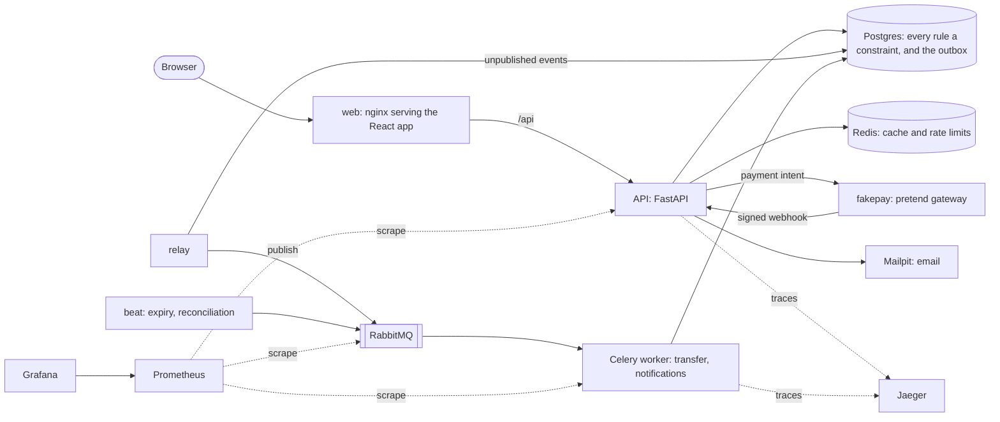
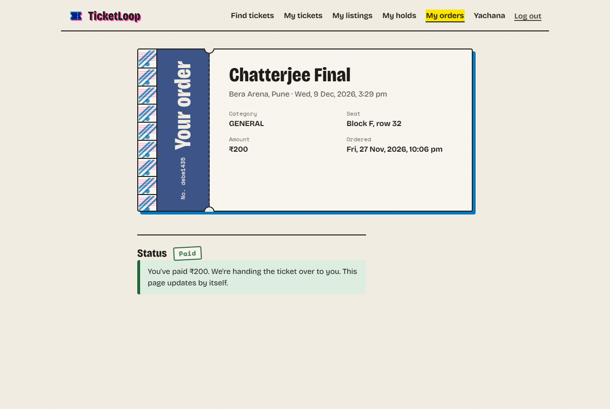

# TicketLoop

[](https://github.com/asw-beep/TicketLoop/actions/workflows/ci.yml)

A marketplace where people resell tickets at no more than face value: FastAPI and Postgres, with RabbitMQ, Celery, Redis and a React app. It is built to stay correct when 100 buyers hit one ticket at once, when requests are retried, when webhooks arrive twice, and when the message broker goes down.


Every page, in the order a guest, a buyer, a seller and an admin meet them. It was recorded in Chrome against `docker compose up`, with the demo data entered through the API and a real purchase through fakepay.

The look is a risograph print:
- warm paper, two fluorescent inks slightly out of register, halftone dots and grain;
- each event gets its own two-ink poster, generated from its category and id, because events have no images;
- dark mode follows the system, and every page fits a 360 px phone.

<details>
<summary>The 24 frames</summary>

| # | Screen | Address | Who |
| --- | --- | --- | --- |
| 1 | Search, the front page | `/` | anyone |
| 2 | Search with filters and a sort | `/?category=CONCERT&sort=price` | anyone |
| 3 | An event and its tickets on sale | `/events/:id` | anyone |
| 4 | A listing: asking price against face value | `/listings/:id` | anyone |
| 5 | Log in | `/login` | signed out |
| 6 | Create an account | `/register` | signed out |
| 7 | Forgot password | `/forgot-password` | anyone |
| 8 | Choose a new password, from the emailed link | `/reset-password#token=…` | anyone |
| 9 | Not found | any other address | anyone |
| 10 | A hold, with its 10-minute countdown | `/reservations/:id` | the buyer |
| 11 | fakepay's checkout page | `localhost:8090/checkout/:id` | the buyer |
| 12 | The order, paid and completed | `/orders/:id` | the buyer |
| 13 | My orders | `/orders` | the buyer |
| 14 | My tickets, with the one just bought | `/tickets` | the buyer |
| 15 | My holds | `/reservations` | the buyer |
| 16 | Account: name and password | `/account` | the buyer |
| 17 | My tickets, and Register a ticket | `/tickets` | a seller |
| 18 | A verified ticket, ready to list | `/tickets/:id` | a seller |
| 19 | My listings: draft, in review, active and sold | `/listings` | a seller |
| 20 | A listing waiting for review | `/listings/:id` | a seller |
| 21 | Events, from draft to published | `/admin/events` | an admin |
| 22 | Verify tickets | `/admin/tickets` | an admin |
| 23 | Review listings | `/admin/listings` | an admin |
| 24 | Search, an event, a hold and an order on a phone, in light and dark | 360 px wide | |

</details>

The M12 load tests ([results](docs/test-results.md)) checked that:
- **The spike.** 1,000 buyers pressed **Reserve** on one ticket in the same instant. Exactly one got the hold; the other 999 got a clean "someone was first", and nobody got an error.
- **100 users** browsed and bought for three and a half minutes:
  - reads p95 62 ms, reservations p95 106 ms;
  - 2,168 paid purchases, no failed request.
- **RabbitMQ stopped for a minute under load:**
  - buyers kept paying, while 621 events waited in the outbox;
  - all of them were delivered within 30 s of its return, and every ticket changed hands once.
- **The invariants.** After every run a SQL check looked for a ticket listed twice, held twice, sold twice, or owned by anyone but its last buyer. It found none, across 12,315 orders.
- **Where it stops.** On a laptop, four API processes top out at about 350 requests a second, and past that latency misses the targets. The ceiling is measured, explained, and moves when the processes are doubled.

The specification is [`plan.md`](plan.md). The build order and study plan is [`build-and-learn-plan.md`](build-and-learn-plan.md).

## Start it

You need Docker Desktop.

```bash
docker compose up -d --build
```

Then open http://localhost:5173. The first build takes a few minutes.

| What | Where |
| --- | --- |
| The app | http://localhost:5173 |
| The API's explorer | http://localhost:8000/docs |
| fakepay, the pretend payment gateway | http://localhost:8090 |
| Mailpit, every email the app sends | http://localhost:8025 |
| Grafana, the dashboard | http://localhost:3000 |
| Jaeger, traces | http://localhost:16686 |
| RabbitMQ's console | http://localhost:15672 (`ticketloop` / `ticketloop`) |

`docker compose down` stops it all, and the data stays in Docker volumes. `docker compose down -v` deletes the data too.

## How it fits together



Postgres decides everything that matters:
- **Who holds a ticket.** One conditional `UPDATE`, backed by a partial unique index.
- **What was paid.** A signed webhook, applied once.
- **Who owns the ticket.** A transfer written in the same transaction as its event in the outbox.

Redis only makes reads faster and limits abuse. RabbitMQ only carries what happens after a payment. Either can go down without losing a sale or selling a ticket twice.

## The 5-minute demo

This needs the stack started above, plus [uv](https://docs.astral.sh/uv/).

**1. Load the demo data.** This fills a database with 2,000 events, 100,000 listings and 1,000 buyers (about 10 s), then points the stack at it:

```bash
uv run python -m scripts.load_test seed
POSTGRES_DB=ticketloop_perf docker compose up -d
```

(In PowerShell: `$env:POSTGRES_DB = 'ticketloop_perf'; docker compose up -d; Remove-Item Env:POSTGRES_DB`.)

**2. Buy a ticket.**
- Open http://localhost:5173. The front page is the search.
- Open any ticket, press **Log in to reserve**, and sign in as `buyer-0001@perf.example.in` with the password `load test password 123`. Any number up to 1000 works.
- Press **Reserve**. The ticket is yours for 10 minutes, counted down on the page. In a private window as `buyer-0002`, **Reserve** on the same ticket is told that someone was first.
- **Checkout** takes you to fakepay; press **Pay**.
- Back on your order, it turns **Paid** when fakepay's signed webhook lands. A moment later it turns **Completed**, once the worker has handed the ticket over, and the ticket is under **My tickets**.

**3. Stop the broker and buy another.**
- Run `docker compose stop rabbitmq`, then buy a second ticket the same way.
- Paying still works, because the webhook needs only Postgres. The order turns **Paid**, then stays there: the ticket's transfer is waiting in the outbox, and Grafana shows the backlog rising.
- Run `docker compose start rabbitmq`. Within seconds of RabbitMQ answering, the relay publishes what waited, and the order turns **Completed** by itself.

<p>
  
  
</p>

I ran it as written in Chrome against the one-command stack:
- the first order completed in under 5 s;
- the second sat at **Paid** with RabbitMQ down;
- it completed 12 s after `docker compose start rabbitmq`, which is mostly RabbitMQ starting up.

**4. Back to your own data:** `docker compose up -d`.

Every other feature, step by step, is in [`docs/walkthrough.md`](docs/walkthrough.md):
- accounts and password reset;
- registering and verifying a ticket, and listing it for review;
- search, holds, every way a payment can go;
- the transfer drills, the cache and the limits, metrics, traces and logs.

## Results

These were measured on a laptop: an Intel Core i5-13450HX (10 cores, 16 threads) with 23.7 GB of RAM. Docker had 16 threads and 11.5 GiB, and k6 ran inside the same VM. The database held 2,000 events, 100,000 listings and 1,000 buyers.

The plan was written before the runs ([test plan](docs/test-plan.md)). Every number, every miss explained and how to run them again are in [results](docs/test-results.md).

| Test | Result |
| --- | --- |
| Spike: 1,000 buyers reserve one ticket at once | 1 hold, 999 × 409, 0 errors, after fixing the deadlock the first run found |
| Load, 100 users (80% browse, 20% buy) | 195 req/s; reads p95 62 ms, reservations p95 106 ms; 0 failed. **Meets NFR-03** |
| Load, 500 users | 327 req/s; reads p95 1,340 ms. **Misses NFR-03**: each API process tops out at about 90 req/s (13 ms of CPU a request) |
| Load, 500 users on 8 API processes | 469 req/s; reads p95 862 ms: the ceiling moves with the processes |
| Load, 1,000 users | 307 req/s; reads p95 3,023 ms; the same ceiling; 0.01% failed |
| The real rate limits | 119 of the 120 searches a minute allows; 104,913 × 429 with `Retry-After`; 0 errors |
| RabbitMQ down for 60 s under load | 0 failed requests; a backlog of 621 delivered within 30 s of its return; all 9,247 orders completed |
| Races, 100 rounds each | reservation 110/110; payment against expiry 2/2 |
| Invariants after every run | 0 violations |

## Status

| Module | State |
| --- | --- |
| M0 · Foundations and design | Done: see [Design docs](#design-docs) |
| M1 · Dev environment and skeleton | Done: app factory, `/api/v1/health` with a database check, settings, JSON logs with request IDs, RFC 9457 errors, Docker Compose, tests |
| M2 · Database layer | Done: users, events, tickets, listings and audit log by Alembic migration; constraints that enforce the business rules; one transaction per request; a test database rolled back after every test |
| M3 · Identity and auth | Done: register and login with Argon2id; 15-minute JWT access tokens; 7-day refresh tokens that rotate, with reuse detection that revokes the whole session; logout; password change and reset; `get_current_user` and `require_admin`; `GET` and `PATCH /users/me`; CI on every push |
| M4 · Events, tickets and document storage | Done: admin event management with a status machine; ticket registration; proof of purchase in MinIO (S3) behind 5-minute signed links, typed by its first bytes; admin verification; one 404 for "missing" and "not yours" on every ticket route, proven by a test that enumerates them; screens for all of it |
| M5 · Listings, verification and audit log | Done: listing a verified ticket at no more than face value; admin review with no self-review; one state machine whose every move is a conditional `UPDATE` plus an audit row in the same transaction; listing history; the event-cancel cascade and listing expiry; races between admins proven with real concurrent transactions; screens for all of it |
| M6 · Discovery: search, filters, pagination | Done: public search with filters and sorts; keyset pagination on every list; indexes proven with `EXPLAIN ANALYZE` on 100,000 listings ([results](docs/discovery-performance.md)): page 500 in 0.2 ms against 45 ms with `OFFSET`; the front page is the search |
| M7 · Reservations and the race | Done: 10-minute holds by one conditional `UPDATE`; 100 buyers against four API processes end with exactly one winner, 20 rounds in a row; compared with `FOR UPDATE` and `SERIALIZABLE` ([design and numbers](docs/reservation-design.md)); holds expire with `SKIP LOCKED`; an event with a held ticket can't be cancelled; reserve, countdown and cancel on screen |
| M8 · Orders and payments | Done: idempotent orders at the server's price; a pretend gateway, fakepay, that can be late, silent, repeat itself or forge; HMAC-signed webhooks applied exactly once; reconciliation that repairs what a webhook never told us; a paid ticket is never released, 50 races in a row; checkout, order page and My orders on screen |
| M9 · Outbox, worker and transfer | Done: every event written in the transaction of its change and published by a relay that waits out a dead broker; RabbitMQ and Celery with late acknowledgement and dead-letter queues; consumers that do their work once however often a message arrives; the ticket moves to its buyer through an idempotent provider call, or to review; a broker outage, a killed worker and a poison message, all automated drills; the order page follows the ticket to My tickets |
| M10 · Redis: caching and rate limits | Done: search and the event page cached in Redis under versioned keys that a commit to `listings` or `events` makes unreachable, found by the session, so no write in the API or the worker can forget; 30 to 60 second jittered expiry; `X-Cache` on every cached route; token buckets in one Lua script on Redis's clock for login, password reset, reserve, payment and search, with `429` and `Retry-After`; when Redis is down every route still answers, uncached and unlimited, and only the request that finds it gone waits; a countdown on every form that can be refused |
| M11 · Observability and delivery | Done: Prometheus metrics on `/metrics` (requests, errors and p50/p95/p99 per route, reservation results, payment webhooks, worker task outcomes, the outbox backlog, cache and rate-limit counts), with no id ever in a label; OpenTelemetry traces from the API through the outbox and RabbitMQ into the worker, in Jaeger; the trace id on every log line as `correlation_id`, so one failed purchase is found by its order id, opened as one trace and its failing step is the red span; Prometheus, a provisioned Grafana dashboard and Jaeger in Compose; CI builds the image and starts it with production settings, and fails on a high-severity Bandit finding, a known vulnerability in a runtime package or a high npm advisory |
| M12 · Load testing and the numbers | Done: k6 spike, load and rate-limit runs and a broker drill under load on a seeded database of 100,000 listings, with an invariants check after every run ([plan](docs/test-plan.md), [results](docs/test-results.md)); a thread and connection-pool deadlock found by the spike and fixed with an admission gate; the throughput ceiling measured and explained; the races at 100 rounds; the browser app in Compose behind nginx, so one command starts everything |
| Riso redesign · the look | Done: every screen restyled as a risograph print, with no change to what any screen does or says; a two-ink poster generated for each event from its category and id; inks that slide into register as a page appears, and hold still under `prefers-reduced-motion`; dark mode; text contrast checked against WCAG AA by a unit test; browser tests that the signed-out and buying pages fit a 360 px phone ([design](docs/superpowers/specs/2026-11-27-riso-redesign-design.md)) |

The roadmap was slimmed to these seven modules on 23 Nov 2026; see [the design](docs/superpowers/specs/2026-11-23-slim-roadmap-m6-m12-design.md) for what was cut and why.

## Run it day to day

You need Docker Desktop, Python 3.12 or newer, [uv](https://docs.astral.sh/uv/), and Node 24 LTS for the frontend. Everything but the API and the frontend runs in Docker; those two run on Windows and reload as you edit:

```bash
docker compose up -d db mailpit minio fakepay rabbitmq redis worker beat relay \
                     prometheus grafana jaeger
                                      # Postgres, a fake inbox at http://localhost:8025, S3 storage,
                                      # the pretend payment gateway at http://localhost:8090,
                                      # RabbitMQ (its console at http://localhost:15672, ticketloop /
                                      # ticketloop), Redis for the cache and the rate limits, the
                                      # worker, beat and relay that move tickets, and the dashboard
                                      # at http://localhost:3000 and traces at http://localhost:16686
cp .env.example .env                  # optional; the defaults already match compose
uv sync                               # create .venv and install dependencies
uv run alembic upgrade head           # create or update the tables
uv run uvicorn app.main:app --reload  # http://localhost:8000/docs for the API explorer
```

Then, in a second terminal:

```bash
cd frontend
npm install
npm run dev                           # http://localhost:5173
```

The dev server forwards `/api` to the API on port 8000, so the browser sees one origin, as nginx does in the one-command stack. If that stack is running, stop its API and app first (`docker compose stop api web`), since they use the same ports, 8000 and 5173.

Celery does not run on Windows, so the worker, beat and relay run in Docker even when the API does not. After changing code they use, rebuild them: `docker compose up -d --build worker beat relay`.

MinIO stores the uploaded proof of purchase. Its web console is at http://localhost:9001 (user `ticketloop`, password `ticketloop-local-secret`). The files sit in the bucket `ticketloop-documents`, which the API creates on startup when `ENVIRONMENT=local`.

Anywhere else, create the bucket yourself and set these (see `.env.example`):
- `STORAGE_ENDPOINT_URL`;
- `STORAGE_PUBLIC_URL`, the host browsers reach, used to sign download links;
- `STORAGE_BUCKET`, `STORAGE_ACCESS_KEY`, `STORAGE_SECRET_KEY` and `STORAGE_REGION`.

Staging and production refuse to start with the built-in storage secret.

Set `LOG_JSON=false` in `.env` for coloured, readable log lines while developing.

```bash
docker compose down      # stop everything; data survives in the pgdata, miniodata, fakepaydata,
                         # rabbitmqdata and prometheusdata volumes
docker compose down -v   # stop and delete the databases and the stored files too
```

## Migrations

```bash
uv run alembic revision --autogenerate -m "what changed"   # draft a migration from the models
uv run alembic upgrade head --sql      # read the SQL before running it
uv run alembic upgrade head
uv run alembic downgrade -1            # undo the last one
uv run alembic check                   # fails if the models and migrations disagree
```

Autogenerate cannot see triggers, functions or a change to an existing CHECK. Read every draft and write those parts by hand.

## Test and lint

```bash
uv run pytest             # integration tests are skipped unless Postgres is running
                          # they build ticketloop_test from the migrations each run
uv run pytest -m integration
REQUIRE_POSTGRES=1 uv run pytest   # fail instead of skip without Postgres, as CI does
REQUIRE_STORAGE=1 uv run pytest    # the same for the MinIO tests (docker compose up -d minio)
REQUIRE_BROKER=1 uv run pytest     # and for the RabbitMQ drills (docker compose up -d rabbitmq)
REQUIRE_REDIS=1 uv run pytest      # and for the cache and rate-limit tests (docker compose up -d redis)
uv run ruff check .
uv run ruff format .
uvx bandit==1.9.4 -r app fakepay --severity-level high    # CI's security job, the Python half
```

The races, against four API processes and a database of their own:

```bash
uv run pytest tests/concurrency                                              # every race, 3 rounds
RACE_ROUNDS=100 uv run pytest tests/concurrency/test_reservation_race.py     # as M12 ran it
uv run python -m tests.concurrency.report                                    # three locking strategies, compared
```

The frontend, from `frontend/`:

```bash
npm test                  # unit tests (Vitest)
npm run e2e               # browser tests in your Chrome; needs `docker compose up -d db mailpit minio rabbitmq redis`.
                          # They start their own API (8001) with a worker and relay beside it,
                          # fakepay (8091) and dev server (5174), on their own database,
                          # ticketloop_e2e, their own queues (prefix e2e-) and Redis database 1
npm run typecheck && npm run lint && npm run format:check
npm run api:types         # after changing the API: regenerate openapi.json and the TypeScript types
npm audit --audit-level=high
```

The load tests, on their own stack and database; [results](docs/test-results.md#run-it-again) has every command:

```bash
uv run python -m scripts.load_test seed && uv run python -m scripts.load_test up
uv run python -m scripts.load_test spike
```

## Layout

```text
app/
  main.py                  app factory; uvicorn runs app.main:app
  api/                     /api/v1 router and the health check
  core/                    config, logging, request-ID middleware, error format, security (hashing, JWT),
                           metrics (/metrics), tracing, and the admission gate
  models.py                imports every model, so Alembic sees every table
  modules/                 one package per business module: models, schemas, service, router
    identity/              users, tokens, auth routes, get_current_user and require_admin
    events/                events, ticket providers, the event status machine, admin event routes
    tickets/               ticket registration, evidence uploads and links, admin verification
    listings/              listings, the listing state machine, review, history, the event cascade and expiry
    discovery/             public search: filters, sorts, the event's listings
    reservations/          10-minute holds: the race, cancelling, expiry
    orders/                orders: one per held ticket, at the listing's price
    payments/              payment intents, signed webhooks, settling, reconciliation
    outbox/                events written with their change, processed_events, and the relay
    transfers/             the transfer state machine and its two consumers: start, then perform
    notifications/         in-app notifications, written by a consumer, read through two routes
    idempotency/           Idempotency-Key: a request sent twice does its work once
    audit/                 the append-only audit log, record() to write to it, and the state machine class
  infrastructure/          Postgres engine, sessions, base model, email sender, object storage (S3 and in-memory), the payment gateway's client, the pretend ticket provider, Redis (the cache, the session hooks that invalidate it, the rate limiter)
  workers/                 Celery: the app and its queues, the tasks around the consumers, the scheduled jobs, the relay's loop
fakepay/                   the pretend payment gateway: its own app, database and checkout page
observability/             Prometheus's scrape configs (everyday and load), Grafana's data sources and the dashboard
tests/
  unit/                    fast, no external services
  integration/             need Postgres
  concurrency/             real races: four API processes, a real fakepay, 100 buyers; report.py compares strategies;
                           the messaging drills against RabbitMQ and real Celery workers
  load/                    k6 scripts (spike, load, limits) and results/, every run's recorded summary
migrations/                Alembic env.py and one file per schema change
scripts/                   experiments and operator tools: lock_experiment, make_admin, export_openapi,
                           expire_listings, expire_reservations, reconcile_payments, seed_discovery, explain_discovery,
                           databases (throwaway ones), e2e_api, load_test (the M12 runner) and check_invariants.sql
frontend/                  React + TypeScript app (Vite); each module adds its screens
  src/api/                 typed client; schema.d.ts is generated from the backend
  src/auth/                access token in memory, refresh through the HttpOnly cookie
  src/lib/poster.ts        the poster generator: two inks, drawn from an event's category and id
  src/pages/               one file per screen
  e2e/                     Playwright browser tests against the real stack
  Dockerfile, nginx.conf   the app built and served by nginx for compose, /api forwarded to the API
.github/workflows/ci.yml   backend tests, frontend checks, browser tests, the image started with production
                           settings, and Bandit, pip-audit and npm audit, on every push
docs/                      design documents (below)
documentation/             one HTML page per finished module for revision and interview prep; open index.html
docker-compose.yml         Postgres, Mailpit, MinIO, fakepay, RabbitMQ, Redis, the migrate job, the API, the worker, beat, the relay,
                           the web app, Prometheus, Grafana, Jaeger
docker-compose.load.yml    laid over it for the load tests: four API containers on ticketloop_perf, and k6
Dockerfile                 the API image, which also runs fakepay, the worker, beat and the relay
```

## Design docs

| Document | What it answers |
| --- | --- |
| [`docs/requirements.md`](docs/requirements.md) | Every FR and NFR as checkable rules, with the test that proves each |
| [`docs/database-design.md`](docs/database-design.md) | ER diagrams, which constraint enforces which rule, indexes, changes from `plan.md` |
| [`docs/schema-draft.sql`](docs/schema-draft.sql) | The full target DDL; loads cleanly into Postgres 17 |
| [`docs/schema-checks.sql`](docs/schema-checks.sql) | Statements that should be rejected by the schema's constraints |
| [`docs/state-machines.md`](docs/state-machines.md) | Listing, reservation, order, payment and transfer lifecycles |
| [`docs/api-contract.md`](docs/api-contract.md) | Every endpoint: who may call it, request, response, errors |
| [`docs/hard-problems.md`](docs/hard-problems.md) | The six hard problems as exact SQL, with crash analysis |
| [`docs/reservation-design.md`](docs/reservation-design.md) | How one of 100 buyers wins, and what three locking strategies cost (measured) |
| [`docs/discovery-performance.md`](docs/discovery-performance.md) | Search query plans and timings on 100,000 listings (generated) |
| [`docs/purchase-flow.md`](docs/purchase-flow.md) | The end-to-end purchase and what every table holds at each step |
| [`docs/test-plan.md`](docs/test-plan.md) | The load and contention tests, written before they ran: what each expects and its pass line |
| [`docs/test-results.md`](docs/test-results.md) | What they got, on what machine, with every miss explained |
| [`docs/walkthrough.md`](docs/walkthrough.md) | Every feature by hand, in the browser and from a terminal |
