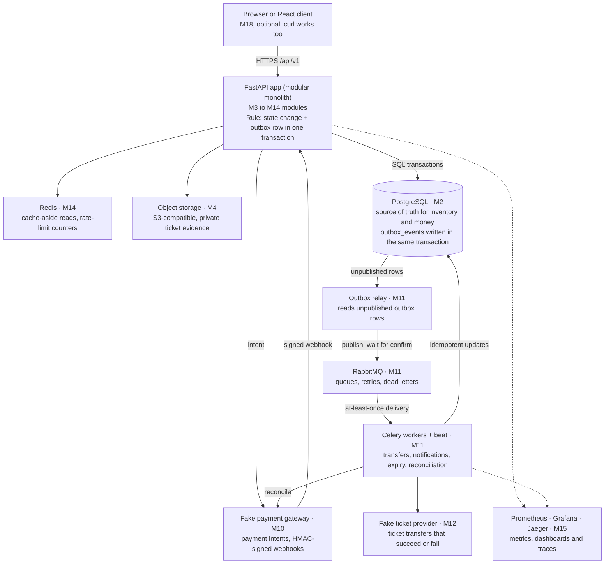

# Ticket Loop — Build & Learn Plan

Nov 16, 2026 · @Aswin Mony

## What you are building and how to use this plan

TicketLoop is a FastAPI modular monolith for fixed-price ticket resale. Its real purpose is to show that a backend stays correct under concurrent requests and partial failures. This plan splits it into 19 modules over about 110 focused sessions (101 without the optional frontend), built in an order where each module depends only on what came before.

The source is `plan.md` (v1.0) in the repo. It is the only file so far; no code exists yet.

### Six problems make this project worth building

Most of the API is CRUD that sets these up. Spend your deepest learning time here:

1. **Double booking:** 100 buyers hit one ticket at once and exactly one wins (M8).
2. **Duplicate orders:** a retried request must not create a second order, which is what idempotency keys solve (M9).
3. **Duplicate or forged webhooks:** the gateway sends the same event twice, or someone fakes one (M10).
4. **Lost events:** the database commits but RabbitMQ is down, which the transactional outbox fixes (M11).
5. **Expiry racing payment:** the expiry worker must never release a ticket that was just paid for (M8 + M10).
6. **Drift:** the gateway and your database disagree, and reconciliation finds it (M10).

### Assumptions to adjust

- One "day" is one focused session of 3 to 4 hours. At 5 sessions a week the plan runs about 22 weeks. With less time, stretch the days; do not skip the Learn steps.
- You know Python basics (functions, classes, venv, pip) and everyday Git. If not, do the optional pre-week in M0.
- You work on Windows 11 with a mixed setup. Your code, the API, tests and the frontend run natively on Windows; Postgres, Redis, RabbitMQ, Celery and the monitoring tools run in Docker Desktop, which uses WSL2 behind the scenes. Celery and Redis do not support Windows, which is why they always live in containers.
- The React frontend is the last module and optional. The backend is the point of the project.

### How each module is laid out

- **Goal:** what exists when you finish.
- **Prerequisites:** tech (tools you install or must know) and knowledge (concepts you must understand first).
- **Learn first:** videos and articles. Watch or read these before writing code for that module.
- **Build:** the concrete tasks, in order.
- **Done when:** a test or demo that proves it works.
- **Explain it:** questions you should answer out loud without notes. If you cannot, you are not done.

### Decisions plan.md leaves open, and what I recommend

| Open question | Recommendation | Why |
| --- | --- | --- |
| Sync or async SQLAlchemy | Sync SQLAlchemy 2.0 with psycopg 3 | One session model shared by FastAPI and Celery workers; fewer concepts at once. Switch later if load tests demand it. |
| Package manager | uv with `pyproject.toml` | Fast, and pyproject-native as plan.md expects. Plain pip + venv also works. |
| Money type | Integer paise in a `BIGINT` column, currency `INR` | plan.md bans floats for money; integers avoid rounding bugs entirely. |
| Reservation expiry before Celery exists | A plain Python loop script in M8, moved to Celery beat in M11 | Keeps the expiry logic a pure function you can test, separate from the scheduler. |
| Logging timing | JSON logs and request IDs from M1; metrics and tracing in M15 | Cheap now and makes every later bug easier to find. |
| Load-test tool | Grafana k6, run from Docker | One laptop can generate far more load with it than with a Python tool, it has load, stress, spike and soak patterns built in, and thresholds turn each run into a pass or fail. One tool keeps every run comparable. |
| Migrations on enums | Store status as `TEXT` with a `CHECK` constraint | Postgres enum types are awkward to change in Alembic; you will add states. |

## Architecture at a glance

*TicketLoop architecture after M17: Postgres decides; everything async flows through the outbox. Module numbers show where each part is built.*

The API writes every state change and its outbox row in one Postgres transaction. The relay, RabbitMQ and Celery carry those events to workers, which write back to Postgres idempotently. Redis only speeds up reads and counts rate limits, and the two fake services stand in for the real payment gateway and ticket provider until you integrate them.

## Module map and build order

Build the 19 modules strictly in this order. Each one leaves you with something running and tested, and each needs only what came before it. Modules M7 and M14 are the only ones that could move; everything from M8 to M12 is a chain.

| # | Module | What exists when done | Needs | Why it sits here | plan.md phase |
| --- | --- | --- | --- | --- | --- |
| M0 | Foundations and design | Requirements, ERD, state diagrams, API contract in `docs/` | nothing | You cannot reason about races in tables you have not designed. | 0 |
| M1 | Dev environment and skeleton | FastAPI app + Postgres in Docker Compose, config, JSON logs, pytest running | M0 | Every later module plugs into this shape. | 1 |
| M2 | Database layer | SQLAlchemy models, sessions, Alembic migrations, test database | M1 | All state lives in Postgres; learn transactions here before you need them. | 1 |
| M3 | Identity and auth | Register, login, JWT access + refresh rotation, roles, first CI run | M2 | Every protected endpoint after this needs a current user. | 1 |
| M4 | Events, tickets, document storage | Event CRUD (admin), ticket upload to MinIO, ownership checks | M3 | Listings point at tickets; tickets point at events and owners. | 1 |
| M5 | Listings, verification, audit log | Listing state machine, admin approve/reject, partial unique index, audit helper | M4 | First real state machine; audit starts now because every later state change must write it. | 2 |
| M6 | Discovery | Search, filters, keyset pagination, indexes checked with `EXPLAIN ANALYZE` | M5 | Needs active listings to search. | 2 |
| M7 | Interests and allocation | Interest API, one-active-interest rule, three allocation strategies | M5 | Allocation is what triggers a reservation. | 2 |
| M8 | Reservations and concurrency | Atomic reservation, 100-buyer race test, expiry script | M7 | The core problem; everything after builds on a reserved ticket. | 3 |
| M9 | Orders and idempotency | Order state machine, `Idempotency-Key` handling | M8 | An order is created from a reservation. | 4 |
| M10 | Payments | Fake gateway, signed webhooks, dedupe, reconciliation, refunds | M9 | A payment belongs to exactly one order. | 4 |
| M11 | Messaging | RabbitMQ, Celery, transactional outbox, retries, dead-letter queue | M10 | Payment success is the first event that must reach a worker reliably. | 5 |
| M12 | Transfers and notifications | Transfer worker with fake provider, in-app notifications | M11 | Both are consumers of outbox events. | 5 |
| M13 | Disputes and admin | Dispute flow, admin review, suspension | M12 | Disputes refer to completed or failed orders. | 5 |
| M14 | Caching and rate limiting | Redis cache-aside for reads, rate limits on hot endpoints | M6 | plan.md says Redis only after the app works; it speeds up M6 reads. | 6 |
| M15 | Observability | Prometheus metrics, Grafana dashboards, OpenTelemetry traces | M11 | Moved before load tests: you need p95 and queue-depth graphs to read a load test. | 7 |
| M16 | CI/CD, security, docs | Full GitHub Actions pipeline, security pass, ADRs, README | M15 | Hardens and explains the finished backend before it is measured. | 7 |
| M17 | Performance, concurrency and resilience testing | Fourteen kinds of test (load, stress, spike, soak, races, deadlocks, lock contention, isolation, idempotency, integrity, coordination, failure recovery, connection pool, latency) and resume numbers | M16 | Runs once the backend is finished, so every number describes the real system. | 6 + 7 |
| M18 | Frontend (optional) | React + TypeScript client for the main flows | M12 | Only after the backend is correct. | separate |

Five changes from plan.md's phase order, each on purpose:

1. The audit-log helper arrives in M5, not at the end, so no state change ever goes unrecorded.
2. A basic CI run (pytest on every push) starts in M3; the full pipeline stays in M16.
3. Observability (M15) comes before the testing campaign (M17), because load-test numbers are unreadable without dashboards.
4. Reservation expiry first runs as a plain script in M8 and moves onto Celery beat in M11.
5. Performance, concurrency and resilience testing runs as one campaign (M17) after the backend is finished, hardened and documented. Each module still ships its own correctness tests, because a module is not done without them.

## Module-by-module breakdown

Each module lists what to know before you start, what to watch and read, what to build, and how to prove it works. Every link below was checked on 16 Nov 2026. Videos come first because they give the mental model; the docs give the exact API.

### M0 · Foundations and design (Days 1 to 6)

**Goal:** every table, state and endpoint is on paper, and you can trace all six hard problems through the design before writing code.

**Prerequisites**

- Tech: Git and a GitHub account, VS Code, a diagram tool ([dbdiagram.io](https://dbdiagram.io) or Mermaid).
- Knowledge: Python basics; an HTTP request and response (method, path, status code, headers, JSON body); tables, primary keys and foreign keys.

**Learn first**

- Video: [Git Tutorial for Beginners: Command-Line Fundamentals](https://www.youtube.com/watch?v=HVsySz-h9r4) (Corey Schafer)
- Video: [HTTP Crash Course & Exploration](https://www.youtube.com/watch?v=iYM2zFP3Zn0) (Traversy Media)
- Video: [RESTful APIs in 100 Seconds](https://www.youtube.com/watch?v=-MTSQjw5DrM) (Fireship). The demo uses Node; watch it for the REST ideas only.
- Video: [Entity Relationship Diagram (ERD) Tutorial, Part 1](https://www.youtube.com/watch?v=QpdhBUYk7Kk) (Lucid Software)
- Video: [System Design Interview: Design Ticketmaster](https://www.youtube.com/watch?v=fhdPyoO6aXI) (Hello Interview). The closest real system to yours. Note why booking needs strong consistency while browsing does not.
- Article: [Ticketmaster problem breakdown](https://www.hellointerview.com/learn/system-design/problem-breakdowns/ticketmaster) (Hello Interview)
- Article: [An overview of HTTP](https://developer.mozilla.org/en-US/docs/Web/HTTP/Overview) (MDN)
- Article: [Web API design best practices](https://learn.microsoft.com/en-us/azure/architecture/best-practices/api-design) (Microsoft)
- Article: Mermaid [state diagrams](https://mermaid.js.org/syntax/stateDiagram.html) and [ER diagrams](https://mermaid.js.org/syntax/entityRelationshipDiagram.html)
- Optional pre-week if Python feels shaky: [OOP: Classes and Instances](https://www.youtube.com/watch?v=ZDa-Z5JzLYM), [Decorators](https://www.youtube.com/watch?v=FsAPt_9Bf3U), [Context Managers](https://www.youtube.com/watch?v=-aKFBoZpiqA) (all Corey Schafer) and [Python Type Checking](https://realpython.com/python-type-checking/) (Real Python). FastAPI routes are decorators and database sessions are context managers, so these two matter most.

**Build**

1. Create the folder layout from plan.md section 19, with empty modules and a README.
2. `docs/requirements.md`: restate each FR and NFR in your own words, plus one line on how you will test it.
3. `docs/database-design.md`: an ERD with every foreign key, unique constraint and partial unique index.
4. `docs/state-machines.md`: Mermaid diagrams for listing, interest, reservation, order, payment and transfer. Under each, a table of allowed transitions and what triggers each one.
5. `docs/api-contract.md`: every endpoint with request body, response, status codes and required role.
6. For each of the six hard problems, write the exact SQL statements in order, then ask: what happens if the process dies between any two of them?
7. Resolve the gaps in plan.md's schema listed below.

**Gaps in plan.md's schema to fix during design**

- `listings` has no `event_id`, yet the index list includes `listings(event_id, status)`. Copy `event_id` onto listings so discovery avoids a join.
- `listings` lacks `original_price` and `verification_status`, which FR-04 lists.
- `orders` has no `listing_id`; `payments` has no `idempotency_key` or `provider_response`. FR-08 and FR-09 list them.
- Missing tables the features need: `refresh_tokens`, `idempotency_keys`, `refunds`, `disputes`, `reconciliation_runs`.
- Pick one lock target. I recommend the listing row: reserving a ticket means moving one `listings` row from `ACTIVE` to `RESERVED`. The ticket row changes only when the transfer completes.
- Add partial unique indexes: one active interest per buyer per listing, and one open reservation per listing.

**Done when:** you can draw the reservation to order to payment to transfer flow from memory, including what every table holds at each step.

**Explain it:** Why is PostgreSQL, not Redis, the source of truth for inventory? What state is a listing in while payment is pending, and what can move it out?

### M1 · Dev environment and skeleton (Days 7 to 10)

**Goal:** `docker compose up` starts Postgres and the API; `/api/v1/health` returns 200 after checking the database; pytest runs; every log line is JSON with a request ID.

**Prerequisites**

- Tech: Docker Desktop (it sets up WSL2 for you), plus Python 3.12 or newer, uv, VS Code and Git Bash installed on Windows.
- Knowledge: images, containers, volumes and port mapping; environment variables; virtual environments; the idea of an ASGI server (uvicorn runs your app).

**Learn first**

- Video: [Docker in 100 Seconds](https://www.youtube.com/watch?v=Gjnup-PuquQ) (Fireship)
- Video: [Docker Tutorial for Beginners, full course in 3 hours](https://www.youtube.com/watch?v=3c-iBn73dDE) (TechWorld with Nana). The first 90 minutes cover what you need now.
- Video: [Ultimate Docker Compose Tutorial](https://www.youtube.com/watch?v=SXwC9fSwct8) (TechWorld with Nana)
- Video: [Python API Development, Comprehensive Course for Beginners](https://www.youtube.com/watch?v=0sOvCWFmrtA) (freeCodeCamp, 19 hours). Your companion course for M1 to M3. Watch the FastAPI basics now. It uses older SQLAlchemy style, so follow the 2.0 docs for database code.
- Article: [Install WSL](https://learn.microsoft.com/en-us/windows/wsl/install) (Microsoft) and [Docker Desktop WSL 2 backend](https://docs.docker.com/desktop/features/wsl/) (Docker)
- Article: [FastAPI tutorial](https://fastapi.tiangolo.com/tutorial/), from First Steps through Bigger Applications
- Article: [FastAPI settings and environment variables](https://fastapi.tiangolo.com/advanced/settings/)
- Article: [uv documentation](https://docs.astral.sh/uv/), [pytest getting started](https://docs.pytest.org/en/stable/getting-started.html), [structlog](https://www.structlog.org/en/stable/)
- Article: [RFC 9457, Problem Details for HTTP APIs](https://www.rfc-editor.org/rfc/rfc9457): one standard shape for every error response.

**Build**

1. Install Docker Desktop (it sets up WSL2 for you). Keep the repo on `E:\` and run the API natively with `uvicorn --reload`; only the services run in containers. Add a `.gitattributes` file with `* text=auto eol=lf` on day one, because scripts saved with Windows line endings fail inside Linux containers.
2. `uv init`, then add fastapi, uvicorn, pydantic-settings, sqlalchemy, psycopg\[binary\], alembic, pytest, httpx, ruff, structlog.
3. `app/main.py` with an app factory, a `/api/v1` router and `/health`.
4. `app/core/config.py` reading settings from the environment; commit `.env.example`, never `.env`.
5. `docker-compose.yml` with `postgres:17` (named volume, healthcheck) and the API service. Day to day you run the API on Windows with `uvicorn --reload`; the containerised API is for the M8 race test and the load tests.
6. Middleware that creates a request ID, returns it in a response header and adds it to every log line.
7. `app/core/exceptions.py`: one error format for every error.
8. The first test: FastAPI `TestClient` calls `/health`.

**Done when:** a fresh clone, then `docker compose up`, then `curl localhost:8000/api/v1/health` returns 200 with the database status; `pytest` and `ruff check` both pass.

**Explain it:** What is the difference between an image and a container? Why does the API container reach Postgres at `db:5432` while your laptop uses `localhost:5432`?

### M2 · Database layer (Days 11 to 15)

**Goal:** the first tables exist through Alembic migrations with every constraint from M0, a session-per-request dependency works, and tests run against a database that resets between tests.

**Prerequisites**

- Tech: the M1 stack, plus `psql` or a GUI such as DBeaver.
- Knowledge: SELECT, INSERT, UPDATE, DELETE, JOIN, GROUP BY; primary key, foreign key, UNIQUE and CHECK constraints; BEGIN, COMMIT and ROLLBACK; what an ORM hides from you.

**Learn first**

- Video: [PostgreSQL in 100 Seconds](https://www.youtube.com/watch?v=n2Fluyr3lbc) (Fireship)
- Video: [Learn PostgreSQL Tutorial, Full Course for Beginners](https://www.youtube.com/watch?v=qw--VYLpxG4) (freeCodeCamp, about 4 hours). Type along in your own `psql` session; skip what you know.
- Video: [Relational Database ACID Transactions, Explained by Example](https://www.youtube.com/watch?v=pomxJOFVcQs) (Hussein Nasser)
- Video: [Database Indexing Explained, with PostgreSQL](https://www.youtube.com/watch?v=-qNSXK7s7_w) (Hussein Nasser). Watch before you write index migrations.
- Article: [SQLAlchemy 2.0 Unified Tutorial](https://docs.sqlalchemy.org/en/20/tutorial/index.html) and [Session Basics](https://docs.sqlalchemy.org/en/20/orm/session_basics.html)
- Article: [What's New in SQLAlchemy 2.0?](https://blog.miguelgrinberg.com/post/what-s-new-in-sqlalchemy-2-0) (Miguel Grinberg)
- Article: [Alembic tutorial](https://alembic.sqlalchemy.org/en/latest/tutorial.html) and [what autogenerate can and cannot detect](https://alembic.sqlalchemy.org/en/latest/autogenerate.html)
- Article: [Partial indexes](https://www.postgresql.org/docs/current/indexes-partial.html) (PostgreSQL docs)

**Build**

1. `infrastructure/database`: engine, sessionmaker and a `get_db` dependency that commits on success and rolls back on error.
2. A base model: UUID primary key generated by Postgres, `created_at` and `updated_at` as `timestamptz` in UTC.
3. Models and the first migration for `users`, `events`, `tickets`, `listings` and `audit_logs`. Every later module adds its own tables in its own migration, which is how real schemas grow.
4. Read the SQL Alembic generates (`alembic upgrade head --sql`) before running it.
5. Declare the partial unique index on `listings(ticket_id)` for open statuses and the CHECK constraints (statuses, price cap, `asking_price_paise >= 100`) in the models; autogenerate writes them for a new table. Hand-write what it cannot see: triggers and functions, and any later change to a CHECK.
6. Test fixtures: a separate test database, and each test wrapped in a transaction that rolls back.
7. Do this experiment: open two `psql` sessions, BEGIN in both, UPDATE the same row, and watch the second one wait. Write down what you saw.

**Done when:** `alembic downgrade base` then `alembic upgrade head` runs cleanly, and a test proves a second open listing for the same ticket raises `IntegrityError`.

**Explain it:** What does `session.commit()` send to Postgres? Why does a partial unique index enforce "one active listing" better than an `if` check in Python?

### M3 · Identity and auth (Days 16 to 21)

**Goal:** register, login, refresh with rotation and logout all work; `get_current_user` and `require_admin` dependencies guard routes; suspended users are blocked; GitHub Actions runs the tests on every push.

**Prerequisites**

- Tech: the M2 stack, PyJWT, an Argon2 library (argon2-cffi or pwdlib).
- Knowledge: hashing versus encryption; salts; a JWT is header.payload.signature and is signed, not encrypted; access versus refresh tokens; FastAPI `Depends`; HTTP 401 (who are you?) versus 403 (you may not).

**Learn first**

- Video: [Session vs Token Authentication in 100 Seconds](https://www.youtube.com/watch?v=UBUNrFtufWo) (Fireship)
- Video: [What Is JWT and Why Should You Use JWT](https://www.youtube.com/watch?v=7Q17ubqLfaM) (Web Dev Simplified)
- Video: [Session Vs JWT: The Differences You May Not Know](https://www.youtube.com/watch?v=fyTxwIa-1U0) (ByteByteGo)
- Video: [How NOT to Store Passwords](https://www.youtube.com/watch?v=8ZtInClXe1Q) (Computerphile)
- Video: the authentication and JWT sections of the [freeCodeCamp FastAPI course](https://www.youtube.com/watch?v=0sOvCWFmrtA)
- Video: [GitHub Actions Tutorial: Basic Concepts and CI/CD Pipeline with Docker](https://www.youtube.com/watch?v=R8_veQiYBjI) (TechWorld with Nana), for the first CI run
- Article: [OAuth2 with Password (and hashing), Bearer with JWT tokens](https://fastapi.tiangolo.com/tutorial/security/oauth2-jwt/) and [Dependencies](https://fastapi.tiangolo.com/tutorial/dependencies/) (FastAPI docs)
- Article: [Password Storage Cheat Sheet](https://cheatsheetseries.owasp.org/cheatsheets/Password_Storage_Cheat_Sheet.html) and [Authentication Cheat Sheet](https://cheatsheetseries.owasp.org/cheatsheets/Authentication_Cheat_Sheet.html) (OWASP)
- Article: [Refresh Token Rotation](https://auth0.com/docs/secure/tokens/refresh-tokens/refresh-token-rotation) (Auth0). Read for the reuse-detection idea, then build it yourself.
- Article: [PyJWT documentation](https://pyjwt.readthedocs.io/en/stable/)
- Article: [Create PostgreSQL service containers](https://docs.github.com/en/actions/tutorials/use-containerized-services/create-postgresql-service-containers) (GitHub docs)

**Build**

1. `users` migration: unique email (store lowercased), `role` (USER or ADMIN), `account_status`. A seller is any user who owns a verified ticket, so it needs no role.
2. Argon2id hashing. Never log a password, even on failure.
3. `POST /auth/register` and `POST /auth/login`, returning a 15-minute access token and a 7-day refresh token.
4. A `refresh_tokens` table that stores a hash of each token plus `family_id`, `revoked_at` and `replaced_by`. On refresh, issue a new pair and revoke the old one. If a revoked token is used again, revoke the whole family: someone stole it.
5. `POST /auth/logout` revokes the current refresh token.
6. Dependencies: `get_current_user` (decode, check expiry, load the user, reject SUSPENDED) and `require_admin`.
7. `GET /users/me` and `PATCH /users/me`; `POST /users/me/password` and the password reset (request and confirm) from FR-01, each of which revokes every refresh token the user holds.
8. Tests for wrong password, expired token, tampered token, reused refresh token, suspended user and a normal user calling an admin route.
9. `.github/workflows/ci.yml` running ruff and pytest against a Postgres service container.

**Done when:** all auth tests pass in CI, and replaying a used refresh token logs out every session in that family.

**Explain it:** Why can you not truly log out a JWT access token, and how do short expiry plus refresh revocation work around it? Why store a hash of the refresh token instead of the token?

### M4 · Events, tickets and document storage (Days 22 to 26)

**Goal:** admins manage events; sellers register tickets and upload purchase evidence to private storage; no user can read another user's ticket or files.

**Prerequisites**

- Tech: an S3-compatible object store in Docker; boto3.
- Knowledge: object storage versus files on disk; presigned URLs; multipart file uploads; IDOR (changing an ID in a URL to read someone else's data); basic limit/offset pagination.

**Storage note:** MinIO stopped publishing its free community Docker image on 23 Oct 2025 ([Chainguard](https://www.chainguard.dev/unchained/secure-and-free-minio-chainguard-containers)). Use Chainguard's free rebuild, `cgr.dev/chainguard/minio`, or any other S3-compatible server. Write your code only against the S3 API through boto3, so the server can change without code changes.

**Learn first**

- Video: [Insecure Direct Object Reference (IDOR) Explained](https://www.youtube.com/watch?v=rloqMGcPMkI) (PwnFunction)
- Article: [IDOR Prevention Cheat Sheet](https://cheatsheetseries.owasp.org/cheatsheets/Insecure_Direct_Object_Reference_Prevention_Cheat_Sheet.html) and [File Upload Cheat Sheet](https://cheatsheetseries.owasp.org/cheatsheets/File_Upload_Cheat_Sheet.html) (OWASP)
- Article: [Presigned URLs](https://boto3.amazonaws.com/v1/documentation/api/latest/guide/s3-presigned-urls.html) (boto3 docs)
- Article: [Request Files](https://fastapi.tiangolo.com/tutorial/request-files/) (FastAPI docs)

**Build**

1. `events` migration with admin-only create and update, and public paginated reads.
2. `tickets` migration. `POST /tickets` takes the owner from the token, never from the request body. `GET /tickets/me` lists your own; `GET /tickets/{id}` works only for the owner or an admin.
3. A storage adapter in `infrastructure/storage` with `put_object` and a presigned GET that expires in 5 minutes. The bucket stays private.
4. Evidence upload: check content type and size, and store the file under a random key, never the user's filename.
5. Ticket verification: an admin moves PENDING to VERIFIED or REJECTED. plan.md is clear that a screenshot proves nothing; real verification needs a provider API later.
6. Tests: user B gets 404 for user A's ticket; an anonymous upload is rejected; an oversized file is rejected.

**Done when:** an IDOR test proves no cross-user access on every ticket endpoint.

**Explain it:** Why return 404 instead of 403 for another user's ticket? Why hand out short-lived presigned URLs instead of a public bucket?

### M5 · Listings, verification and audit log (Days 27 to 31)

**Goal:** sellers list verified tickets; admins approve or reject; every status change goes through one state-machine function and writes an audit row in the same transaction.

**Prerequisites**

- Tech: everything from M2 to M4.
- Knowledge: finite state machines (states, transitions, guards); why a database constraint is the last line of defence; what writing the audit row in the same transaction guarantees.

**Learn first**

- Video: [Computers Without Memory](https://www.youtube.com/watch?v=vhiiia1_hC4) (Computerphile). The theory behind state machines in 10 minutes; optional but it makes the idea click.
- Article: [How Payment Intents work](https://docs.stripe.com/payments/paymentintents/lifecycle) (Stripe). A production state machine to model yours on, and useful again in M10.
- Article: [Logging Cheat Sheet](https://cheatsheetseries.owasp.org/cheatsheets/Logging_Cheat_Sheet.html) (OWASP): what an audit event should and must never contain.
- Article: [Unique indexes](https://www.postgresql.org/docs/current/indexes-unique.html) (PostgreSQL docs)

**Build**

1. `listings` migration with `event_id` copied from the ticket, prices in paise, `status`, `expires_at` and the partial unique index.
2. One `transition(listing, to_state, actor)` function backed by an `ALLOWED` dictionary. An illegal move raises an error that maps to HTTP 409.
3. Apply transitions with a conditional UPDATE: `UPDATE listings SET status = :to WHERE id = :id AND status = :from`, then check the row count. This is the M8 pattern, learned in a calmer setting.
4. A pure price rule: asking price may not exceed the original price. Unit-test it.
5. An audit helper, `record(session, actor_id, entity, entity_id, action, metadata)`, called inside the same transaction as the change.
6. Endpoints: create (DRAFT to PENDING\_VERIFICATION), PATCH price only in allowed states, DELETE cancels only from ACTIVE, plus admin pending, approve and reject.
7. Listing expiry from ACTIVE to EXPIRED as a plain query for now; it gets a schedule in M11.
8. Tests: every illegal transition fails; a seller cannot list someone else's ticket; a second open listing for one ticket fails; the audit row rolls back together with a failed change.

**Done when:** a table-driven test tries every (from, to) pair and only the allowed ones succeed.

**Explain it:** Why check the current state inside the UPDATE's WHERE clause instead of reading it first in Python? What happens to the audit row when the listing update fails?

### M6 · Discovery: search, filters, pagination (Days 32 to 35)

**Goal:** buyers search and filter listings with keyset pagination, and every common query uses an index at 100,000 rows, proven with `EXPLAIN ANALYZE`.

**Prerequisites**

- Tech: the M5 stack, Faker for seed data, [explain.dalibo.com](https://explain.dalibo.com) to visualise query plans.
- Knowledge: B-tree indexes; composite index column order; reading a query plan (Seq Scan, Index Scan, Bitmap Heap Scan); why OFFSET slows down as it grows.

**Learn first**

- Video: [Database Indexing Explained, with PostgreSQL](https://www.youtube.com/watch?v=-qNSXK7s7_w) (Hussein Nasser). Re-watch with your own schema in mind.
- Video: [Pagination in MySQL: offset vs. cursor](https://www.youtube.com/watch?v=zwDIN04lIpc) (PlanetScale). Shown in MySQL; the idea is identical in Postgres.
- Article: [Use The Index, Luke](https://use-the-index-luke.com/), especially [No Offset](https://use-the-index-luke.com/no-offset) (Markus Winand). The best free book on indexes.
- Article: [Using EXPLAIN](https://www.postgresql.org/docs/current/using-explain.html) and [Multicolumn indexes](https://www.postgresql.org/docs/current/indexes-multicolumn.html) (PostgreSQL docs)
- Article: [Basics of Postgres query planning](https://pganalyze.com/docs/explain/basics-of-postgres-query-planning) (pganalyze)
- Article: [pg\_trgm](https://www.postgresql.org/docs/current/pgtrgm.html) for fast `ILIKE` name search (PostgreSQL docs)
- Article: [Faker documentation](https://faker.readthedocs.io/)

**Build**

1. A seed script that creates 2,000 events and 100,000 listings. Indexes show no effect on 50 rows.
2. `GET /listings` with filters for event name, category, city, price range and ticket category, sorted by date or price.
3. Keyset pagination: the cursor encodes the last row's sort value and id, then `WHERE (price, id) > (:p, :id) ORDER BY price, id LIMIT 20`. Cap page size at 100.
4. Indexes: `listings(event_id, status)`, `listings(status, price, id)`, `listings(status, created_at, id)` and a trigram GIN index on `events.name`. Record before-and-after timings.
5. `GET /events/{id}/listings`.
6. Response models that expose public fields only: no seller email, no ticket documents.

**Done when:** page 500 loads as fast as page 1, and no common filter does a Seq Scan on `listings` at 100,000 rows.

**Explain it:** Why does `OFFSET 10000` get slower as the offset grows? Why does the order of columns in a composite index matter?

### M7 · Interests and allocation (Days 36 to 38)

**Goal:** buyers register interest; one buyer holds at most one active interest per listing; the seller or platform picks a winner by first-come-first-served, random choice or seller selection, and every pick is audited.

**Prerequisites**

- Tech: the M5 stack.
- Knowledge: partial unique indexes (from M2); `INSERT ... ON CONFLICT`; the Strategy design pattern; why a fair random pick must be reproducible from the audit trail.

**Learn first**

- Video: [Queues in PostgreSQL](https://www.youtube.com/watch?v=B81nQLg4RuU) (PGCon talk by Thomas Munro, who worked on `SKIP LOCKED`). Explains ordered, concurrent picking from a table.
- Video: re-watch the waiting-queue part of [Design Ticketmaster](https://www.youtube.com/watch?v=fhdPyoO6aXI) (Hello Interview).
- Article: [INSERT ... ON CONFLICT](https://www.postgresql.org/docs/current/sql-insert.html#SQL-ON-CONFLICT) (PostgreSQL docs)
- Article: [secrets module](https://docs.python.org/3/library/secrets.html) (Python docs), for unbiased random choice.

**Build**

1. `interests` migration with a partial unique index on `(listing_id, buyer_id) WHERE status = 'ACTIVE'`.
2. `POST /listings/{id}/interests`: reject the seller and any listing that is not ACTIVE; turn a unique violation into 409.
3. `GET /listings/{id}/interests` for the seller and admins only; buyers never see each other.
4. `DELETE /interests/{id}` moves the interest to WITHDRAWN, owner only.
5. Three allocation strategies behind one interface: FCFS (`ORDER BY created_at, id`), random (`secrets.SystemRandom`, with the candidate list and choice written to the audit log) and seller-selected (validate that the chosen interest is ACTIVE).
6. The winning interest becomes SELECTED; the rest stay ACTIVE as fallbacks if the reservation later expires. Record this choice in an ADR.
7. Tests: duplicate interest, seller interest, FCFS picks the earliest, and random picks spread roughly evenly over 1,000 runs.

**Done when:** each strategy has tests, and the audit log alone is enough to explain any past pick.

**Explain it:** Why must buyers not see the list of other interested buyers? How would you prove to a suspicious buyer that the random pick was fair?

### M8 · Reservations and concurrency (Days 39 to 46)

**Goal:** 100 buyers reserving one listing at the same instant produce exactly one reservation, every time; expired reservations release the listing safely, even with two expiry workers running.

This is the heart of the project. Take the full eight days, and do the experiments: comparing three locking approaches is where the real learning happens.

**Prerequisites**

- Tech: the M7 stack, a multi-worker uvicorn in Docker, httpx, `concurrent.futures`.
- Knowledge: race conditions; isolation levels (READ COMMITTED, REPEATABLE READ, SERIALIZABLE); row locks; `SELECT ... FOR UPDATE` and `SKIP LOCKED`; deadlocks; Python threads.

**Learn first**

- Video: [Transactions: myths, surprises and opportunities](https://www.youtube.com/watch?v=5ZjhNTM8XU8) (Martin Kleppmann, Strange Loop). The single best talk on what isolation levels really guarantee.
- Video: re-watch [Relational Database ACID Transactions](https://www.youtube.com/watch?v=pomxJOFVcQs) (Hussein Nasser), now focusing on isolation.
- Video: re-watch the ticket-locking part of [Design Ticketmaster](https://www.youtube.com/watch?v=fhdPyoO6aXI) (Hello Interview).
- Video: [Python Threading Tutorial](https://www.youtube.com/watch?v=IEEhzQoKtQU) (Corey Schafer), for writing the race test.
- Article: [Transaction Isolation](https://www.postgresql.org/docs/current/transaction-iso.html) and [Explicit Locking](https://www.postgresql.org/docs/current/explicit-locking.html) (PostgreSQL docs). Read the READ COMMITTED section twice: it explains what happens when two UPDATEs hit one row.
- Article: [The locking clause of SELECT](https://www.postgresql.org/docs/current/sql-select.html#SQL-FOR-UPDATE-SHARE) (PostgreSQL docs)
- Article: [Deeply understand isolation levels and read phenomena](https://dev.to/techschoolguru/understand-isolation-levels-read-phenomena-in-mysql-postgres-c2e) (Tech School). Reproduce each anomaly yourself in two `psql` windows.
- Article: [How to implement a database job queue using SKIP LOCKED](https://vladmihalcea.com/database-job-queue-skip-locked/) (Vlad Mihalcea), for the expiry worker.
- Article: [Hermitage](https://github.com/ept/hermitage) (Martin Kleppmann): tests of what each database's isolation levels actually prevent.
- Book: chapter 7, Transactions, of [Designing Data-Intensive Applications](https://dataintensive.net/) (Kleppmann). Worth buying; you will reuse it in M10 and M11.

**Build**

1. `reservations` migration with a partial unique index allowing one open reservation (CREATED or PAYMENT\_PENDING) per listing. This is the safety net under your application logic.
2. One `reserve(listing_id, buyer_id)` service used by both the direct endpoint and the M7 allocation path.
3. Inside one transaction: `UPDATE listings SET status = 'RESERVED' WHERE id = :id AND status = 'ACTIVE' AND seller_id <> :buyer RETURNING id`. Zero rows means 409. Otherwise insert the reservation with `expires_at = now() + 10 minutes`, write the audit row and commit.
4. On an experiment branch, build two alternatives: `SELECT ... FOR UPDATE` then check in Python, and SERIALIZABLE isolation with a retry on SQLSTATE 40001.
5. The race test: run the API with `uvicorn --workers 4`, then fire 100 simultaneous requests from 100 different users with a thread pool. Assert 1 success, 99 conflicts, one open reservation row and a RESERVED listing. Run it against all three approaches and record latency and results in `docs/reservation-design.md`.
6. A second race: a seller cancels while buyers reserve (plan.md concurrency test 5).
7. `GET /reservations/{id}` (buyer only) and `POST /reservations/{id}/cancel` (CREATED only, listing back to ACTIVE).
8. `app/workers/expire_reservations.py`, a loop every 30 seconds: claim expired CREATED reservations with `FOR UPDATE SKIP LOCKED`, mark them EXPIRED and release each listing with a conditional UPDATE. It leaves PAYMENT\_PENDING alone until M10 makes that safe.
9. Run two expiry workers together and assert each reservation expired exactly once, by counting audit rows.

**Done when:** plan.md's Phase 3 exit test passes 20 runs in a row: 100 concurrent buyers, exactly one reservation.

**Explain it:** Under READ COMMITTED, what does the second UPDATE do while the first is uncommitted, and what does it see afterwards? When would you choose `SELECT ... FOR UPDATE` over a conditional UPDATE? Why can FastAPI's `TestClient` never prove concurrency safety?

### M9 · Orders and idempotency (Days 47 to 50)

**Goal:** `POST /orders` creates exactly one order per reservation; replaying the same `Idempotency-Key` returns the same response; reusing a key with a different body is rejected; order status changes only through a state machine.

**Prerequisites**

- Tech: the M8 stack.
- Knowledge: which HTTP methods are idempotent (GET, PUT, DELETE) and which are not (POST); why clients retry (timeouts, flaky mobile networks); unique constraints as a form of idempotency; storing a response so it can be replayed.

**Learn first**

- Video: [Idempotency in APIs Explained, Why It Matters + Code Example](https://www.youtube.com/watch?v=dZTkBeB_dmg) (Arkynate, 6 minutes)
- Video: [How Idempotency Works](https://roadmap.sh/videos/how-idempotency-prevents-duplicate-payments) (roadmap.sh): a payment succeeds, the response is lost, the app retries.
- Article: [Implementing Stripe-like Idempotency Keys in Postgres](https://brandur.org/idempotency-keys) (Brandur Leach). The most important read for M9 and M10; it builds almost exactly what you need.
- Article: [Designing robust and predictable APIs with idempotency](https://stripe.com/blog/idempotency) (Stripe)
- Article: [The Idempotency-Key HTTP Header Field](https://datatracker.ietf.org/doc/draft-ietf-httpapi-idempotency-key-header/) (IETF draft 08, updated Oct 2026): the header's semantics and error codes.
- Article: [Avoiding Double Payments in a Distributed Payments System](https://medium.com/airbnb-engineering/avoiding-double-payments-in-a-distributed-payments-system-2981f6b070bb) (Airbnb Engineering)
- Article: [How to avoid double payment](https://blog.bytebytego.com/p/how-to-avoid-double-payment) (ByteByteGo)

**Build**

1. `orders` migration with `reservation_id` UNIQUE (one order per reservation, enforced by the database), `listing_id`, buyer, seller, `amount` copied from the listing on the server, currency, status and `idempotency_key`.
2. An `idempotency_keys` table keyed on `(user_id, key)` with `request_hash`, `response_status`, `response_body`, `locked_at` and a 24-hour expiry.
3. The flow: insert the key row with `ON CONFLICT DO NOTHING`. If it already existed: a different request hash returns 422, a stored response is replayed, and an in-progress key returns 409. Otherwise do the work and store the response in the same transaction.
4. The order state machine with the M5 pattern: CREATED, PAYMENT\_PENDING, PAID, TRANSFER\_PENDING, COMPLETED, plus the failure branches.
5. Checks: the reservation must be the buyer's own, unexpired and CREATED.
6. `GET /orders/{id}` for the buyer or seller, and `GET /orders/me` with keyset pagination.
7. Tests: 50 concurrent requests with the same key (plan.md concurrency test 2); same key with a different body; an expired reservation; another user's reservation.

**Done when:** 50 concurrent requests sharing one `Idempotency-Key` create exactly one order, and all 50 receive the same response body.

**Explain it:** Two layers stop duplicate orders here, the key table and `reservation_id` UNIQUE. What does each catch that the other misses? Why must the amount come from the database and never from the request?

### M10 · Payments: fake gateway, webhooks, reconciliation (Days 51 to 58)

**Goal:** a fake gateway behaves like a real one (success, failure, delays, duplicate and forged webhooks, timeouts); the backend verifies every webhook, applies each provider event exactly once in effect, and a reconciliation job repairs any drift.

**Prerequisites**

- Tech: the M9 stack; a second small FastAPI app in its own container as the fake gateway; Python's `hmac` and `hashlib`.
- Knowledge: webhooks (the provider calls you); HMAC-SHA256 signatures and constant-time comparison; replay attacks and timestamp windows; at-least-once delivery; reconciliation; the race between reservation expiry and payment success.

**Learn first**

- Video: [Webhooks for Beginners, Full Course](https://www.youtube.com/watch?v=41NOoEz3Tzc) (freeCodeCamp). The first hour is enough.
- Video: [Securing Stream Ciphers (HMAC)](https://www.youtube.com/watch?v=wlSG3pEiQdc) (Computerphile)
- Article and video: [Your Idempotent Code Is Lying To You](https://codeopinion.com/your-idempotent-code-is-lying-to-you/) (CodeOpinion). Why calling a gateway outside your database transaction can still double-charge.
- Article: [Receive webhook events](https://docs.stripe.com/webhooks) (Stripe docs): signatures, retries, duplicates and out-of-order delivery.
- Article: [Validate and Test Webhooks](https://razorpay.com/docs/webhooks/validate-test/) (Razorpay docs). Your future real provider: HMAC-SHA256 over the raw body in the `X-Razorpay-Signature` header. Copy this scheme into your fake gateway.
- Article: [hmac.compare\_digest](https://docs.python.org/3/library/hmac.html) (Python docs)
- Article: [Payment and fintech guides](https://bytebytego.com/guides/payment-and-fintech/) (ByteByteGo): double charges, reconciliation, settlement.

**Build**

1. The fake gateway container `fakepay`: create an intent, then a test checkout where you pick the outcome (success, failure, delay N seconds, webhook sent twice, bad signature, webhook never sent). It keeps its own records and exposes a lookup endpoint for reconciliation, plus refunds.
2. `payments` migration (`provider_transaction_id` UNIQUE, amount, currency, status, `idempotency_key`, `provider_response` as JSONB) and `payment_events` with `provider_event_id` UNIQUE.
3. `POST /payments/intents`: save a PENDING payment row first, then call the gateway with your idempotency key, so a crash or retry never creates two intents. Order and reservation move to PAYMENT\_PENDING.
4. `POST /payments/webhooks/fakepay`: read the raw body; verify the HMAC with `compare_digest`; reject timestamps older than 5 minutes; insert into `payment_events` with `ON CONFLICT DO NOTHING` and return 200 at once for duplicates. For a new event, in one transaction: check amount and currency against the order, then move payment, order and reservation to their success or failure states.
5. Make expiry safe: the expiry worker now skips any reservation with a pending or succeeded payment. An expired PAYMENT\_PENDING reservation is checked against the gateway, never released blindly.
6. A reconciliation script (it moves to Celery beat in M11): find payments PENDING for more than N minutes, ask the gateway, and fix local state through the same transition functions. Each run writes a `reconciliation_runs` row listing every fix; a second run changes nothing.
7. Refunds: PAID to REFUND\_PENDING to REFUNDED through a gateway refund and a refund webhook, deduplicated the same way.
8. Tests for plan.md's list: a webhook delivered 10 times changes state once; a forged signature returns 401 and changes nothing; a late webhook after reconciliation already fixed things is a no-op; expiry racing payment success, run 50 times, never releases a paid listing; a payment timeout leaves a recoverable order.

**Done when:** plan.md's Phase 4 exit test holds: delayed, duplicated and failed payment events all recover correctly, each with an automated test.

**Explain it:** Why verify the HMAC over raw bytes rather than parsed JSON? Why answer a duplicate webhook with 200 instead of an error? If the server crashes after the gateway charged the card but before you saved anything, which component discovers it, and how?

### M11 · Messaging: RabbitMQ, Celery, transactional outbox (Days 59 to 66)

**Goal:** every business event is saved in the same transaction as the change that caused it, reaches a worker even if RabbitMQ was down, and is applied once even when delivered twice; expiry and reconciliation run on Celery beat.

**Prerequisites**

- Tech: RabbitMQ (management image), Celery, pika for the learning exercises.
- Knowledge: producers, exchanges, queues, bindings; acks, nacks and prefetch; at-most-once versus at-least-once delivery; the dual-write problem; dead-letter queues; exponential backoff with jitter.

**Learn first**

- Video: [RabbitMQ Crash Course](https://www.youtube.com/watch?v=Cie5v59mrTg) (Hussein Nasser)
- Video: [The Outbox Pattern](https://roadmap.sh/videos/how-the-transactional-outbox-pattern-works) (roadmap.sh): the service saves an order, crashes before publishing, and the event is lost.
- Article and video: [Outbox Pattern: Reliably Save State & Publish Events](https://codeopinion.com/outbox-pattern-reliably-save-state-publish-events/) (CodeOpinion)
- Video: [Distributed Systems lecture series](https://www.youtube.com/playlist?list=PLeKd45zvjcDFUEv_ohr_HdUFe97RItdiB) (Martin Kleppmann, Cambridge). Watch the early lectures on system models and failures; return to the rest after the project.
- Article: [Pattern: Transactional outbox](https://microservices.io/patterns/data/transactional-outbox.html) and [Pattern: Idempotent Consumer](https://microservices.io/patterns/communication-style/idempotent-consumer.html) (Chris Richardson)
- Article: [RabbitMQ tutorials](https://www.rabbitmq.com/tutorials), starting at [Hello World in Python](https://www.rabbitmq.com/tutorials/tutorial-one-python)
- Article: [Consumer Acknowledgements and Publisher Confirms](https://www.rabbitmq.com/docs/confirms) and [Dead Letter Exchanges](https://www.rabbitmq.com/docs/dlx) (RabbitMQ docs)
- Article: [First steps with Celery](https://docs.celeryq.dev/en/stable/getting-started/first-steps-with-celery.html), [Tasks: retrying and acks\_late](https://docs.celeryq.dev/en/stable/userguide/tasks.html) and [Periodic tasks](https://docs.celeryq.dev/en/stable/userguide/periodic-tasks.html) (Celery docs). No Celery video beats these pages.
- Article: [What do you mean by "Event-Driven"?](https://martinfowler.com/articles/201701-event-driven.html) (Martin Fowler)

**Build**

1. Before Celery hides it, do RabbitMQ tutorials 1 to 5 and 7 with raw pika in a scratch folder.
2. Add `rabbitmq`, `worker` and `beat` services to Compose. Celery does not support Windows, so the worker and beat always run in containers.
3. An `emit(session, aggregate_type, aggregate_id, event_type, payload)` helper that inserts into `outbox_events` inside the caller's transaction. Call it for payment succeeded or failed, reservation expired, listing approved and transfer results.
4. A relay process that loops: lock unpublished rows with `FOR UPDATE SKIP LOCKED LIMIT 100`, publish each with broker confirmation, set `published_at`, and on failure bump `retry_count` and back off.
5. Consumers as Celery tasks with `acks_late=True`, automatic retries with backoff and jitter, and a `processed_events (consumer, event_id)` unique table so a redelivered message does nothing. After the last retry the message goes to a dead-letter queue.
6. Move reservation expiry, listing expiry and reconciliation onto Celery beat.
7. Failure drills: stop RabbitMQ while making payments and watch outbox rows wait, then start it and see them all published; `docker kill` a worker mid-task and see the message redelivered and ignored the second time; send a poison message and find it in the DLQ.

**Done when:** plan.md's Phase 5 exit test holds: events survive a broker outage and worker crashes with nothing lost and nothing applied twice.

**Explain it:** Why not simply publish to RabbitMQ right after the commit? Exactly-once delivery is impossible, so how do you still get an exactly-once effect? What does `acks_late` fix, and what new risk does it add?

### M12 · Transfers and notifications (Days 67 to 70)

**Goal:** a payment-succeeded event starts a transfer with a fake ticket provider; success completes the order, marks the listing SOLD and changes the ticket's owner; failure ends in retry, manual review and refund; buyer and seller get in-app notifications for each step.

**Prerequisites**

- Tech: the M11 stack and a fake provider container.
- Knowledge: multi-step workflows across systems (sagas); compensating actions versus rollback; when to retry and when to stop for a human.

**Learn first**

- Article: [Pattern: Saga](https://microservices.io/patterns/data/saga.html) (Chris Richardson)
- Video: [Saga Pattern for Distributed Transactions](https://conf42.com/Cloud_Native_2023_Dmitry_Khorev_saga_pattern_distributed_transactions) (Dmitry Khorev, Conf42 conference talk)
- Video: re-watch the acknowledgement part of [RabbitMQ Crash Course](https://www.youtube.com/watch?v=Cie5v59mrTg) (Hussein Nasser)
- Article: [WebSockets](https://fastapi.tiangolo.com/advanced/websockets/) (FastAPI docs), only if you add live notifications later.

**Build**

1. The fake provider: `POST /transfers` with a configurable result (success, failure, slow) delivered by callback.
2. `transfers` migration with `order_id` UNIQUE. The payment-succeeded consumer creates the transfer as INITIATED and moves the order to TRANSFER\_PENDING.
3. On provider success, in one transaction: transfer COMPLETED, order COMPLETED, listing SOLD, ticket `current_owner_id` set to the buyer, and a transfer-completed event emitted.
4. On failure: retry with backoff N times, then REQUIRES\_MANUAL\_REVIEW and order TRANSFER\_FAILED. `POST /transfers/{id}/retry` is admin-only and works only from retryable states.
5. A permanent failure triggers a refund through the M10 flow. Record this compensation policy in an ADR.
6. `notifications` migration and a consumer that turns each event into one notification per affected user, idempotently.
7. `GET /notifications` (own only, paginated) and `PATCH /notifications/{id}/read`.
8. Tests: a paid order is never COMPLETED before the transfer succeeds (FR-10); a duplicate payment event creates one transfer; a permanent failure ends in manual review plus refund.

**Done when:** one integration test runs the whole happy path (reserve, order, pay, transfer, notify), and another runs the failed-transfer path to a refund.

**Explain it:** Why is an order not COMPLETED at PAID? Why is a refund after a failed transfer a compensation and not a rollback?

### M13 · Disputes and admin (Days 71 to 73)

**Goal:** buyers and sellers open disputes with evidence; admins review and resolve them and suspend fraudulent accounts; every admin action is audited; users can read their full transaction history.

**Prerequisites**

- Tech: roles from M3, storage from M4, events from M11.
- Knowledge: role-based access control; broken access control as the top web risk; designing a history table that never loses entries.

**Learn first**

- Video: re-watch [IDOR Explained](https://www.youtube.com/watch?v=rloqMGcPMkI) (PwnFunction) with admin routes in mind.
- Article: [Authorization Cheat Sheet](https://cheatsheetseries.owasp.org/cheatsheets/Authorization_Cheat_Sheet.html) (OWASP)
- Article: re-read the [Logging Cheat Sheet](https://cheatsheetseries.owasp.org/cheatsheets/Logging_Cheat_Sheet.html) (OWASP) for audit content.

**Build**

1. `disputes` and `dispute_events` (an append-only history) migrations, with a fixed list of reasons and evidence stored through the M4 adapter.
2. `POST /orders/{id}/disputes` for that order's buyer or seller, and a list of your own disputes.
3. Admin: `GET /admin/disputes` and a resolve action (refund buyer, release to seller, reject), each writing a dispute event, an audit row and an outbox event for notifications.
4. Admin suspension: revoke the user's refresh tokens (M3) and cancel their active listings through the state machine.
5. `GET /users/me/history`: orders, payments and transfers merged into one paginated timeline.
6. A test that lists every `/admin` route from the app's router and proves a normal user gets 403 on each.

**Done when:** that route-enumerating test passes, so no admin route can be added later without protection.

**Explain it:** Where exactly is the admin check enforced, and how do you know no admin route was missed?

### M14 · Caching and rate limiting (Days 74 to 77)

**Goal:** public reads come from Redis through cache-aside with TTLs and invalidation on listing changes; login, listing creation, reservation, payment and search are rate limited with 429 and `Retry-After`; no inventory decision ever reads Redis.

**Prerequisites**

- Tech: Redis in Compose, redis-py.
- Knowledge: cache-aside versus write-through; TTLs; invalidation and cache stampedes; Redis strings, `INCR`, `EXPIRE` and sorted sets; fixed window, sliding window and token bucket limits; HTTP 429.

**Learn first**

- Video: [Redis in 100 Seconds](https://www.youtube.com/watch?v=G1rOthIU-uo) (Fireship)
- Video: [Cache Systems Every Developer Should Know](https://www.youtube.com/watch?v=dGAgxozNWFE) (ByteByteGo)
- Article: [Caching Best Practices](https://aws.amazon.com/caching/best-practices/) (AWS): lazy loading, write-through, TTLs.
- Article: [Design a Rate Limiter](https://bytebytego.com/courses/system-design-interview/design-a-rate-limiter) (ByteByteGo book chapter)
- Article: [Scaling your API with rate limiters](https://stripe.com/blog/rate-limiters) (Stripe)
- Article: [Rate-limiting algorithms compared](https://arcjet.com/learn/rate-limiting-guide) (Arcjet)
- Article: [redis-py documentation](https://redis.readthedocs.io/en/stable/)

**Build**

1. A Redis service, a client in `infrastructure/redis`, and a setting that switches caching off so you can measure its effect.
2. Cache-aside for `GET /events/{id}` and the first page of popular searches, with keys that include every filter and a 30 to 60 second TTL.
3. Invalidation after commit: a listing state change bumps a per-event version number that is part of the cache key, so old entries are never read again.
4. Stampede protection with a short lock or jittered TTLs.
5. A rate-limit dependency (sliding-window counter, or token bucket in a Lua script) keyed on user or IP, with per-endpoint limits. Login is keyed on email plus IP.
6. Decide per endpoint what happens when Redis is down: the cache fails open (read from Postgres); record your rate-limiter choice in an ADR.
7. Tests: second call is a cache hit; a reservation attempt on a listing shown in a stale cached search still gets 409 from Postgres; the sixth login in a minute gets 429.

**Done when:** with Redis stopped, the app still gives correct answers, only slower, and the cache hit ratio is measurable.

**Explain it:** Why is a slightly stale search result acceptable while a stale inventory check is not? Why invalidate after the commit and not before?

### M15 · Observability (Days 78 to 83)

**Goal:** Grafana shows request rate, errors and p50, p95 and p99 latency per endpoint, plus reservation conflicts, payment outcomes, outbox backlog, queue depth and database pool use; one trace follows a purchase from API to database, outbox, RabbitMQ, worker and provider; logs carry request and correlation IDs.

**Prerequisites**

- Tech: Prometheus, Grafana, Jaeger, the OpenTelemetry SDK, prometheus-fastapi-instrumentator.
- Knowledge: counters, gauges and histograms; percentiles; the four golden signals (latency, traffic, errors, saturation); label cardinality; spans and trace-context propagation.

**Learn first**

- Video: [How Prometheus Monitoring works](https://www.youtube.com/watch?v=h4Sl21AKiDg) (TechWorld with Nana)
- Video: [OpenTelemetry Course, Understand Software Performance](https://www.youtube.com/watch?v=r8UvWSX3KA8) (freeCodeCamp)
- Video: [How NOT to Measure Latency](https://www.youtube.com/watch?v=lJ8ydIuPFeU) (Gil Tene, Strange Loop). Why averages lie; watch it before you trust any p99.
- Article: [Monitoring Distributed Systems](https://sre.google/sre-book/monitoring-distributed-systems/) (Google SRE book)
- Article: Prometheus [overview](https://prometheus.io/docs/introduction/overview/), [metric types](https://prometheus.io/docs/concepts/metric_types/) and [histograms and summaries](https://prometheus.io/docs/practices/histograms/)
- Article: [prometheus-fastapi-instrumentator](https://github.com/trallnag/prometheus-fastapi-instrumentator) (GitHub)
- Article: [OpenTelemetry Python: Getting Started by Example](https://opentelemetry.io/docs/languages/python/getting-started/) (its example is Flask; the ideas carry over) and [FastAPI instrumentation](https://opentelemetry-python-contrib.readthedocs.io/en/latest/instrumentation/fastapi/fastapi.html)
- Article: [Jaeger Getting Started](https://www.jaegertracing.io/docs/latest/getting-started/) and [Get started with Grafana and Prometheus](https://grafana.com/docs/grafana/latest/getting-started/get-started-grafana-prometheus/)
- Article: [structlog context variables](https://www.structlog.org/en/stable/contextvars.html)

**Build**

1. Prometheus, Grafana and Jaeger containers; enable RabbitMQ's Prometheus plugin.
2. `/metrics` through the instrumentator, plus custom metrics: `reservation_attempts_total{result}`, `payment_events_total{type,outcome}`, a webhook processing histogram, an outbox backlog gauge, worker retries and checked-out database connections.
3. Keep labels low-cardinality: never a user ID or listing ID as a label.
4. OpenTelemetry for FastAPI, SQLAlchemy, Celery and httpx. Store trace context in each outbox event so the worker's span joins the API's trace.
5. Bind `request_id`, `correlation_id` (the trace ID), `order_id` and `reservation_id` to logs through contextvars; redact tokens and secrets.
6. Commit the Grafana dashboard JSON and provision it automatically.
7. Define alert rules: outbox backlog above a threshold for 5 minutes, error rate above 1%, webhook failures.

**Done when:** you can take one failed purchase, find it in the logs by order ID, open its trace and point at the step that failed and how long each step took.

**Explain it:** Why record latency as a histogram rather than an average? Why is a user ID a terrible metric label? How does one trace continue across RabbitMQ?

### M16 · CI/CD, security and documentation (Days 84 to 89)

**Goal:** every push runs lint, type checks and unit, integration and concurrency tests against real Postgres, Redis and RabbitMQ; `main` builds a Docker image; a security pass leaves no open high-severity findings; a stranger can run and understand the project from the README.

**Prerequisites**

- Tech: GitHub Actions, Docker multi-stage builds, mypy, Bandit, pip-audit, OWASP ZAP.
- Knowledge: CI versus CD; caching dependencies in CI; secrets in CI; the OWASP API Security Top 10; the ADR format.

**Learn first**

- Video: re-watch the Docker build part of [GitHub Actions Tutorial](https://www.youtube.com/watch?v=R8_veQiYBjI) (TechWorld with Nana)
- Video: re-watch the Dockerfile section of [Docker Tutorial for Beginners](https://www.youtube.com/watch?v=3c-iBn73dDE) (TechWorld with Nana)
- Article: [Building and testing Python](https://docs.github.com/en/actions/tutorials/build-and-test-code/python) (GitHub docs)
- Article: [Multi-stage builds](https://docs.docker.com/build/building/multi-stage/) (Docker docs)
- Article: [OWASP API Security Top 10, 2023](https://owasp.org/API-Security/editions/2023/en/0x11-t10/)
- Article: [ZAP baseline scan](https://www.zaproxy.org/docs/docker/baseline-scan/), [Bandit](https://bandit.readthedocs.io/en/latest/) and [pip-audit](https://github.com/pypa/pip-audit)
- Article: [Documenting Architecture Decisions](https://cognitect.com/blog/2011/11/15/documenting-architecture-decisions) (Michael Nygard) and [adr.github.io](https://adr.github.io/)

**Build**

1. CI stages: ruff and mypy, then unit tests, then integration tests with Postgres, Redis and RabbitMQ service containers, then the concurrency tests. Cache uv dependencies.
2. A multi-stage Dockerfile running as a non-root user; build and push to GitHub Container Registry on `main`.
3. A security pass against the OWASP API Top 10: object-level authorization (M4, M13), authentication (M3), rate limits (M14), CORS limited to your frontend's origin, request size limits, no secrets in logs, webhook verification (M10). Run Bandit, pip-audit and a ZAP baseline scan against the running stack; fix or document every finding.
4. Secrets: `.env` never committed, GitHub Actions secrets in CI, and a note on how production would store them.
5. Documentation: a README with a one-command start, an architecture diagram and a demo script; the notes from every module; ADRs for sync SQLAlchemy, lock strategy, idempotency, outbox relay, compensation, cache invalidation and Redis failure behaviour. Leave an empty Results section in the README for M17's numbers.
6. A demo script that runs a full purchase and one failure drill in under 5 minutes, for interviews.

**Done when:** plan.md's Phase 7 exit holds: a fresh machine runs `docker compose up`, CI is green, and a reviewer can follow any request through code, logs, metrics and traces.

**Explain it:** answer plan.md section 23's eight questions out loud, without notes.

### M17 · Performance, concurrency and resilience testing (Days 90 to 101)

**Goal:** the finished backend goes through fourteen kinds of test, each with a written hypothesis, a repeatable script and a recorded result. Every invariant still holds afterwards, and the numbers that go on your resume are measured on documented hardware.

This campaign runs once the backend is finished, so every number describes the real system. The tests each module already has (M2's IntegrityError test, M8's race test, M10's expiry race, M11's broker drill) stay where they are, because a module is not done without them. M17 repeats them at scale and adds everything else.

**Prerequisites**

- Tech: Grafana k6 (run from its Docker image), pytest, Hypothesis, Testcontainers, Toxiproxy, Docker Compose, and the M15 Prometheus and Grafana dashboards.
- Knowledge: throughput versus latency; percentiles and coordinated omission; Postgres isolation levels, row locks and deadlock detection; connection pools; chaos experiments (hypothesis, blast radius, rollback).

**Learn first**

- Video: re-watch [How NOT to Measure Latency](https://www.youtube.com/watch?v=lJ8ydIuPFeU) (Gil Tene)
- Article: [Grafana k6 docs](https://grafana.com/docs/k6/latest/), its [load test types](https://grafana.com/docs/k6/latest/testing-guides/test-types/) (load, stress, spike, soak), [scenarios](https://grafana.com/docs/k6/latest/using-k6/scenarios/) and [thresholds](https://grafana.com/docs/k6/latest/using-k6/thresholds/)
- Article: [Transaction Isolation](https://www.postgresql.org/docs/current/transaction-iso.html) and [Explicit Locking](https://www.postgresql.org/docs/current/explicit-locking.html), which covers deadlocks (PostgreSQL docs)
- Article: [Lock Monitoring](https://wiki.postgresql.org/wiki/Lock_Monitoring) (PostgreSQL wiki) and [the cumulative statistics system](https://www.postgresql.org/docs/current/monitoring-stats.html), where `pg_stat_database.deadlocks` lives
- Article: [Hermitage](https://github.com/ept/hermitage) (Martin Kleppmann): isolation anomalies written as two-session scripts. Copy the method.
- Article: [Stateful tests](https://hypothesis.readthedocs.io/en/latest/stateful.html) (Hypothesis docs) and [Testcontainers for Python](https://testcontainers-python.readthedocs.io/en/latest/)
- Article: [Connection Pooling](https://docs.sqlalchemy.org/en/20/core/pooling.html) (SQLAlchemy docs) and [PgBouncer](https://www.pgbouncer.org/)
- Article: [Principles of Chaos Engineering](https://principlesofchaos.org/) and [Toxiproxy](https://github.com/Shopify/toxiproxy) (Shopify)

**The fourteen tests**

| # | Test | How it runs in TicketLoop | Passes when |
| --- | --- | --- | --- |
| 1 | Load | k6 ramps to 100, 500 and 1,000 virtual users with a realistic mix: browsers 80% (search, view), buyers 15% (interest, reserve, order, pay), sellers 5% | Reads under 300 ms p95 and reservations under 500 ms p95 (NFR-03); error rate under 1% |
| 2 | Stress | Keep ramping past 1,000 (toward plan.md's 10,000) until errors or p99 climb sharply | You can name the breaking point, what failed first (pool, CPU, Postgres, Redis) and the graph that shows it |
| 3 | Spike | 0 to 1,000 users in seconds on one hot listing, then back to baseline | Exactly one reservation in the database, every other buyer a clean 409, no 5xx, latency back to baseline afterwards |
| 4 | Soak | 2 to 4 hours at about 60% of the load-test peak | Memory, connection count, outbox backlog and queue depth stay flat; errors do not creep up |
| 5 | Race condition | Re-run the M8 and M10 races with 4 API workers, 100 times each, plus cancel-versus-reserve and webhook-versus-reconciliation | Zero double bookings and zero released paid listings, in every run |
| 6 | Deadlock | Provoke one on purpose (two transactions locking two rows in opposite order), then audit every multi-row transaction for a consistent lock order | Postgres detects it (SQLSTATE `40P01`), the app retries or returns a clean error, and `pg_stat_database.deadlocks` stays at 0 under normal load |
| 7 | Lock contention | Measure waits on the hot listing with `log_lock_waits`, `pg_locks`, wait events in `pg_stat_activity` and a `lock_timeout`; compare M8's three reservation strategies under the spike | Lock-wait p95 recorded per strategy, and no wait longer than `lock_timeout` |
| 8 | Transaction isolation | pytest with a Testcontainers Postgres and two connections, scripted in Hermitage style: dirty read, non-repeatable read, lost update and write skew, at Read Committed and Serializable | Each anomaly is either impossible or shown harmless because a conditional UPDATE or a constraint blocks it |
| 9 | Idempotency | 50 concurrent `POST /orders` with one `Idempotency-Key`; the same key with a different body; one webhook delivered 10 times, out of order; a consumer message redelivered | One order, one payment effect and one notification; the different body gets 422 |
| 10 | Data integrity | `scripts/check_invariants.sql` runs after every other test (no ticket in two open listings, no listing with two live reservations, every succeeded payment belongs to a paid or later order); Hypothesis stateful tests drive random sequences of transitions | The script returns zero rows, every time; Hypothesis finds no sequence that breaks a state machine |
| 11 | Distributed coordination | Several API instances, two outbox relays and two expiry workers at once. The lock is a Postgres row or `SKIP LOCKED`, not Redis, because Postgres decides (M0). Redis rate-limit counters are checked across all instances | Each reservation expires exactly once, each event takes effect once, and rate limits hold across instances |
| 12 | Failure recovery | Every plan.md section 12 drill: kill the API mid-order, stop RabbitMQ, kill a worker, gateway timeouts, latency and a cut database through Toxiproxy, failing transfers | Nothing lost, nothing applied twice, invariants hold, and the system recovers by itself except for documented manual-review cases |
| 13 | Connection pool | Shrink and grow `pool_size` and `max_overflow`, push past Postgres `max_connections`, then try PgBouncer | You know the pool size that gives the best throughput, and saturation shows up as timeouts in the metrics, not as hangs |
| 14 | Latency | p50, p95 and p99 per endpoint, from k6 and the M15 Prometheus histograms, at every load stage | Recorded for every stage, with the slowest endpoint explained |

A Redis distributed lock is deliberately not part of the design: two systems that can both say "this ticket is taken" can disagree. Test 11 checks coordination where TicketLoop actually does it.

**Tools**

| Tool | Role here |
| --- | --- |
| Grafana k6 | Load, stress, spike, soak and latency runs; the one load tool, so every run is comparable |
| pytest | Runs the isolation, race, deadlock, idempotency, integrity and recovery tests |
| Hypothesis | Stateful property-based tests of the state machines |
| Testcontainers | A throwaway Postgres 17 per suite, with test-only settings such as a short `deadlock_timeout` and `log_lock_waits` on |
| PostgreSQL | The system under test, read through `pg_stat_database`, `pg_locks`, `pg_stat_activity` and `pg_stat_statements` |
| Redis | Already in the stack (M14): rate-limit counters across instances, and behaviour when Redis is down |
| Prometheus and Grafana | Built in M15; the source of every server-side number and graph |
| Toxiproxy | Adds latency and cuts connections for the failure drills |
| Docker Compose | The whole stack, reproducible, with the API scaled to several instances |
| Locust, Apache JMeter | Not used. k6 covers both, and one load tool keeps results comparable |

**Numbers for your resume**

| Metric | Measured from |
| --- | --- |
| Maximum requests per second | k6 summary at the stress test's breaking point |
| Maximum concurrent users | The highest k6 stage that still met the latency and error targets |
| p50, p95 and p99 latency | k6 summary and Prometheus histograms |
| Error rate (%) | k6 `http_req_failed` |
| Transaction throughput | `pg_stat_database.xact_commit` per second, and completed purchases per minute |
| Deadlock frequency | `pg_stat_database.deadlocks` before and after each run |
| Lock wait time | `log_lock_waits` lines and `pg_stat_activity` wait events, p95 per strategy |
| Database connection use | The M15 pool gauges against pool size, and the Postgres connection count |
| Successful transactions under contention | Spike test: one winner, every other buyer a clean 409, zero 5xx |
| Duplicate transactions prevented | Idempotent replays, deduplicated webhooks and skipped redeliveries, counted from `idempotency_keys`, `payment_events` and `processed_events` |
| Overselling and data corruption incidents | `check_invariants.sql` across every run. The target, and the claim, is 0 |

Every number is reported with the hardware, the data volume and the script that produced it, so you can defend it in an interview. A laptop will likely top out before 10,000 users; where and why it does is a finding, not a failure.

**Build**

1. `docs/test-plan.md`: for each of the fourteen tests, the hypothesis, the script, the metric and the pass line, written before running anything.
2. Seed data at realistic volumes (extend the M6 seed script), and k6 scripts in `tests/load/` with thresholds, so each run passes or fails by itself.
3. `scripts/check_invariants.sql`, run after every test that follows.
4. Performance tests in this order: latency baseline, load, stress, spike, soak, connection pool. Tune one thing at a time (pool size, uvicorn workers, an index, a cache TTL), re-run, and record before and after.
5. Concurrency tests in `tests/concurrency/` against a Testcontainers Postgres: race, deadlock, lock contention, isolation and distributed coordination.
6. Correctness tests: idempotency storms and Hypothesis stateful tests.
7. Failure drills in `tests/failure/`. For each: hypothesis, run, what you saw, what you fixed.
8. `docs/test-results.md` with the tables, Grafana screenshots and hardware; copy the resume numbers into the README's Results section.
9. Add the fast suites (isolation, idempotency, integrity, small-scale races) to the M16 CI pipeline.

**Done when:** every one of the fourteen tests has a script, a recorded result, and either a pass or an explained failure; `check_invariants.sql` returned zero rows after every run; the resume table is filled from real runs; and plan.md's Phase 6 exit holds.

**Explain it:** Where is your bottleneck, and what is the evidence? What does p99 tell you that an average hides? How do you produce a deadlock, and how does TicketLoop avoid one? Which anomaly does Read Committed allow, and why does it not hurt TicketLoop? How do you know you never oversold a ticket? What would you change first to handle ten times the traffic?

### M18 · Frontend, optional (Days 102 to 110)

**Goal:** a React and TypeScript app covering browse, search, interest, reservation with a countdown, payment through the fake gateway, orders and notifications, plus the seller listing flow and the admin queue.

**Prerequisites**

- Tech: Node LTS, Vite, React, TypeScript, TanStack Query, openapi-typescript.
- Knowledge: modern JavaScript (modules, async/await, fetch); React components, props, state and effects; TypeScript basics; CORS; the trade-offs of keeping tokens in memory versus cookies.

**Learn first**

- Video: [React in 100 Seconds](https://www.youtube.com/watch?v=Tn6-PIqc4UM) and [TypeScript in 100 Seconds](https://www.youtube.com/watch?v=zQnBQ4tB3ZA) (Fireship)
- Video: [React Course, Beginner's Tutorial for React](https://www.youtube.com/watch?v=bMknfKXIFA8) (freeCodeCamp, 2022). The core concepts have not changed.
- Article: [react.dev Learn](https://react.dev/learn), [TypeScript Handbook](https://www.typescriptlang.org/docs/handbook/intro.html), [Vite guide](https://vite.dev/guide/)
- Article: [TanStack Query overview](https://tanstack.com/query/latest/docs/framework/react/overview) and [openapi-typescript](https://openapi-ts.dev/)

**Build**

1. A Vite React-TS app in `frontend/`, separate from the backend as plan.md asks.
2. TypeScript types generated from FastAPI's `/openapi.json`, so the backend contract drives the frontend.
3. Pages: search with infinite scroll over keyset cursors, listing detail, reserve with a countdown from `expires_at`, checkout through fakepay, order status polling, a notifications bell.
4. Auth: access token in memory; on a 401, refresh once and retry.
5. The client generates an `Idempotency-Key` per checkout click and reuses it on retries: the browser's half of idempotency.
6. Seller pages (create listing, upload evidence) and admin pages (pending listings, disputes).

**Done when:** a non-technical friend can buy a ticket through the UI on your local stack.

**Explain it:** where does the browser get the `Idempotency-Key`, and when must it change?

## Day-by-day plan

The plan runs 110 sessions: 22 weeks at 5 sessions a week, or 101 sessions without the optional frontend. Tick each day off as you finish it. A session is roughly 1 hour of learning and 2 to 3 hours of building; the links for every named video or article are in that module's section above.

Three rules keep it honest:

1. Do the Learn part of a day before its Build part, never the other way round.
2. A day marked **Checkpoint** is a gate. Do not start the next module until its Done-when test passes.
3. If you fall behind, push the whole schedule back. Do not skip checkpoints or experiments to catch up.

### Week 1 · Days 1 to 5 · Design (M0)

- [ ] **Day 1 · M0.** Watch the Git tutorial and HTTP crash course. Create the repo with plan.md section 19's folders and push it to GitHub.
- [ ] **Day 2 · M0.** Watch RESTful APIs in 100 Seconds and Design Ticketmaster. Write `docs/requirements.md` for FR-01 to FR-06, with a test idea for each.
- [ ] **Day 3 · M0.** Finish requirements (FR-07 to FR-12 and the NFRs). Watch the ERD tutorial and draft the ERD for every table.
- [ ] **Day 4 · M0.** Fix the schema gaps listed in M0. Add every foreign key, unique constraint and partial index; write `docs/database-design.md`.
- [ ] **Day 5 · M0.** Mermaid state diagrams and transition tables for listing, interest and reservation.

### Week 2 · Days 6 to 10 · Design finish and skeleton (M0, M1)

- [ ] **Day 6 · M0 · Checkpoint.** State diagrams for order, payment and transfer; `docs/api-contract.md`; write the six hard problems as SQL sequences. Draw the purchase flow from memory.
- [ ] **Day 7 · M1.** Install Docker Desktop (it sets up WSL2), Python and uv on Windows. Watch Docker in 100 Seconds and the first half of Nana's Docker course. Run Postgres in a container and connect with `psql`.
- [ ] **Day 8 · M1.** Watch Nana's Compose tutorial and the FastAPI basics in the freeCodeCamp course. `uv init`, add dependencies, build the app factory and `/health`.
- [ ] **Day 9 · M1.** Settings with pydantic-settings; `docker-compose.yml` with the API, Postgres and a healthcheck; `/health` checks the database.
- [ ] **Day 10 · M1 · Checkpoint.** Request-ID middleware, JSON logs with structlog, one error format, the first pytest. Fresh clone, `docker compose up`, health returns 200.

### Week 3 · Days 11 to 15 · Database layer (M2)

- [ ] **Day 11 · M2.** Watch PostgreSQL in 100 Seconds and the first half of the freeCodeCamp Postgres course, typing along.
- [ ] **Day 12 · M2.** Finish the Postgres essentials. Watch Hussein Nasser's ACID video. Do the two-session locking experiment and write notes.
- [ ] **Day 13 · M2.** Read the ORM half of the SQLAlchemy 2.0 Unified Tutorial. Build the engine, sessionmaker, `get_db` and base model.
- [ ] **Day 14 · M2.** Read the Alembic tutorial. Models and first migration for users, events, tickets, listings and audit\_logs; read the generated SQL.
- [ ] **Day 15 · M2 · Checkpoint.** Watch the indexing video. Hand-write the partial unique index and CHECK constraints; test fixtures; the IntegrityError test. Downgrade to base and upgrade to head cleanly.

### Week 4 · Days 16 to 20 · Identity (M3)

- [ ] **Day 16 · M3.** Watch the three auth videos (Fireship, Web Dev Simplified, ByteByteGo) and How NOT to Store Passwords; read OWASP Password Storage. Argon2id hashing and the register endpoint.
- [ ] **Day 17 · M3.** Read the FastAPI OAuth2 and JWT tutorial. Login issuing access and refresh tokens; `get_current_user`.
- [ ] **Day 18 · M3.** Read Auth0's rotation page. `refresh_tokens` table, rotation, family revocation on reuse, logout.
- [ ] **Day 19 · M3.** `require_admin`, the suspension check, `GET` and `PATCH /users/me`; tests for every auth failure case.
- [ ] **Day 20 · M3.** Watch Nana's GitHub Actions tutorial. CI workflow with ruff, pytest and a Postgres service container.

### Week 5 · Days 21 to 25 · Identity finish, events and tickets (M3, M4)

- [ ] **Day 21 · M3 · Checkpoint.** Buffer day. Write `docs/notes/auth.md` and answer the Explain-it questions out loud. CI is green and refresh-token reuse kills the family.
- [ ] **Day 22 · M4.** Events migration, admin create and update, public paginated list.
- [ ] **Day 23 · M4.** Watch PwnFunction's IDOR video; read the OWASP IDOR cheat sheet. Tickets migration, `POST /tickets`, `GET /tickets/me`, owner-only `GET /tickets/{id}`.
- [ ] **Day 24 · M4.** S3-compatible storage container; boto3 storage adapter; presigned URLs.
- [ ] **Day 25 · M4.** Read the OWASP File Upload cheat sheet. Evidence upload with type and size checks and random keys.

### Week 6 · Days 26 to 30 · Tickets finish and listings (M4, M5)

- [ ] **Day 26 · M4 · Checkpoint.** Admin ticket verification. An IDOR test across every ticket endpoint.
- [ ] **Day 27 · M5.** Read Stripe's PaymentIntent lifecycle. Listings migration with the partial unique index; `transition()` and its `ALLOWED` table.
- [ ] **Day 28 · M5.** Conditional-UPDATE transitions; the price rule with unit tests; the audit helper in the same transaction.
- [ ] **Day 29 · M5.** Listing endpoints (create, change price, cancel) and admin pending, approve and reject.
- [ ] **Day 30 · M5.** Listing expiry query; the table-driven test of every (from, to) pair; the audit rollback test.

### Week 7 · Days 31 to 35 · Listings finish and discovery (M5, M6)

- [ ] **Day 31 · M5 · Checkpoint.** Buffer day. `docs/notes/listings.md` and the Explain-it check.
- [ ] **Day 32 · M6.** Re-watch the indexing video; read the opening chapters of Use The Index, Luke. Seed 2,000 events and 100,000 listings.
- [ ] **Day 33 · M6.** `GET /listings` with filters and sorting. Measure each query with `EXPLAIN ANALYZE` before adding indexes.
- [ ] **Day 34 · M6.** Watch PlanetScale's pagination video; read No Offset. Keyset pagination; compare OFFSET and keyset at page 500.
- [ ] **Day 35 · M6 · Checkpoint.** Composite and trigram indexes; re-measure and record before and after; public response models.

### Week 8 · Days 36 to 40 · Interests and concurrency theory (M7, M8)

- [ ] **Day 36 · M7.** Watch Queues in PostgreSQL. Interests migration and partial unique index; create, list and withdraw endpoints.
- [ ] **Day 37 · M7.** Three allocation strategies behind one interface, each pick audited.
- [ ] **Day 38 · M7 · Checkpoint.** Tests, including the random spread over 1,000 runs; ADR on fallback interests.
- [ ] **Day 39 · M8.** Watch Kleppmann's Transactions talk. Read PostgreSQL's Transaction Isolation page, the READ COMMITTED section twice.
- [ ] **Day 40 · M8.** Reproduce dirty reads, non-repeatable reads, phantoms and lost updates in two `psql` windows with Tech School's article. Write notes.

### Week 9 · Days 41 to 45 · Reservations (M8)

- [ ] **Day 41 · M8.** Reservations migration and partial unique index; `reserve()` with the conditional UPDATE; the endpoint returns 201 or 409.
- [ ] **Day 42 · M8.** Watch Corey Schafer's threading tutorial. Write the 100-buyer race test against `uvicorn --workers 4` in Docker.
- [ ] **Day 43 · M8.** Experiment branch: a `SELECT ... FOR UPDATE` version and a SERIALIZABLE-with-retry version. Run the race test on all three.
- [ ] **Day 44 · M8.** Record the comparison in `docs/reservation-design.md` as an ADR. Cancel endpoint and the cancel-versus-reserve race test.
- [ ] **Day 45 · M8.** Read Vlad Mihalcea's SKIP LOCKED article. The expiry loop script and the two-worker expiry test.

### Week 10 · Days 46 to 50 · Concurrency gate and orders (M8, M9)

- [ ] **Day 46 · M8 · Checkpoint.** Run the race test 20 times and fix any flake. Explain-it check out loud. This is plan.md's Phase 3 exit.
- [ ] **Day 47 · M9.** Watch the two idempotency videos. Read Brandur's idempotency-keys article in full.
- [ ] **Day 48 · M9.** Orders migration with `reservation_id` UNIQUE; the order state machine; the `idempotency_keys` table.
- [ ] **Day 49 · M9.** The idempotency flow: insert or replay, request hash, 409 while in progress.
- [ ] **Day 50 · M9 · Checkpoint.** Order read endpoints; the 50-concurrent-same-key test; the different-body test.

### Week 11 · Days 51 to 55 · Payments (M10)

- [ ] **Day 51 · M10.** Watch the first hour of Webhooks for Beginners and Computerphile's HMAC video. Read Stripe's webhook docs and Razorpay's validation page.
- [ ] **Day 52 · M10.** Build the fakepay container: intents, checkout with a chosen outcome, signed webhooks, lookup and refunds.
- [ ] **Day 53 · M10.** Read CodeOpinion's idempotency article. Payments and payment\_events migrations; `POST /payments/intents` saving first, then calling the gateway.
- [ ] **Day 54 · M10.** The webhook endpoint: raw-body HMAC, timestamp window, dedupe insert, amount check, transactional state updates.
- [ ] **Day 55 · M10.** Make expiry payment-aware. Run the expiry-versus-payment race test 50 times.

### Week 12 · Days 56 to 60 · Payments finish and RabbitMQ (M10, M11)

- [ ] **Day 56 · M10.** Reconciliation script and `reconciliation_runs`; a test that a second run changes nothing.
- [ ] **Day 57 · M10.** Refund flow with refund-webhook dedupe.
- [ ] **Day 58 · M10 · Checkpoint.** Every plan.md payment failure test; `docs/payment-design.md`. This is plan.md's Phase 4 exit.
- [ ] **Day 59 · M11.** Watch Hussein Nasser's RabbitMQ crash course. RabbitMQ tutorials 1 to 3 with pika.
- [ ] **Day 60 · M11.** Tutorials 4, 5 and 7 (publisher confirms). Read RabbitMQ's confirms and dead-letter docs.

### Week 13 · Days 61 to 65 · Outbox and Celery (M11)

- [ ] **Day 61 · M11.** Watch the roadmap.sh and CodeOpinion outbox videos; read the two microservices.io patterns. `outbox_events` and `emit()` wired into payment, reservation and listing changes.
- [ ] **Day 62 · M11.** The relay process: SKIP LOCKED, broker confirms, `published_at`, `retry_count`, backoff.
- [ ] **Day 63 · M11.** Read Celery's First Steps and Tasks pages. Worker and beat services; the first consumer with `acks_late` and `processed_events`.
- [ ] **Day 64 · M11.** Retries with backoff and jitter, dead-letter queue wiring, the poison-message test.
- [ ] **Day 65 · M11.** Move reservation expiry, listing expiry and reconciliation onto Celery beat.

### Week 14 · Days 66 to 70 · Messaging gate and transfers (M11, M12)

- [ ] **Day 66 · M11 · Checkpoint.** Failure drills: broker outage, worker kill, double delivery; `docs/messaging-design.md`. This is plan.md's Phase 5 exit.
- [ ] **Day 67 · M12.** Read the Saga pattern page. Fake provider container, transfers migration, the payment-succeeded consumer.
- [ ] **Day 68 · M12.** The success transaction (transfer, order, listing SOLD, new owner); failure retries ending in manual review; the admin retry endpoint.
- [ ] **Day 69 · M12.** Refund on permanent failure, with an ADR; notifications table, consumer and endpoints.
- [ ] **Day 70 · M12 · Checkpoint.** End-to-end integration tests for the happy path and the failed-transfer path.

### Week 15 · Days 71 to 75 · Disputes and caching (M13, M14)

- [ ] **Day 71 · M13.** Read the OWASP Authorization cheat sheet. Disputes and dispute\_events; create and list disputes with evidence.
- [ ] **Day 72 · M13.** Admin resolution with audit and outbox events; suspension that revokes tokens and cancels listings.
- [ ] **Day 73 · M13 · Checkpoint.** The transaction history endpoint and the route-enumerating admin test.
- [ ] **Day 74 · M14.** Watch Redis in 100 Seconds and ByteByteGo's cache video; read AWS caching best practices. Redis service, client and cache switch.
- [ ] **Day 75 · M14.** Cache-aside for events and popular searches; version-key invalidation after commit; a stampede guard.

### Week 16 · Days 76 to 80 · Rate limits and metrics (M14, M15)

- [ ] **Day 76 · M14.** Read ByteByteGo's rate limiter chapter and Stripe's rate limiter post. The limiter dependency with 429 and `Retry-After`.
- [ ] **Day 77 · M14 · Checkpoint.** Redis-down behaviour and its ADR; cache and rate-limit tests.
- [ ] **Day 78 · M15.** Watch Nana's Prometheus video and Gil Tene's latency talk; read the SRE monitoring chapter. Prometheus and Grafana containers; `/metrics`.
- [ ] **Day 79 · M15.** Custom business metrics with low-cardinality labels; outbox backlog and connection-pool gauges.
- [ ] **Day 80 · M15.** The Grafana dashboard (golden signals plus business panels), committed and provisioned.

### Week 17 · Days 81 to 85 · Tracing and CI (M15, M16)

- [ ] **Day 81 · M15.** Watch the first half of the freeCodeCamp OpenTelemetry course. Jaeger container; instrument FastAPI, SQLAlchemy and httpx.
- [ ] **Day 82 · M15.** Celery instrumentation and trace context carried in outbox events, so one trace spans API to worker.
- [ ] **Day 83 · M15 · Checkpoint.** Log context (request, correlation and order IDs), redaction, alert rules. Trace one failed purchase end to end.
- [ ] **Day 84 · M16.** Read GitHub's Python CI tutorial. The full pipeline with Postgres, Redis and RabbitMQ service containers, plus mypy.
- [ ] **Day 85 · M16.** Multi-stage, non-root Dockerfile; build and push the image on `main`.

### Week 18 · Days 86 to 90 · Hardening, docs and the test plan (M16, M17)

- [ ] **Day 86 · M16.** Read the OWASP API Security Top 10 and walk the checklist; CORS and request size limits.
- [ ] **Day 87 · M16.** Bandit, pip-audit and a ZAP baseline scan; fix or document each finding.
- [ ] **Day 88 · M16.** Read Nygard's ADR article and finish the ADRs; README with the architecture diagram and one-command start.
- [ ] **Day 89 · M16 · Checkpoint.** The demo script; answer plan.md section 23's eight questions out loud and record yourself. This is plan.md's Phase 7 exit.
- [ ] **Day 90 · M17.** Re-watch Gil Tene's latency talk; read the k6 docs and its test-types guide. Write `docs/test-plan.md` for all fourteen tests and `scripts/check_invariants.sql`.

### Week 19 · Days 91 to 95 · Performance tests (M17)

- [ ] **Day 91 · M17.** Scale up the seed data; k6 scripts with thresholds. Latency baseline, then the load test at 100, 500 and 1,000 users.
- [ ] **Day 92 · M17.** Read SQLAlchemy's pooling page. Stress test to the breaking point and the connection-pool test; name the bottleneck with evidence.
- [ ] **Day 93 · M17.** The spike test on one hot listing, asserting one winner in the database; start the soak run.
- [ ] **Day 94 · M17.** Read the soak results. Tune one thing at a time and re-run the load test; record before and after.
- [ ] **Day 95 · M17.** Read Postgres's isolation and explicit-locking chapters and Hermitage. Testcontainers fixture; isolation tests for dirty read, non-repeatable read, lost update and write skew.

### Week 20 · Days 96 to 100 · Concurrency, correctness and failure tests (M17)

- [ ] **Day 96 · M17.** Race tests at scale, 100 runs each; provoke and handle a deadlock; audit lock order in every multi-row transaction.
- [ ] **Day 97 · M17.** Read the Lock Monitoring wiki page. Lock contention per reservation strategy; distributed coordination with several API instances, relays and expiry workers.
- [ ] **Day 98 · M17.** Read Hypothesis's stateful testing page. Idempotency storms; stateful property tests for the state machines.
- [ ] **Day 99 · M17.** Read Principles of Chaos Engineering. Toxiproxy and every section 12 failure drill, with the invariants check after each.
- [ ] **Day 100 · M17.** Fix what broke and re-run every test that failed.

### Week 21 · Days 101 to 105 · Results and frontend start (M17, M18)

- [ ] **Day 101 · M17 · Checkpoint.** `docs/test-results.md`, the resume numbers and the README's Results section. This is plan.md's Phase 6 exit.
- [ ] **Day 102 · M18.** Watch React and TypeScript in 100 Seconds; start the freeCodeCamp React course. Scaffold the Vite React-TS app.
- [ ] **Day 103 · M18.** Continue the React course. Generate types from `/openapi.json`; an API client that refreshes once on 401.
- [ ] **Day 104 · M18.** Read the TanStack Query overview. Search page with infinite scroll over keyset cursors.
- [ ] **Day 105 · M18.** Listing detail, interest, and reserve with a countdown.

### Week 22 · Days 106 to 110 · Frontend finish (M18)

- [ ] **Day 106 · M18.** Checkout through fakepay with a client-generated `Idempotency-Key`; order status polling.
- [ ] **Day 107 · M18.** Notifications bell and order history.
- [ ] **Day 108 · M18.** Seller pages: create listing and upload evidence.
- [ ] **Day 109 · M18.** Admin pages: pending listings and disputes.
- [ ] **Day 110 · M18 · Checkpoint.** A non-technical friend buys a ticket through the UI; fix whatever confused them.

## How to avoid building blindly

You understand a piece of the system when you can predict how it breaks before you run it. These eight habits force that.

1. **Predict, then run.** Before every concurrency or failure test, write down what you expect to happen. A wrong prediction is the most valuable result you can get.
2. **Write the SQL by hand first.** For every critical write (reserve, webhook, outbox relay), run the raw SQL in `psql` before writing the ORM version. Turn on `echo=True` to see what SQLAlchemy actually sends.
3. **Keep one note per module** in `docs/notes/`: the problem, the options, your choice and the evidence. These become your ADRs and your interview answers (plan.md section 22).
4. **Use AI as a tutor, not an author.** Ask it to explain a concept or review code you wrote. If you cannot rewrite a piece of code from memory the next day, you do not own it yet.
5. **Break your own code before moving on.** Kill the process between two statements, send the request twice, stop a container, then check the database.
6. **Commit small and often,** at least once a day, with messages that say why, not only what.
7. **Review weekly.** Spend 20 minutes at the end of each week re-reading your notes and re-answering the Explain-it questions from earlier modules.
8. **When stuck for 45 minutes, write the question down:** what you expected, what happened, and the smallest example that shows it. The answer often appears while you write.
