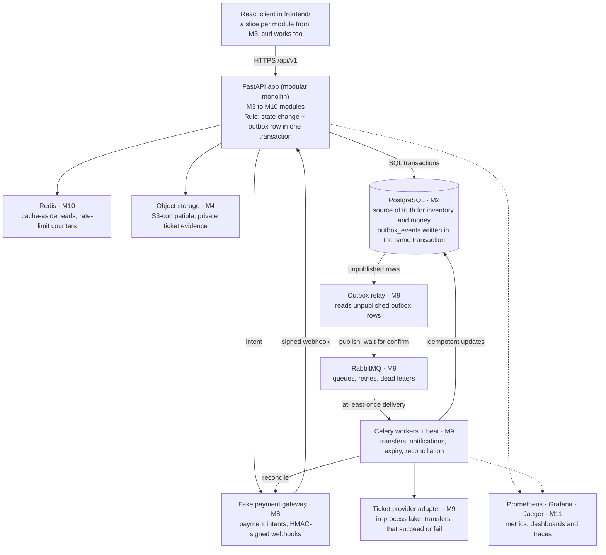

# Ticket Loop — Build & Learn Plan

Nov 16, 2026 · @Aswin Mony

## What you are building and how to use this plan

TicketLoop is a FastAPI modular monolith for fixed-price ticket resale. Its real purpose is to show that a backend stays correct under concurrent requests and partial failures. This plan splits it into 19 modules over about 110 focused sessions, built in an order where each module depends only on what came before. On 23 Nov 2026, with M0 to M5 done, it was slimmed to 13 modules (M0 to M12) so it finishes in one more week: see [Cut from the plan](#cut-from-the-plan-23-nov-2026).

The source is `plan.md` (v1.0) in the repo. It is the only file so far; no code exists yet.

### Six problems make this project worth building

Most of the API is CRUD that sets these up. Spend your deepest learning time here:

1. **Double booking:** 100 buyers hit one ticket at once and exactly one wins (M7).
2. **Duplicate orders:** a retried request must not create a second order, which is what idempotency keys solve (M8).
3. **Duplicate or forged webhooks:** the gateway sends the same event twice, or someone fakes one (M8).
4. **Lost events:** the database commits but RabbitMQ is down, which the transactional outbox fixes (M9).
5. **Expiry racing payment:** the expiry worker must never release a ticket that was just paid for (M7 + M8).
6. **Drift:** the gateway and your database disagree, and reconciliation finds it (M8).

### Assumptions to adjust

- One "day" is one focused session of 3 to 4 hours. At 5 sessions a week the plan ran about 22 weeks; after the slimming, M6 to M12 run one a day from 24 to 30 November 2026. With less time, stretch the days; do not skip the Learn steps.
- You know Python basics (functions, classes, venv, pip) and everyday Git. If not, do the optional pre-week in M0.
- You work on Windows 11 with a mixed setup. Your code, the API, tests and the frontend run natively on Windows; Postgres, Redis, RabbitMQ, Celery and the monitoring tools run in Docker Desktop, which uses WSL2 behind the scenes. Celery and Redis do not support Windows, which is why they always live in containers.
- The React frontend grows a slice at a time. M3 to M5 each added the screens for what they built; from M6 only the buying flow (search, reserve, pay, own the ticket) gets screens, and there is no polish module. The backend is still the point of the project: a module's screens are thin and never hold business rules.

### How each module is laid out

- **Goal:** what exists when you finish.
- **Prerequisites:** tech (tools you install or must know) and knowledge (concepts you must understand first).
- **Learn first:** videos and articles. Watch or read these before writing code for that module.
- **Build:** the concrete tasks, in order.
- **Done when:** a test or demo that proves it works.
- **Explain it:** questions you should answer out loud without notes. If you cannot, you are not done.

### Decisions plan.md leaves open, and what I recommend

| Open question | Recommendation | Why |
| --- | --- | --- |
| Sync or async SQLAlchemy | Sync SQLAlchemy 2.0 with psycopg 3 | One session model shared by FastAPI and Celery workers; fewer concepts at once. Switch later if load tests demand it. |
| Package manager | uv with `pyproject.toml` | Fast, and pyproject-native as plan.md expects. Plain pip + venv also works. |
| Money type | Integer paise in a `BIGINT` column, currency `INR` | plan.md bans floats for money; integers avoid rounding bugs entirely. |
| Reservation expiry before Celery exists | A plain Python loop script in M7, moved to Celery beat in M9 | Keeps the expiry logic a pure function you can test, separate from the scheduler. |
| Logging timing | JSON logs and request IDs from M1; metrics and tracing in M11 | Cheap now and makes every later bug easier to find. |
| Load-test tool | Grafana k6, run from Docker | One laptop can generate far more load with it than with a Python tool, it has load, stress, spike and soak patterns built in, and thresholds turn each run into a pass or fail. One tool keeps every run comparable. |
| Migrations on enums | Store status as `TEXT` with a `CHECK` constraint | Postgres enum types are awkward to change in Alembic; you will add states. |

## Architecture at a glance

*TicketLoop architecture after M12: Postgres decides; everything async flows through the outbox. Module numbers show where each part is built.*

The API writes every state change and its outbox row in one Postgres transaction. The relay, RabbitMQ and Celery carry those events to workers, which write back to Postgres idempotently. Redis only speeds up reads and counts rate limits, and the fake gateway and the in-process provider adapter stand in for the real payment gateway and ticket provider.

## Module map and build order

Build the 13 modules strictly in this order. Each one leaves you with something running and tested, and each needs only what came before it. M10 is the only one that could move; M7 to M9 are a chain.

| # | Module | What exists when done | Needs | Why it sits here | plan.md phase |
| --- | --- | --- | --- | --- | --- |
| M0 | Foundations and design | Requirements, ERD, state diagrams, API contract in `docs/` | nothing | You cannot reason about races in tables you have not designed. | 0 |
| M1 | Dev environment and skeleton | FastAPI app + Postgres in Docker Compose, config, JSON logs, pytest running | M0 | Every later module plugs into this shape. | 1 |
| M2 | Database layer | SQLAlchemy models, sessions, Alembic migrations, test database | M1 | All state lives in Postgres; learn transactions here before you need them. | 1 |
| M3 | Identity and auth | Register, login, JWT access + refresh rotation, roles, first CI run, first screens | M2 | Every protected endpoint after this needs a current user. | 1 |
| M4 | Events, tickets, document storage | Event CRUD (admin), ticket upload to MinIO, ownership checks | M3 | Listings point at tickets; tickets point at events and owners. | 1 |
| M5 | Listings, verification, audit log | Listing state machine, admin approve/reject, partial unique index, audit helper | M4 | First real state machine; audit starts now because every later state change must write it. | 2 |
| M6 | Discovery | Search, filters, keyset pagination, indexes checked with `EXPLAIN ANALYZE` | M5 | Needs active listings to search. | 2 |
| M7 | Reservations and concurrency | Atomic reservation, 100-buyer race test, three locking strategies compared, expiry loop | M6 | The core problem; everything after builds on a reserved ticket. | 3 |
| M8 | Orders and payments | Order state machine, `Idempotency-Key` handling, fake gateway, signed webhooks, dedupe, reconciliation | M7 | An order is created from a reservation and paid by exactly one live payment. | 4 |
| M9 | Outbox and transfer | Transactional outbox, RabbitMQ, Celery, retries, dead-letter queue, the transfer and notification consumers | M8 | Payment success is the first event that must reach a worker reliably. | 5 |
| M10 | Caching and rate limiting | Redis cache-aside for reads, token-bucket rate limits on hot endpoints | M6 | plan.md says Redis only after the app works; it speeds up M6 reads. | 6 |
| M11 | Observability and delivery | Prometheus metrics, a Grafana dashboard, OpenTelemetry traces, the image and dependency scans in CI | M9 | You need p95 and queue-depth graphs to read a load test. | 7 |
| M12 | Load testing and results | k6 load and spike runs, races at scale, a broker drill, the invariants check, resume numbers | M11 | Runs once the backend is finished, so every number describes the real system. | 6 + 7 |

Seven changes from plan.md's phase order, each on purpose:

1. The audit-log helper arrives in M5, not at the end, so no state change ever goes unrecorded.
2. A basic CI run (pytest on every push) starts in M3; the image build and scans arrive in M11.
3. Observability (M11) comes before load testing (M12), because load-test numbers are unreadable without dashboards.
4. Reservation expiry first runs as a plain script in M7 and moves onto Celery beat in M9.
5. Load and contention testing runs as one module (M12) after the backend is finished. Each module still ships its own correctness tests, because a module is not done without them.
6. The frontend arrives a slice per module from M3, so every feature can be tried in a browser as soon as it exists. From M6 only the buying flow gets screens; each module's **Screens** paragraph lists its slice.
7. On 23 Nov 2026 the plan was slimmed from 19 modules to 13 for a one-week finish. See [Cut from the plan](#cut-from-the-plan-23-nov-2026).

## Module-by-module breakdown

Each module lists what to know before you start, what to watch and read, what to build, and how to prove it works. Every link below was checked on 16 Nov 2026. Videos come first because they give the mental model; the docs give the exact API.

### M0 · Foundations and design (Days 1 to 6)

**Goal:** every table, state and endpoint is on paper, and you can trace all six hard problems through the design before writing code.

**Prerequisites**

- Tech: Git and a GitHub account, VS Code, a diagram tool ([dbdiagram.io](https://dbdiagram.io) or Mermaid).
- Knowledge: Python basics; an HTTP request and response (method, path, status code, headers, JSON body); tables, primary keys and foreign keys.

**Learn first**

- Video: [Git Tutorial for Beginners: Command-Line Fundamentals](https://www.youtube.com/watch?v=HVsySz-h9r4) (Corey Schafer)
- Video: [HTTP Crash Course & Exploration](https://www.youtube.com/watch?v=iYM2zFP3Zn0) (Traversy Media)
- Video: [RESTful APIs in 100 Seconds](https://www.youtube.com/watch?v=-MTSQjw5DrM) (Fireship). The demo uses Node; watch it for the REST ideas only.
- Video: [Entity Relationship Diagram (ERD) Tutorial, Part 1](https://www.youtube.com/watch?v=QpdhBUYk7Kk) (Lucid Software)
- Video: [System Design Interview: Design Ticketmaster](https://www.youtube.com/watch?v=fhdPyoO6aXI) (Hello Interview). The closest real system to yours. Note why booking needs strong consistency while browsing does not.
- Article: [Ticketmaster problem breakdown](https://www.hellointerview.com/learn/system-design/problem-breakdowns/ticketmaster) (Hello Interview)
- Article: [An overview of HTTP](https://developer.mozilla.org/en-US/docs/Web/HTTP/Overview) (MDN)
- Article: [Web API design best practices](https://learn.microsoft.com/en-us/azure/architecture/best-practices/api-design) (Microsoft)
- Article: Mermaid [state diagrams](https://mermaid.js.org/syntax/stateDiagram.html) and [ER diagrams](https://mermaid.js.org/syntax/entityRelationshipDiagram.html)
- Optional pre-week if Python feels shaky: [OOP: Classes and Instances](https://www.youtube.com/watch?v=ZDa-Z5JzLYM), [Decorators](https://www.youtube.com/watch?v=FsAPt_9Bf3U), [Context Managers](https://www.youtube.com/watch?v=-aKFBoZpiqA) (all Corey Schafer) and [Python Type Checking](https://realpython.com/python-type-checking/) (Real Python). FastAPI routes are decorators and database sessions are context managers, so these two matter most.

**Build**

1. Create the folder layout from plan.md section 19, with empty modules and a README.
2. `docs/requirements.md`: restate each FR and NFR in your own words, plus one line on how you will test it.
3. `docs/database-design.md`: an ERD with every foreign key, unique constraint and partial unique index.
4. `docs/state-machines.md`: Mermaid diagrams for listing, interest, reservation, order, payment and transfer. Under each, a table of allowed transitions and what triggers each one.
5. `docs/api-contract.md`: every endpoint with request body, response, status codes and required role.
6. For each of the six hard problems, write the exact SQL statements in order, then ask: what happens if the process dies between any two of them?
7. Resolve the gaps in plan.md's schema listed below.

**Gaps in plan.md's schema to fix during design**

- `listings` has no `event_id`, yet the index list includes `listings(event_id, status)`. Copy `event_id` onto listings so discovery avoids a join.
- `listings` lacks `original_price` and `verification_status`, which FR-04 lists.
- `orders` has no `listing_id`; `payments` has no `idempotency_key` or `provider_response`. FR-08 and FR-09 list them.
- Missing tables the features need: `refresh_tokens`, `idempotency_keys`, `refunds`, `disputes`, `reconciliation_runs`.
- Pick one lock target. I recommend the listing row: reserving a ticket means moving one `listings` row from `ACTIVE` to `RESERVED`. The ticket row changes only when the transfer completes.
- Add partial unique indexes: one active interest per buyer per listing, and one open reservation per listing.

**Done when:** you can draw the reservation to order to payment to transfer flow from memory, including what every table holds at each step.

**Explain it:** Why is PostgreSQL, not Redis, the source of truth for inventory? What state is a listing in while payment is pending, and what can move it out?

### M1 · Dev environment and skeleton (Days 7 to 10)

**Goal:** `docker compose up` starts Postgres and the API; `/api/v1/health` returns 200 after checking the database; pytest runs; every log line is JSON with a request ID.

**Prerequisites**

- Tech: Docker Desktop (it sets up WSL2 for you), plus Python 3.12 or newer, uv, VS Code and Git Bash installed on Windows.
- Knowledge: images, containers, volumes and port mapping; environment variables; virtual environments; the idea of an ASGI server (uvicorn runs your app).

**Learn first**

- Video: [Docker in 100 Seconds](https://www.youtube.com/watch?v=Gjnup-PuquQ) (Fireship)
- Video: [Docker Tutorial for Beginners, full course in 3 hours](https://www.youtube.com/watch?v=3c-iBn73dDE) (TechWorld with Nana). The first 90 minutes cover what you need now.
- Video: [Ultimate Docker Compose Tutorial](https://www.youtube.com/watch?v=SXwC9fSwct8) (TechWorld with Nana)
- Video: [Python API Development, Comprehensive Course for Beginners](https://www.youtube.com/watch?v=0sOvCWFmrtA) (freeCodeCamp, 19 hours). Your companion course for M1 to M3. Watch the FastAPI basics now. It uses older SQLAlchemy style, so follow the 2.0 docs for database code.
- Article: [Install WSL](https://learn.microsoft.com/en-us/windows/wsl/install) (Microsoft) and [Docker Desktop WSL 2 backend](https://docs.docker.com/desktop/features/wsl/) (Docker)
- Article: [FastAPI tutorial](https://fastapi.tiangolo.com/tutorial/), from First Steps through Bigger Applications
- Article: [FastAPI settings and environment variables](https://fastapi.tiangolo.com/advanced/settings/)
- Article: [uv documentation](https://docs.astral.sh/uv/), [pytest getting started](https://docs.pytest.org/en/stable/getting-started.html), [structlog](https://www.structlog.org/en/stable/)
- Article: [RFC 9457, Problem Details for HTTP APIs](https://www.rfc-editor.org/rfc/rfc9457): one standard shape for every error response.

**Build**

1. Install Docker Desktop (it sets up WSL2 for you). Keep the repo on `E:\` and run the API natively with `uvicorn --reload`; only the services run in containers. Add a `.gitattributes` file with `* text=auto eol=lf` on day one, because scripts saved with Windows line endings fail inside Linux containers.
2. `uv init`, then add fastapi, uvicorn, pydantic-settings, sqlalchemy, psycopg\[binary\], alembic, pytest, httpx, ruff, structlog.
3. `app/main.py` with an app factory, a `/api/v1` router and `/health`.
4. `app/core/config.py` reading settings from the environment; commit `.env.example`, never `.env`.
5. `docker-compose.yml` with `postgres:17` (named volume, healthcheck) and the API service. Day to day you run the API on Windows with `uvicorn --reload`; the containerised API is for the M7 race test and the load tests.
6. Middleware that creates a request ID, returns it in a response header and adds it to every log line.
7. `app/core/exceptions.py`: one error format for every error.
8. The first test: FastAPI `TestClient` calls `/health`.

**Done when:** a fresh clone, then `docker compose up`, then `curl localhost:8000/api/v1/health` returns 200 with the database status; `pytest` and `ruff check` both pass.

**Explain it:** What is the difference between an image and a container? Why does the API container reach Postgres at `db:5432` while your laptop uses `localhost:5432`?

### M2 · Database layer (Days 11 to 15)

**Goal:** the first tables exist through Alembic migrations with every constraint from M0, a session-per-request dependency works, and tests run against a database that resets between tests.

**Prerequisites**

- Tech: the M1 stack, plus `psql` or a GUI such as DBeaver.
- Knowledge: SELECT, INSERT, UPDATE, DELETE, JOIN, GROUP BY; primary key, foreign key, UNIQUE and CHECK constraints; BEGIN, COMMIT and ROLLBACK; what an ORM hides from you.

**Learn first**

- Video: [PostgreSQL in 100 Seconds](https://www.youtube.com/watch?v=n2Fluyr3lbc) (Fireship)
- Video: [Learn PostgreSQL Tutorial, Full Course for Beginners](https://www.youtube.com/watch?v=qw--VYLpxG4) (freeCodeCamp, about 4 hours). Type along in your own `psql` session; skip what you know.
- Video: [Relational Database ACID Transactions, Explained by Example](https://www.youtube.com/watch?v=pomxJOFVcQs) (Hussein Nasser)
- Video: [Database Indexing Explained, with PostgreSQL](https://www.youtube.com/watch?v=-qNSXK7s7_w) (Hussein Nasser). Watch before you write index migrations.
- Article: [SQLAlchemy 2.0 Unified Tutorial](https://docs.sqlalchemy.org/en/20/tutorial/index.html) and [Session Basics](https://docs.sqlalchemy.org/en/20/orm/session_basics.html)
- Article: [What's New in SQLAlchemy 2.0?](https://blog.miguelgrinberg.com/post/what-s-new-in-sqlalchemy-2-0) (Miguel Grinberg)
- Article: [Alembic tutorial](https://alembic.sqlalchemy.org/en/latest/tutorial.html) and [what autogenerate can and cannot detect](https://alembic.sqlalchemy.org/en/latest/autogenerate.html)
- Article: [Partial indexes](https://www.postgresql.org/docs/current/indexes-partial.html) (PostgreSQL docs)

**Build**

1. `infrastructure/database`: engine, sessionmaker and a `get_db` dependency that commits on success and rolls back on error.
2. A base model: UUID primary key generated by Postgres, `created_at` and `updated_at` as `timestamptz` in UTC.
3. Models and the first migration for `users`, `events`, `tickets`, `listings` and `audit_logs`. Every later module adds its own tables in its own migration, which is how real schemas grow.
4. Read the SQL Alembic generates (`alembic upgrade head --sql`) before running it.
5. Declare the partial unique index on `listings(ticket_id)` for open statuses and the CHECK constraints (statuses, price cap, `asking_price_paise >= 100`) in the models; autogenerate writes them for a new table. Hand-write what it cannot see: triggers and functions, and any later change to a CHECK.
6. Test fixtures: a separate test database, and each test wrapped in a transaction that rolls back.
7. Do this experiment: open two `psql` sessions, BEGIN in both, UPDATE the same row, and watch the second one wait. Write down what you saw.

**Done when:** `alembic downgrade base` then `alembic upgrade head` runs cleanly, and a test proves a second open listing for the same ticket raises `IntegrityError`.

**Explain it:** What does `session.commit()` send to Postgres? Why does a partial unique index enforce "one active listing" better than an `if` check in Python?

### M3 · Identity and auth (Days 16 to 21)

**Goal:** register, login, refresh with rotation and logout all work; `get_current_user` and `require_admin` dependencies guard routes; suspended users are blocked; GitHub Actions runs the tests on every push.

**Prerequisites**

- Tech: the M2 stack, PyJWT, an Argon2 library (argon2-cffi or pwdlib).
- Knowledge: hashing versus encryption; salts; a JWT is header.payload.signature and is signed, not encrypted; access versus refresh tokens; FastAPI `Depends`; HTTP 401 (who are you?) versus 403 (you may not).

**Learn first**

- Video: [Session vs Token Authentication in 100 Seconds](https://www.youtube.com/watch?v=UBUNrFtufWo) (Fireship)
- Video: [What Is JWT and Why Should You Use JWT](https://www.youtube.com/watch?v=7Q17ubqLfaM) (Web Dev Simplified)
- Video: [Session Vs JWT: The Differences You May Not Know](https://www.youtube.com/watch?v=fyTxwIa-1U0) (ByteByteGo)
- Video: [How NOT to Store Passwords](https://www.youtube.com/watch?v=8ZtInClXe1Q) (Computerphile)
- Video: the authentication and JWT sections of the [freeCodeCamp FastAPI course](https://www.youtube.com/watch?v=0sOvCWFmrtA)
- Video: [GitHub Actions Tutorial: Basic Concepts and CI/CD Pipeline with Docker](https://www.youtube.com/watch?v=R8_veQiYBjI) (TechWorld with Nana), for the first CI run
- Article: [OAuth2 with Password (and hashing), Bearer with JWT tokens](https://fastapi.tiangolo.com/tutorial/security/oauth2-jwt/) and [Dependencies](https://fastapi.tiangolo.com/tutorial/dependencies/) (FastAPI docs)
- Article: [Password Storage Cheat Sheet](https://cheatsheetseries.owasp.org/cheatsheets/Password_Storage_Cheat_Sheet.html) and [Authentication Cheat Sheet](https://cheatsheetseries.owasp.org/cheatsheets/Authentication_Cheat_Sheet.html) (OWASP)
- Article: [Refresh Token Rotation](https://auth0.com/docs/secure/tokens/refresh-tokens/refresh-token-rotation) (Auth0). Read for the reuse-detection idea, then build it yourself.
- Article: [PyJWT documentation](https://pyjwt.readthedocs.io/en/stable/)
- Article: [Create PostgreSQL service containers](https://docs.github.com/en/actions/tutorials/use-containerized-services/create-postgresql-service-containers) (GitHub docs)
- Video: [React in 100 Seconds](https://www.youtube.com/watch?v=Tn6-PIqc4UM) and [TypeScript in 100 Seconds](https://www.youtube.com/watch?v=zQnBQ4tB3ZA) (Fireship), for the first screens
- Article: [react.dev Learn](https://react.dev/learn) up to "Managing State", and the [Vite guide](https://vite.dev/guide/)

**Build**

1. `users` migration: unique email (store lowercased), `role` (USER or ADMIN), `account_status`. A seller is any user who owns a verified ticket, so it needs no role.
2. Argon2id hashing. Never log a password, even on failure.
3. `POST /auth/register` and `POST /auth/login`, returning a 15-minute access token in the body and a 7-day refresh token in an HttpOnly, SameSite=Strict cookie scoped to `/api/v1/auth`, so page scripts never touch it.
4. A `refresh_tokens` table that stores a hash of each token plus `family_id`, `revoked_at` and `replaced_by`. On refresh, issue a new pair and revoke the old one. If a revoked token is used again, revoke the whole family: someone stole it.
5. `POST /auth/logout` revokes the session the cookie belongs to and clears the cookie.
6. Dependencies: `get_current_user` (decode, check expiry, load the user, reject SUSPENDED) and `require_admin`.
7. `GET /users/me` and `PATCH /users/me`; `POST /users/me/password` and the password reset (request and confirm) from FR-01, each of which revokes every refresh token the user holds.
8. Tests for wrong password, expired token, tampered token, reused refresh token, suspended user and a normal user calling an admin route.
9. `.github/workflows/ci.yml` running ruff and pytest against a Postgres service container.
10. The first screens, in `frontend/` (Vite, React, TypeScript, types generated from `/openapi.json`): register, log in, your account (edit your name, change your password), forgot and reset password. Mailpit in Docker catches the reset email at `localhost:8025`. Browser tests click through all of it in CI.

**Screens:** the list in item 10. The access token stays in memory, the browser holds the refresh cookie, and refreshes never overlap, even across tabs.

**Done when:** all auth tests pass in CI, replaying a used refresh token logs out every session in that family, and you can register, reset a forgotten password from the emailed link, and log out everywhere, all in the browser.

**Explain it:** Why can you not truly log out a JWT access token, and how do short expiry plus refresh revocation work around it? Why store a hash of the refresh token instead of the token?

### M4 · Events, tickets and document storage (Days 22 to 26)

**Goal:** admins manage events; sellers register tickets and upload purchase evidence to private storage; no user can read another user's ticket or files.

**Prerequisites**

- Tech: an S3-compatible object store in Docker; boto3.
- Knowledge: object storage versus files on disk; presigned URLs; multipart file uploads; IDOR (changing an ID in a URL to read someone else's data); basic limit/offset pagination.

**Storage note:** MinIO stopped publishing its free community Docker image on 23 Oct 2025 ([Chainguard](https://www.chainguard.dev/unchained/secure-and-free-minio-chainguard-containers)). Use Chainguard's free rebuild, `cgr.dev/chainguard/minio`, or any other S3-compatible server. Write your code only against the S3 API through boto3, so the server can change without code changes.

**Learn first**

- Video: [Insecure Direct Object Reference (IDOR) Explained](https://www.youtube.com/watch?v=rloqMGcPMkI) (PwnFunction)
- Article: [IDOR Prevention Cheat Sheet](https://cheatsheetseries.owasp.org/cheatsheets/Insecure_Direct_Object_Reference_Prevention_Cheat_Sheet.html) and [File Upload Cheat Sheet](https://cheatsheetseries.owasp.org/cheatsheets/File_Upload_Cheat_Sheet.html) (OWASP)
- Article: [Presigned URLs](https://boto3.amazonaws.com/v1/documentation/api/latest/guide/s3-presigned-urls.html) (boto3 docs)
- Article: [Request Files](https://fastapi.tiangolo.com/tutorial/request-files/) (FastAPI docs)

**Build**

1. `events` migration with admin-only create and update, and public paginated reads.
2. `tickets` migration. `POST /tickets` takes the owner from the token, never from the request body. `GET /tickets/me` lists your own; `GET /tickets/{id}` works only for the owner or an admin.
3. A storage adapter in `infrastructure/storage` with `put_object` and a presigned GET that expires in 5 minutes. The bucket stays private.
4. Evidence upload: check content type and size, and store the file under a random key, never the user's filename.
5. Ticket verification: an admin moves PENDING to VERIFIED or REJECTED. plan.md is clear that a screenshot proves nothing; real verification needs a provider API later.
6. Tests: user B gets 404 for user A's ticket; an anonymous upload is rejected; an oversized file is rejected.

**Screens:** an admin events page (create, edit, list); a seller's **My tickets** page to register a ticket and upload purchase evidence, then open it through its presigned link. Someone else's ticket address shows the not-found page.

**Done when:** an IDOR test proves no cross-user access on every ticket endpoint.

**Explain it:** Why return 404 instead of 403 for another user's ticket? Why hand out short-lived presigned URLs instead of a public bucket?

### M5 · Listings, verification and audit log (Days 27 to 31)

**Goal:** sellers list verified tickets; admins approve or reject; every status change goes through one state-machine function and writes an audit row in the same transaction.

**Prerequisites**

- Tech: everything from M2 to M4.
- Knowledge: finite state machines (states, transitions, guards); why a database constraint is the last line of defence; what writing the audit row in the same transaction guarantees.

**Learn first**

- Video: [Computers Without Memory](https://www.youtube.com/watch?v=vhiiia1_hC4) (Computerphile). The theory behind state machines in 10 minutes; optional but it makes the idea click.
- Article: [How Payment Intents work](https://docs.stripe.com/payments/paymentintents/lifecycle) (Stripe). A production state machine to model yours on, and useful again in M8.
- Article: [Logging Cheat Sheet](https://cheatsheetseries.owasp.org/cheatsheets/Logging_Cheat_Sheet.html) (OWASP): what an audit event should and must never contain.
- Article: [Unique indexes](https://www.postgresql.org/docs/current/indexes-unique.html) (PostgreSQL docs)

**Build**

1. `listings` migration with `event_id` copied from the ticket, prices in paise, `status`, `expires_at` and the partial unique index.
2. One `transition(listing, to_state, actor)` function backed by an `ALLOWED` dictionary. An illegal move raises an error that maps to HTTP 409.
3. Apply transitions with a conditional UPDATE: `UPDATE listings SET status = :to WHERE id = :id AND status = :from`, then check the row count. This is the M7 pattern, learned in a calmer setting.
4. A pure price rule: asking price may not exceed the original price. Unit-test it.
5. An audit helper, `record(session, actor_id, entity, entity_id, action, metadata)`, called inside the same transaction as the change.
6. Endpoints: create (DRAFT to PENDING\_VERIFICATION), PATCH price only in allowed states, DELETE cancels only from ACTIVE, plus admin pending, approve and reject.
7. Listing expiry from ACTIVE to EXPIRED as a plain query for now; it gets a schedule in M9.
8. Tests: every illegal transition fails; a seller cannot list someone else's ticket; a second open listing for one ticket fails; the audit row rolls back together with a failed change.

**As built:** the `listings` table already existed from M2, so the M5 migration adds only indexes. Create makes a `DRAFT`, and a separate `POST /listings/{id}/submit` sends it for review, so a seller can fix a draft before an admin sees it. The seller can cancel from `DRAFT`, `PENDING_VERIFICATION` or `ACTIVE`; an admin only from `ACTIVE`. The audit column is `details`, not `metadata` (see `docs/database-design.md`).

**Screens:** **List this ticket** with a price, and each listing's status; an admin queue of pending listings with approve and reject; a listing's status history read from the audit log.

**Done when:** a table-driven test tries every (from, to) pair and only the allowed ones succeed.

**Explain it:** Why check the current state inside the UPDATE's WHERE clause instead of reading it first in Python? What happens to the audit row when the listing update fails?

### M6 · Discovery: search, filters, pagination (Tue 24 Nov)

**Goal:** buyers search and filter listings with keyset pagination, and every common query uses an index at 100,000 rows, proven with `EXPLAIN ANALYZE`.

**Prerequisites**

- Tech: the M5 stack, Faker for seed data, [explain.dalibo.com](https://explain.dalibo.com) to visualise query plans.
- Knowledge: B-tree indexes; composite index column order; reading a query plan (Seq Scan, Index Scan, Bitmap Heap Scan); why OFFSET slows down as it grows.

**Learn first**

- Video: [Database Indexing Explained, with PostgreSQL](https://www.youtube.com/watch?v=-qNSXK7s7_w) (Hussein Nasser). Re-watch with your own schema in mind.
- Video: [Pagination in MySQL: offset vs. cursor](https://www.youtube.com/watch?v=zwDIN04lIpc) (PlanetScale). Shown in MySQL; the idea is identical in Postgres.
- Article: [Use The Index, Luke](https://use-the-index-luke.com/), especially [No Offset](https://use-the-index-luke.com/no-offset) (Markus Winand). The best free book on indexes.
- Article: [Using EXPLAIN](https://www.postgresql.org/docs/current/using-explain.html) and [Multicolumn indexes](https://www.postgresql.org/docs/current/indexes-multicolumn.html) (PostgreSQL docs)
- Article: [Basics of Postgres query planning](https://pganalyze.com/docs/explain/basics-of-postgres-query-planning) (pganalyze)
- Article: [pg\_trgm](https://www.postgresql.org/docs/current/pgtrgm.html) for fast `ILIKE` name search (PostgreSQL docs)
- Article: [Faker documentation](https://faker.readthedocs.io/)

**Build**

1. `scripts/seed_discovery.py` (Faker): 2,000 events and 100,000 listings with their tickets and sellers, written only to a database whose name ends in `_perf`.
2. Public `GET /listings`, `GET /events`, `GET /events/{id}` and `GET /events/{id}/listings`, with the filters and sorts in `docs/api-contract.md`. Public fields only: no seller email or name, no ticket documents, no provider references.
3. Keyset pagination inside the shared `paginate()` helper, for every list endpoint, behind the same opaque cursor: sort name, last sort value and id. Page size 20 by default, 100 at most.
4. Indexes: `listings(status, price, id)` and `listings(status, created_at, id)` as partial indexes on `ACTIVE`, a trigram GIN index on `events.name`, `events(status, starts_at)`, plus what `EXPLAIN ANALYZE` shows the joined filters need. Record before-and-after plans and timings; drop any index no plan uses.
5. The browser tests move to their own database, recreated at the start of every run.

**Screens:** `/` becomes the public search page (filters, sort, **Load more** over the cursor) and each event gets a page of its tickets for sale. The existing listing page is the detail view.

**Done when:** page 500 loads within 20% of page 1's time, and no common filter does a Seq Scan on `listings` at 100,000 rows.

**First to drop if the day runs short:** the `GET /events` filters beyond name and city.

**Explain it:** Why does `OFFSET 10000` get slower as the offset grows? Why does the order of columns in a composite index matter?

### M7 · Reservations and concurrency (Wed 25 Nov)

**Goal:** 100 buyers reserving one listing at the same instant produce exactly one reservation, every time; expired reservations release the listing safely, even with two expiry workers running.

**Prerequisites**

- Tech: the M6 stack, a multi-worker uvicorn in Docker, httpx, `concurrent.futures`.
- Knowledge: race conditions; isolation levels (READ COMMITTED, REPEATABLE READ, SERIALIZABLE); row locks; `SELECT ... FOR UPDATE` and `SKIP LOCKED`; deadlocks; Python threads.

**Learn first**

- Video: [Transactions: myths, surprises and opportunities](https://www.youtube.com/watch?v=5ZjhNTM8XU8) (Martin Kleppmann, Strange Loop). The single best talk on what isolation levels really guarantee.
- Video: re-watch [Relational Database ACID Transactions](https://www.youtube.com/watch?v=pomxJOFVcQs) (Hussein Nasser), now focusing on isolation.
- Video: re-watch the ticket-locking part of [Design Ticketmaster](https://www.youtube.com/watch?v=fhdPyoO6aXI) (Hello Interview).
- Video: [Python Threading Tutorial](https://www.youtube.com/watch?v=IEEhzQoKtQU) (Corey Schafer), for writing the race test.
- Article: [Transaction Isolation](https://www.postgresql.org/docs/current/transaction-iso.html) and [Explicit Locking](https://www.postgresql.org/docs/current/explicit-locking.html) (PostgreSQL docs). Read the READ COMMITTED section twice: it explains what happens when two UPDATEs hit one row.
- Article: [The locking clause of SELECT](https://www.postgresql.org/docs/current/sql-select.html#SQL-FOR-UPDATE-SHARE) (PostgreSQL docs)
- Article: [Deeply understand isolation levels and read phenomena](https://dev.to/techschoolguru/understand-isolation-levels-read-phenomena-in-mysql-postgres-c2e) (Tech School). Reproduce each anomaly yourself in two `psql` windows.
- Article: [How to implement a database job queue using SKIP LOCKED](https://vladmihalcea.com/database-job-queue-skip-locked/) (Vlad Mihalcea), for the expiry worker.
- Article: [Hermitage](https://github.com/ept/hermitage) (Martin Kleppmann): tests of what each database's isolation levels actually prevent.
- Book: chapter 7, Transactions, of [Designing Data-Intensive Applications](https://dataintensive.net/) (Kleppmann). Worth buying; you will reuse it in M8 and M9.

**Build**

1. `reservations` migration with a partial unique index allowing one live reservation (`CREATED`, `PAYMENT_PENDING` or `CONFIRMED`) per listing: the safety net under the application logic.
2. `POST /listings/{id}/reservations` in one transaction: `UPDATE listings SET status = 'RESERVED' WHERE id = :id AND status = 'ACTIVE' AND seller_id <> :buyer AND expires_at > now() RETURNING id`; zero rows means 409. Then insert the reservation with `expires_at = now() + 10 minutes` and write the audit rows.
3. `GET /reservations/{id}`, `GET /reservations/me` and `POST /reservations/{id}/cancel` (only from `CREATED`; the listing goes back to `ACTIVE`).
4. An event with a `RESERVED` listing cannot be cancelled (409) until the hold ends.
5. In `tests/concurrency/` only, two alternatives: `SELECT ... FOR UPDATE` then check in Python, and SERIALIZABLE with a retry on SQLSTATE 40001.
6. The race test: `uvicorn --workers 4` on Linux, 100 users released together. Assert 1 success, 99 conflicts, one live reservation row and a `RESERVED` listing, by reading the database. Run all three approaches and record results and latency in `docs/reservation-design.md`.
7. A second race: a seller cancels while buyers reserve.
8. `scripts/expire_reservations.py`, a loop every 30 seconds: claim due `CREATED` reservations with `FOR UPDATE SKIP LOCKED`, expire each and release its listing. It never touches `PAYMENT_PENDING`. Two workers together expire each reservation exactly once, counted by audit rows.

**Screens:** **Reserve** on a listing, a countdown from `expires_at`, **Cancel**, and a plain message when someone else got there first or the hold ran out.

**Done when:** the 100-buyer race passes 20 runs in a row on 4 workers, and the comparison of three approaches is recorded.

**First to drop if the day runs short:** the SERIALIZABLE variant of the comparison.

**Explain it:** Under READ COMMITTED, what does the second UPDATE do while the first is uncommitted, and what does it see afterwards? When would you choose `SELECT ... FOR UPDATE` over a conditional UPDATE? Why can FastAPI's `TestClient` never prove concurrency safety?

### M8 · Orders and payments: idempotency, fake gateway, webhooks, reconciliation (Thu 26 Nov)

**Goal:** `POST /orders` creates exactly one order per reservation and replays the same response for the same `Idempotency-Key`; a fake gateway behaves like a real one; every webhook is verified and applied exactly once in effect; reconciliation repairs drift; expiry never releases a paid listing.

**Prerequisites**

- Tech: the M7 stack; a second small FastAPI app, `fakepay`, in its own container; Python's `hmac` and `hashlib`.
- Knowledge: which HTTP methods are idempotent and why clients retry; unique constraints as idempotency; storing a response so it can be replayed; webhooks; HMAC-SHA256 and constant-time comparison; replay attacks and timestamp windows; at-least-once delivery; reconciliation; the race between reservation expiry and payment success.

**Learn first**

- Video: [Idempotency in APIs Explained, Why It Matters + Code Example](https://www.youtube.com/watch?v=dZTkBeB_dmg) (Arkynate, 6 minutes)
- Video: [How Idempotency Works](https://roadmap.sh/videos/how-idempotency-prevents-duplicate-payments) (roadmap.sh): a payment succeeds, the response is lost, the app retries.
- Article: [Implementing Stripe-like Idempotency Keys in Postgres](https://brandur.org/idempotency-keys) (Brandur Leach). The most important read for M8; it builds almost exactly what you need.
- Article: [Designing robust and predictable APIs with idempotency](https://stripe.com/blog/idempotency) (Stripe)
- Article: [The Idempotency-Key HTTP Header Field](https://datatracker.ietf.org/doc/draft-ietf-httpapi-idempotency-key-header/) (IETF draft 08, updated Oct 2026): the header's semantics and error codes.
- Article: [Avoiding Double Payments in a Distributed Payments System](https://medium.com/airbnb-engineering/avoiding-double-payments-in-a-distributed-payments-system-2981f6b070bb) (Airbnb Engineering)
- Article: [How to avoid double payment](https://blog.bytebytego.com/p/how-to-avoid-double-payment) (ByteByteGo)
- Video: [Webhooks for Beginners, Full Course](https://www.youtube.com/watch?v=41NOoEz3Tzc) (freeCodeCamp). The first hour is enough.
- Video: [Securing Stream Ciphers (HMAC)](https://www.youtube.com/watch?v=wlSG3pEiQdc) (Computerphile)
- Article and video: [Your Idempotent Code Is Lying To You](https://codeopinion.com/your-idempotent-code-is-lying-to-you/) (CodeOpinion). Why calling a gateway outside your database transaction can still double-charge.
- Article: [Receive webhook events](https://docs.stripe.com/webhooks) (Stripe docs): signatures, retries, duplicates and out-of-order delivery.
- Article: [Validate and Test Webhooks](https://razorpay.com/docs/webhooks/validate-test/) (Razorpay docs). Your future real provider: HMAC-SHA256 over the raw body in the `X-Razorpay-Signature` header. Copy this scheme into your fake gateway.
- Article: [hmac.compare\_digest](https://docs.python.org/3/library/hmac.html) (Python docs)
- Article: [Payment and fintech guides](https://bytebytego.com/guides/payment-and-fintech/) (ByteByteGo): double charges, reconciliation, settlement.

**Build**

1. `orders` migration (`reservation_id` UNIQUE, the amount copied from the listing on the server) and `idempotency_keys` keyed on `(user_id, key)`: insert with `ON CONFLICT DO NOTHING`; a different body is 422, a stored response is replayed, a key in progress is 409.
2. The order state machine with the M5 pattern: `CREATED`, `PAYMENT_PENDING`, `PAID`, `PAYMENT_FAILED`, `CANCELLED`, `TRANSFER_PENDING`, `COMPLETED`, `TRANSFER_FAILED`.
3. The `fakepay` container: intents (the payment id is the idempotency key), a checkout page and an API that pick the outcome (success, failure, delay, webhook twice, bad signature, no webhook), a lookup endpoint. No refunds.
4. `payments` saved as `CREATED` before the gateway is called, `payment_events` unique on the provider's event id, `reconciliation_runs`.
5. The webhook: raw body, `hmac.compare_digest`, a 5-minute timestamp window, the dedupe insert answering duplicates with 200, the amount check, then success or failure applied through the transition functions in one transaction.
6. Safe expiry: a `PAYMENT_PENDING` reservation is resolved by asking the gateway, never released by the clock.
7. A reconciliation script that repairs stuck payments through the same transition functions; a second run changes nothing.
8. Tests: 50 concurrent requests with one key; same key, different body; a webhook delivered 10 times; a forged signature; a late webhook after reconciliation; an amount mismatch; expiry racing payment success, 50 runs; a gateway timeout.

**Screens:** checkout from a reservation (one `Idempotency-Key` per click, reused on retry), `fakepay`'s page with its outcome buttons, an order page that polls until the payment settles, and **My orders**.

**Done when:** 50 concurrent requests sharing one `Idempotency-Key` create one order with 50 identical responses, and delayed, duplicated and failed payments all end in a correct state, each with an automated test.

**First to drop if the day runs short:** the delay and no-webhook buttons on `fakepay`'s page (they stay as test switches).

**Explain it:** Two layers stop duplicate orders here, the key table and `reservation_id` UNIQUE. What does each catch that the other misses? Why must the amount come from the database and never from the request? Why verify the HMAC over raw bytes rather than parsed JSON? Why answer a duplicate webhook with 200 instead of an error? If the server crashes after the gateway charged the card but before you saved anything, which component discovers it, and how?

### M9 · Outbox, RabbitMQ, Celery and the transfer (Fri 27 Nov)

**Goal:** every business event is saved in the same transaction as the change that caused it, reaches a worker even if RabbitMQ was down, and is applied once even when delivered twice; a paid order completes by moving the ticket to the buyer; expiry and reconciliation run on Celery beat.

**Prerequisites**

- Tech: RabbitMQ (management image), Celery, pika for the learning exercises.
- Knowledge: producers, exchanges, queues, bindings; acks, nacks and prefetch; at-most-once versus at-least-once delivery; the dual-write problem; dead-letter queues; exponential backoff with jitter.
- Knowledge, too: multi-step workflows across systems (sagas); when to retry and when to stop for a human.

**Learn first**

- Video: [RabbitMQ Crash Course](https://www.youtube.com/watch?v=Cie5v59mrTg) (Hussein Nasser)
- Video: [The Outbox Pattern](https://roadmap.sh/videos/how-the-transactional-outbox-pattern-works) (roadmap.sh): the service saves an order, crashes before publishing, and the event is lost.
- Article and video: [Outbox Pattern: Reliably Save State & Publish Events](https://codeopinion.com/outbox-pattern-reliably-save-state-publish-events/) (CodeOpinion)
- Video: [Distributed Systems lecture series](https://www.youtube.com/playlist?list=PLeKd45zvjcDFUEv_ohr_HdUFe97RItdiB) (Martin Kleppmann, Cambridge). Watch the early lectures on system models and failures; return to the rest after the project.
- Article: [Pattern: Transactional outbox](https://microservices.io/patterns/data/transactional-outbox.html) and [Pattern: Idempotent Consumer](https://microservices.io/patterns/communication-style/idempotent-consumer.html) (Chris Richardson)
- Article: [RabbitMQ tutorials](https://www.rabbitmq.com/tutorials), starting at [Hello World in Python](https://www.rabbitmq.com/tutorials/tutorial-one-python)
- Article: [Consumer Acknowledgements and Publisher Confirms](https://www.rabbitmq.com/docs/confirms) and [Dead Letter Exchanges](https://www.rabbitmq.com/docs/dlx) (RabbitMQ docs)
- Article: [First steps with Celery](https://docs.celeryq.dev/en/stable/getting-started/first-steps-with-celery.html), [Tasks: retrying and acks\_late](https://docs.celeryq.dev/en/stable/userguide/tasks.html) and [Periodic tasks](https://docs.celeryq.dev/en/stable/userguide/periodic-tasks.html) (Celery docs). No Celery video beats these pages.
- Article: [What do you mean by "Event-Driven"?](https://martinfowler.com/articles/201701-event-driven.html) (Martin Fowler)
- Article: [Pattern: Saga](https://microservices.io/patterns/data/saga.html) (Chris Richardson)

**Build**

1. `rabbitmq`, `worker`, `beat` and `relay` in Compose. Celery does not support Windows, so these always run in containers.
2. `emit(session, aggregate_type, aggregate_id, event_type, payload)` inserting into `outbox_events` in the caller's transaction, for payment succeeded and failed, reservation expired and transfer completed.
3. The relay: `FOR UPDATE SKIP LOCKED LIMIT 100`, publish through Celery with publisher confirms, set `published_at`; on failure bump `retry_count` and back off.
4. Consumers as Celery tasks with `acks_late`, retries with backoff and jitter, a dead-letter queue after the last retry, and `processed_events (consumer, event_id)` written with the consumer's effect.
5. The transfer consumer: `transfers` with `order_id` UNIQUE, an in-process provider adapter, and on success one transaction for transfer `COMPLETED`, order `COMPLETED`, listing `SOLD` and the ticket's new owner. Exhausted retries end in `REQUIRES_MANUAL_REVIEW`.
6. A notifications consumer (one notification per user per event) with `GET /notifications` and mark-as-read. No screen.
7. Reservation expiry, listing expiry and reconciliation on Celery beat.
8. Failure drills: stop RabbitMQ while paying; kill a worker mid-task; send a poison message.

**Screens:** the order page shows the transfer until **Completed**, the buyer's **My tickets** shows the bought ticket, and the seller's listing shows **Sold**.

**Done when:** one integration test runs reserve, order, pay, webhook, outbox and consumer to a completed transfer, and the drills end with nothing lost and nothing applied twice.

**First to drop if the day runs short:** the notifications consumer.

**Explain it:** Why not simply publish to RabbitMQ right after the commit? Exactly-once delivery is impossible, so how do you still get an exactly-once effect? What does `acks_late` fix, and what new risk does it add? Why is an order not `COMPLETED` at `PAID`?

### M10 · Caching and rate limiting (Sat 28 Nov)

**Goal:** public reads come from Redis through cache-aside with TTLs and invalidation on listing changes; login, search, reservation and payment are rate limited with 429 and `Retry-After`; no inventory decision ever reads Redis.

**Prerequisites**

- Tech: Redis in Compose, redis-py.
- Knowledge: cache-aside versus write-through; TTLs; invalidation and cache stampedes; Redis strings, `INCR`, `EXPIRE` and sorted sets; fixed window, sliding window and token bucket limits; HTTP 429.

**Learn first**

- Video: [Redis in 100 Seconds](https://www.youtube.com/watch?v=G1rOthIU-uo) (Fireship)
- Video: [Cache Systems Every Developer Should Know](https://www.youtube.com/watch?v=dGAgxozNWFE) (ByteByteGo)
- Article: [Caching Best Practices](https://aws.amazon.com/caching/best-practices/) (AWS): lazy loading, write-through, TTLs.
- Article: [Design a Rate Limiter](https://bytebytego.com/courses/system-design-interview/design-a-rate-limiter) (ByteByteGo book chapter)
- Article: [Scaling your API with rate limiters](https://stripe.com/blog/rate-limiters) (Stripe)
- Article: [Rate-limiting algorithms compared](https://arcjet.com/learn/rate-limiting-guide) (Arcjet)
- Article: [redis-py documentation](https://redis.readthedocs.io/en/stable/)

**Build**

1. A Redis service, a client in `infrastructure/redis`, and a setting that switches caching off so its effect can be measured.
2. Cache-aside for `GET /events/{id}` and the first page of searches, keyed on every filter and the sort, with jittered 30 to 60 second TTLs.
3. Invalidation after commit through version numbers in the keys: one per event, one for search.
4. A token bucket in one Lua script, per endpoint, keyed on user or IP; login on email plus IP. Every limit is a setting.
5. When Redis is down the cache and the limiter both fail open, logged and counted; the trade-off is written up.
6. Tests: a second call is a hit; a reservation from a stale cached search still gets 409 from Postgres; the sixth login in a minute gets 429.

**Screens:** one shared message with a countdown from `Retry-After`, on login, search and reserve.

**Done when:** with Redis stopped, the app still gives correct answers, only slower, and the cache hit ratio is measurable.

**First to drop if the day runs short:** caching `GET /events/{id}/listings`.

**Explain it:** Why is a slightly stale search result acceptable while a stale inventory check is not? Why invalidate after the commit and not before?

### M11 · Observability and delivery (Sun 29 Nov)

**Goal:** Grafana shows request rate, errors and p50, p95 and p99 latency per endpoint, plus reservation conflicts, payment outcomes, outbox backlog, queue depth and database pool use; one trace follows a purchase from API to database, outbox, RabbitMQ and worker; CI builds the Docker image and scans the dependencies.

**Prerequisites**

- Tech: Prometheus, Grafana, Jaeger, the OpenTelemetry SDK, prometheus-fastapi-instrumentator.
- Knowledge: counters, gauges and histograms; percentiles; the four golden signals (latency, traffic, errors, saturation); label cardinality; spans and trace-context propagation.
- Tech, too: Docker, Bandit, pip-audit.

**Learn first**

- Video: [How Prometheus Monitoring works](https://www.youtube.com/watch?v=h4Sl21AKiDg) (TechWorld with Nana)
- Video: [OpenTelemetry Course, Understand Software Performance](https://www.youtube.com/watch?v=r8UvWSX3KA8) (freeCodeCamp)
- Video: [How NOT to Measure Latency](https://www.youtube.com/watch?v=lJ8ydIuPFeU) (Gil Tene, Strange Loop). Why averages lie; watch it before you trust any p99.
- Article: [Monitoring Distributed Systems](https://sre.google/sre-book/monitoring-distributed-systems/) (Google SRE book)
- Article: Prometheus [overview](https://prometheus.io/docs/introduction/overview/), [metric types](https://prometheus.io/docs/concepts/metric_types/) and [histograms and summaries](https://prometheus.io/docs/practices/histograms/)
- Article: [prometheus-fastapi-instrumentator](https://github.com/trallnag/prometheus-fastapi-instrumentator) (GitHub)
- Article: [OpenTelemetry Python: Getting Started by Example](https://opentelemetry.io/docs/languages/python/getting-started/) (its example is Flask; the ideas carry over) and [FastAPI instrumentation](https://opentelemetry-python-contrib.readthedocs.io/en/latest/instrumentation/fastapi/fastapi.html)
- Article: [Jaeger Getting Started](https://www.jaegertracing.io/docs/latest/getting-started/) and [Get started with Grafana and Prometheus](https://grafana.com/docs/grafana/latest/getting-started/get-started-grafana-prometheus/)
- Article: [structlog context variables](https://www.structlog.org/en/stable/contextvars.html)
- Article: [Multi-stage builds](https://docs.docker.com/build/building/multi-stage/) (Docker docs)
- Article: [Bandit](https://bandit.readthedocs.io/en/latest/) and [pip-audit](https://github.com/pypa/pip-audit)

**Build**

1. Prometheus, Grafana and Jaeger containers; RabbitMQ's Prometheus plugin.
2. `/metrics` through the instrumentator, plus `reservation_attempts_total{result}`, `payment_events_total{type,outcome}`, a webhook histogram, an outbox backlog gauge, worker retries and checked-out database connections. Never a user or listing id as a label.
3. A Grafana dashboard committed as JSON and provisioned on start.
4. OpenTelemetry for FastAPI, SQLAlchemy, httpx and Celery, with the trace context stored in each outbox event so the worker's span joins the API's trace.
5. CI builds the non-root image and checks that it answers `/api/v1/health`; Bandit, pip-audit and `npm audit` fail the build on high severity.

**Screens:** none in the app; Grafana is this module's screen.

**Done when:** you can take one failed purchase, find it in the logs by order ID, open its trace and point at the step that failed.

**First to drop if the day runs short:** the trace through RabbitMQ (API and database spans stay), then the Celery panels.

**Explain it:** Why record latency as a histogram rather than an average? Why is a user ID a terrible metric label? How does one trace continue across RabbitMQ?

### M12 · Load testing and results (Mon 30 Nov)

**Goal:** the finished backend is measured under load and under contention, every invariant still holds afterwards, and the numbers that go on your resume come from scripts anyone can rerun on documented hardware.

**Prerequisites**

- Tech: Grafana k6 from its Docker image, the M6 seed script, the M11 dashboards.
- Knowledge: throughput versus latency; percentiles and coordinated omission; why one IP playing 1,000 users needs the rate limits raised.

**Learn first**

- Video: re-watch [How NOT to Measure Latency](https://www.youtube.com/watch?v=lJ8ydIuPFeU) (Gil Tene)
- Article: [Grafana k6 docs](https://grafana.com/docs/k6/latest/), its [load test types](https://grafana.com/docs/k6/latest/testing-guides/test-types/) (load, stress, spike, soak), [scenarios](https://grafana.com/docs/k6/latest/using-k6/scenarios/) and [thresholds](https://grafana.com/docs/k6/latest/using-k6/thresholds/)

**Build**

1. `docs/test-plan.md` first: hypothesis, script, metric and pass line for each test.
2. k6 scripts with thresholds in `tests/load/`: a load test at 100, 500 and 1,000 users (80% browse, 20% buy); a spike of 1,000 users on one listing; the M7 race 100 times and M8's expiry-versus-payment race; RabbitMQ stopped mid-run.
3. `scripts/check_invariants.sql`, run after every test, returning zero rows.
4. `docs/test-results.md` with the tables, Grafana screenshots, hardware and data volume.
5. The README rewrite: a one-command start, an architecture diagram, a demo script and a Results section with the numbers.

**Screens:** none; the load tests call the API directly. The browser tests run once more against the finished stack.

**Done when:** each test has a script and a recorded result, the invariants returned zero rows after every run, and the README's Results come from real runs.

**First to drop if the day runs short:** everything except the spike, the races at scale, the 100-user load stage, the invariants and the README Results.

**Explain it:** Where is your bottleneck, and what is the evidence? What does p99 tell you that an average hides? How do you know you never oversold a ticket? What would you change first to handle ten times the traffic?

## Cut from the plan (23 Nov 2026)

TicketLoop is a resume project that will not launch, and it had one more week. These were cut so the week goes to the backend problems interviewers ask about; [the slim-roadmap design](docs/superpowers/specs/2026-11-23-slim-roadmap-m6-m12-design.md) has the reasoning.

- **Old M7 · Interests and allocation.** Buyers reserve directly; first come, first served is the race itself.
- **Old M13 · Disputes and admin.** No disputes, suspensions or history timeline. The route-enumerating admin guard test already exists from M5.
- **Refunds, everywhere.** A transfer that fails for good stops in manual review; cancelling an event after a sale does nothing to its orders.
- **The fake ticket-provider container and admin transfer retry or abandon.** The transfer calls an in-process adapter.
- **Old M18 · Frontend polish.** From M6, only the buying flow gets screens.
- **From old M15 to M17:** alert rules, the ZAP scan, a Content Security Policy, pushing the image to a registry, stress testing toward 10,000 users, soak, deadlock and isolation suites, Hypothesis, Testcontainers, Toxiproxy and connection-pool tuning.

## Day-by-day plan

The plan ran 110 sessions: 22 weeks at 5 sessions a week. After Day 31 it is slimmed to one module a day for a week; see the final week below. Tick each day off as you finish it. A session is roughly 1 hour of learning and 2 to 3 hours of building; the links for every named video or article are in that module's section above.

Three rules keep it honest:

1. Do the Learn part of a day before its Build part, never the other way round.
2. A day marked **Checkpoint** is a gate. Do not start the next module until its Done-when test passes.
3. If you fall behind, push the whole schedule back. Do not skip checkpoints or experiments to catch up.

### Week 1 · Days 1 to 5 · Design (M0)

- [ ] **Day 1 · M0.** Watch the Git tutorial and HTTP crash course. Create the repo with plan.md section 19's folders and push it to GitHub.
- [ ] **Day 2 · M0.** Watch RESTful APIs in 100 Seconds and Design Ticketmaster. Write `docs/requirements.md` for FR-01 to FR-06, with a test idea for each.
- [ ] **Day 3 · M0.** Finish requirements (FR-07 to FR-12 and the NFRs). Watch the ERD tutorial and draft the ERD for every table.
- [ ] **Day 4 · M0.** Fix the schema gaps listed in M0. Add every foreign key, unique constraint and partial index; write `docs/database-design.md`.
- [ ] **Day 5 · M0.** Mermaid state diagrams and transition tables for listing, interest and reservation.

### Week 2 · Days 6 to 10 · Design finish and skeleton (M0, M1)

- [ ] **Day 6 · M0 · Checkpoint.** State diagrams for order, payment and transfer; `docs/api-contract.md`; write the six hard problems as SQL sequences. Draw the purchase flow from memory.
- [ ] **Day 7 · M1.** Install Docker Desktop (it sets up WSL2), Python and uv on Windows. Watch Docker in 100 Seconds and the first half of Nana's Docker course. Run Postgres in a container and connect with `psql`.
- [ ] **Day 8 · M1.** Watch Nana's Compose tutorial and the FastAPI basics in the freeCodeCamp course. `uv init`, add dependencies, build the app factory and `/health`.
- [ ] **Day 9 · M1.** Settings with pydantic-settings; `docker-compose.yml` with the API, Postgres and a healthcheck; `/health` checks the database.
- [ ] **Day 10 · M1 · Checkpoint.** Request-ID middleware, JSON logs with structlog, one error format, the first pytest. Fresh clone, `docker compose up`, health returns 200.

### Week 3 · Days 11 to 15 · Database layer (M2)

- [ ] **Day 11 · M2.** Watch PostgreSQL in 100 Seconds and the first half of the freeCodeCamp Postgres course, typing along.
- [ ] **Day 12 · M2.** Finish the Postgres essentials. Watch Hussein Nasser's ACID video. Do the two-session locking experiment and write notes.
- [ ] **Day 13 · M2.** Read the ORM half of the SQLAlchemy 2.0 Unified Tutorial. Build the engine, sessionmaker, `get_db` and base model.
- [ ] **Day 14 · M2.** Read the Alembic tutorial. Models and first migration for users, events, tickets, listings and audit\_logs; read the generated SQL.
- [ ] **Day 15 · M2 · Checkpoint.** Watch the indexing video. Hand-write the partial unique index and CHECK constraints; test fixtures; the IntegrityError test. Downgrade to base and upgrade to head cleanly.

### Week 4 · Days 16 to 20 · Identity (M3)

- [ ] **Day 16 · M3.** Watch the three auth videos (Fireship, Web Dev Simplified, ByteByteGo) and How NOT to Store Passwords; read OWASP Password Storage. Argon2id hashing and the register endpoint.
- [ ] **Day 17 · M3.** Read the FastAPI OAuth2 and JWT tutorial. Login issuing access and refresh tokens; `get_current_user`.
- [ ] **Day 18 · M3.** Read Auth0's rotation page. `refresh_tokens` table, rotation, family revocation on reuse, logout.
- [ ] **Day 19 · M3.** `require_admin`, the suspension check, `GET` and `PATCH /users/me`; tests for every auth failure case.
- [ ] **Day 20 · M3.** Watch Nana's GitHub Actions tutorial. CI workflow with ruff, pytest and a Postgres service container. Watch React and TypeScript in 100 Seconds; the first screens in `frontend/`, with Mailpit for the reset email.

### Week 5 · Days 21 to 25 · Identity finish, events and tickets (M3, M4)

- [ ] **Day 21 · M3 · Checkpoint.** Buffer day. Write `docs/notes/auth.md` and answer the Explain-it questions out loud. CI is green and refresh-token reuse kills the family.
- [ ] **Day 22 · M4.** Events migration, admin create and update, public paginated list.
- [ ] **Day 23 · M4.** Watch PwnFunction's IDOR video; read the OWASP IDOR cheat sheet. Tickets migration, `POST /tickets`, `GET /tickets/me`, owner-only `GET /tickets/{id}`.
- [ ] **Day 24 · M4.** S3-compatible storage container; boto3 storage adapter; presigned URLs.
- [ ] **Day 25 · M4.** Read the OWASP File Upload cheat sheet. Evidence upload with type and size checks and random keys.

### Week 6 · Days 26 to 30 · Tickets finish and listings (M4, M5)

- [ ] **Day 26 · M4 · Checkpoint.** Admin ticket verification. An IDOR test across every ticket endpoint.
- [ ] **Day 27 · M5.** Read Stripe's PaymentIntent lifecycle. Listings migration with the partial unique index; `transition()` and its `ALLOWED` table.
- [ ] **Day 28 · M5.** Conditional-UPDATE transitions; the price rule with unit tests; the audit helper in the same transaction.
- [ ] **Day 29 · M5.** Listing endpoints (create, change price, cancel) and admin pending, approve and reject.
- [ ] **Day 30 · M5.** Listing expiry query; the table-driven test of every (from, to) pair; the audit rollback test.

### Week 7 · Day 31 · Listings finish (M5)

- [ ] **Day 31 · M5 · Checkpoint.** Buffer day. `docs/notes/listings.md` and the Explain-it check.

### The final week · 24 to 30 November 2026 · M6 to M12

The slimmed plan: one module a day, each ending as one commit with its documentation page. When a day runs short, drop that module's "first to drop" item, never its tests.

- [ ] **Tue 24 Nov · M6 · Checkpoint.** Seed 100,000 listings; public search with filters and sorts; keyset paging in the shared helper; indexes measured before and after with `EXPLAIN ANALYZE`; the search page.
- [ ] **Wed 25 Nov · M7 · Checkpoint.** Reservations with the conditional UPDATE; the 100-buyer race on 4 workers, 20 runs; the three-way locking comparison; the expiry loop and the two-worker test; Reserve and the countdown.
- [ ] **Thu 26 Nov · M8 · Checkpoint.** Orders with idempotency keys; `fakepay`; payments, signed webhooks and dedupe; payment-aware expiry; reconciliation; checkout and My orders.
- [ ] **Fri 27 Nov · M9 · Checkpoint.** The outbox, relay, RabbitMQ and Celery; the transfer and notification consumers; beat; the three failure drills; the bought ticket in the buyer's name.
- [ ] **Sat 28 Nov · M10 · Checkpoint.** Cache-aside with version keys; the Lua token bucket; Redis-down behaviour; the rate-limit message.
- [ ] **Sun 29 Nov · M11 · Checkpoint.** Metrics, the Grafana dashboard, one trace from API to worker; the image and dependency scans in CI.
- [ ] **Mon 30 Nov · M12 · Checkpoint.** The test plan, k6 load and spike runs, races at scale, the broker drill, the invariants check, the results and the README.

## How to avoid building blindly

You understand a piece of the system when you can predict how it breaks before you run it. These eight habits force that.

1. **Predict, then run.** Before every concurrency or failure test, write down what you expect to happen. A wrong prediction is the most valuable result you can get.
2. **Write the SQL by hand first.** For every critical write (reserve, webhook, outbox relay), run the raw SQL in `psql` before writing the ORM version. Turn on `echo=True` to see what SQLAlchemy actually sends.
3. **Keep one note per module** in `docs/notes/`: the problem, the options, your choice and the evidence. These become your ADRs and your interview answers (plan.md section 22).
4. **Use AI as a tutor, not an author.** Ask it to explain a concept or review code you wrote. If you cannot rewrite a piece of code from memory the next day, you do not own it yet.
5. **Break your own code before moving on.** Kill the process between two statements, send the request twice, stop a container, then check the database.
6. **Commit small and often,** at least once a day, with messages that say why, not only what.
7. **Review weekly.** Spend 20 minutes at the end of each week re-reading your notes and re-answering the Explain-it questions from earlier modules.
8. **When stuck for 45 minutes, write the question down:** what you expected, what happened, and the smallest example that shows it. The answer often appears while you write.
