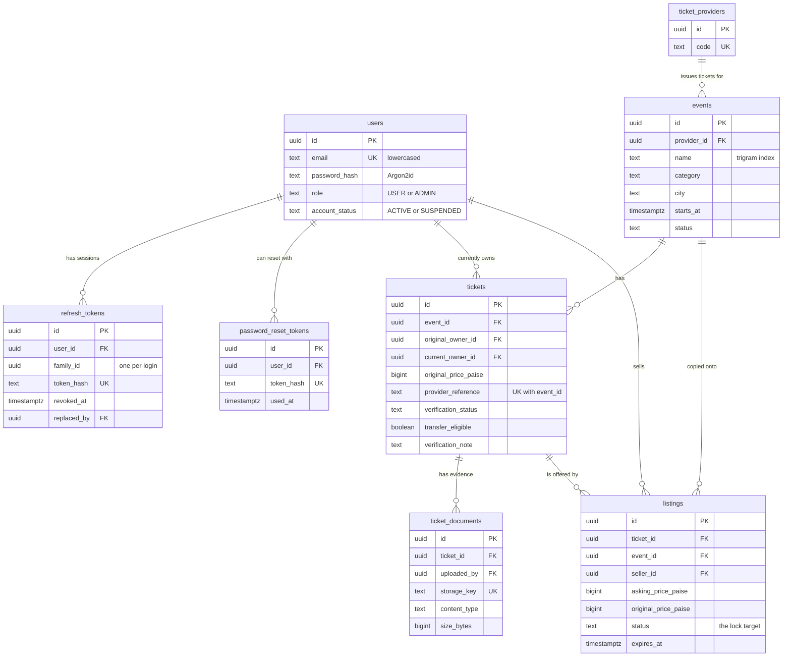
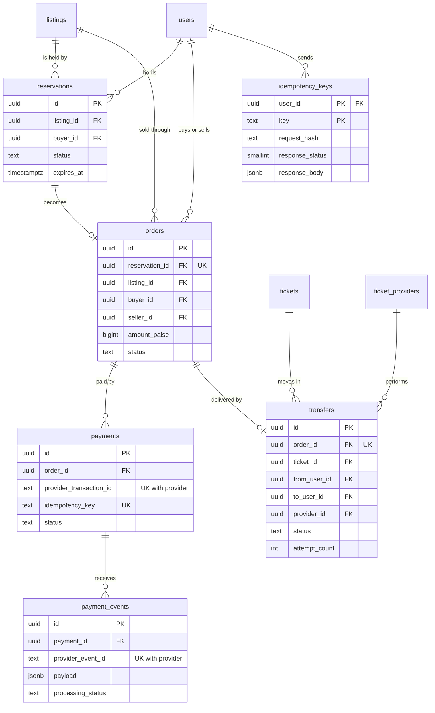
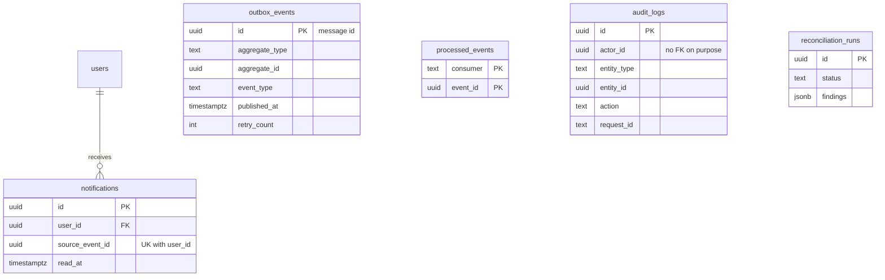

# Database design

PostgreSQL 17 is the single source of truth for inventory and money. This document explains the schema; the exact DDL is [`schema-draft.sql`](schema-draft.sql), which loads cleanly into Postgres 17, and [`schema-checks.sql`](schema-checks.sql) proves the key constraints reject bad data.

The draft is the target. From M2, each module's Alembic migration builds its own tables from it: M3 builds identity, M4 the catalogue, and so on. On 23 Nov 2026 the roadmap was slimmed: `interests`, `refunds`, `disputes`, `dispute_events` and `dispute_evidence` will never be built and are gone from the draft.

**Built so far (M7):** the M2 migration created `users`, `ticket_providers`, `events`, `tickets`, `listings` and `audit_logs`; M3 added `refresh_tokens` and `password_reset_tokens`; M4 added `ticket_documents`, the column `tickets.verification_note`, and one seeded row in `ticket_providers` (`fakeprovider`, FakeProvider) so an admin can create events on a fresh database. Its downgrade removes that row only if no event uses it. M5 added no tables: its migration added five indexes (four on `listings`, one on `audit_logs`, marked below), and M5 is the first module to write `listings` and `audit_logs` rows. M6 added no tables: its migration created the `pg_trgm` extension and seven indexes, measured in [`discovery-performance.md`](discovery-performance.md). M7 added `reservations` and its three indexes.

## Conventions

| Topic | Rule | Why |
| --- | --- | --- |
| Primary keys | `UUID DEFAULT gen_random_uuid()` | IDs appear in URLs; sequential integers would let anyone count your orders or guess the next one. |
| Time | `TIMESTAMPTZ`, UTC | `TIMESTAMP` without a zone silently drops the offset. Every comparison like `expires_at < now()` must be unambiguous. |
| Money | `BIGINT` paise, columns end in `_paise` | Floats cannot represent 0.1 exactly; integers have no rounding at all. `BIGINT` because `INT` tops out at ₹2.1 crore. |
| Statuses | `TEXT` plus a `CHECK (status IN (...))` | A Postgres `ENUM` needs `ALTER TYPE` to add a value, which is awkward in Alembic. A CHECK is one constraint swap. |
| Deletes | No hard deletes; foreign keys keep the default `RESTRICT` | Orders, payments and audit rows must outlive everything they point at. Users are suspended, not deleted. |
| `updated_at` | Set by the application on every write | One rule in one place (the SQLAlchemy model), rather than a trigger per table. |
| Names | `uq_` unique, `ix_` index, `ck_` check, `pk_` primary key | Constraint names appear in error messages; a readable name tells you which rule fired. |

## Entity-relationship diagrams

The schema has 24 tables, too many for one readable diagram, so here are three views. Every foreign key is drawn. `UK` marks a unique column; partial unique indexes are listed in the next section.

### Identity and catalogue (M3, M4, M5)

### Purchase path (M7 to M9)

### Support: notifications, messaging, audit (M5, M8, M9)

`outbox_events`, `processed_events`, `audit_logs` and `reconciliation_runs` have no foreign keys. They refer to many kinds of rows (an outbox event can be about an order, a listing or a reservation), and an audit insert must never fail because of a foreign key.

## What each table is for

| Table | Purpose | Module |
| --- | --- | --- |
| `users` | Accounts, role and suspension status | M3 |
| `refresh_tokens` | One row per issued refresh token, hashed. `family_id` ties together every token descended from one login, so reuse of a revoked token can revoke them all. | M3 |
| `password_reset_tokens` | Single-use, hashed, 30-minute reset tokens | M3 |
| `ticket_providers` | Who can transfer a ticket for an event. One fake provider, `fakeprovider`, seeded by the M4 migration. | M4 (built) |
| `events` | What people go to. Admin-managed. | M4 (built) |
| `tickets` | One entitlement to attend. `current_owner_id` changes only when a transfer completes. `verification_note` holds the admin's reason for a decision. | M4 (built) |
| `ticket_documents` | Pointers to private evidence files in object storage: a random `storage_key` (`ticket-documents/<32 hex>`), the type read from the file's first bytes, and its size. The file name is never stored. At most 5 per ticket, enforced by the service. | M4 (built) |
| `listings` | One ticket offered at one fixed price. Its row is the lock that decides who gets the ticket. | M5 (built) |
| `reservations` | A 10-minute hold on a listing for one buyer | M7 (built) |
| `orders` | One purchase attempt, created from a reservation | M8 (built) |
| `idempotency_keys` | The stored response for each `Idempotency-Key`, so a retried request is answered from here instead of done twice | M8 (built) |
| `payments` | One attempt to collect money for one order | M8 (built) |
| `payment_events` | Every verified webhook, kept forever. Its unique key is the webhook dedupe. | M8 (built) |
| `reconciliation_runs` | One row per reconciliation job: what it checked and what it fixed | M8 (built) |
| `outbox_events` | Events written in the same transaction as the change, waiting to be published to RabbitMQ. `headers` carries trace context from M11. | M9 |
| `processed_events` | Which consumer has already handled which event, so redelivery is harmless | M9 |
| `transfers` | Handing the ticket to the buyer through the provider adapter | M9 |
| `notifications` | In-app messages, read through the API | M9 |
| `audit_logs` | Append-only record of every important state change and admin action. Written only through `app/modules/audit/service.record()`, which stamps `created_at` with `clock_timestamp()` so rows from one transaction keep their order. | M5 (built) |

## Business rules enforced by the database

Application code checks every rule first, to give a helpful error. The database enforces the critical ones again, because application code has bugs and two requests can pass the same check at the same moment.

| Rule | Constraint |
| --- | --- |
| One account per email | `uq_users_email` + `ck_users_email_lowercase` (so `A@x.in` and `a@x.in` cannot both exist) |
| A token hash is stored once; a rotated refresh token is always revoked | `uq_refresh_tokens_token_hash`, `uq_password_reset_tokens_token_hash`, `ck_refresh_tokens_replaced_means_revoked` |
| One real ticket is registered once | `uq_tickets_event_provider_reference` |
| At most one open listing per ticket (FR-04 rule 2) | partial unique index `uq_listings_one_open_per_ticket` on `ticket_id` `WHERE status IN ('DRAFT','PENDING_VERIFICATION','ACTIVE','RESERVED')` |
| No markup, minimum ₹1 (FR-04 rule 6) | `ck_listings_price_cap`, `ck_listings_min_price` |
| A rejection always has a reason | `ck_listings_rejection_reason` |
| One live reservation per listing (FR-07) | partial unique `uq_reservations_one_live_per_listing` `WHERE status IN ('CREATED','PAYMENT_PENDING','CONFIRMED')` |
| One order per reservation (FR-08) | `uq_orders_reservation` |
| A seller cannot buy their own listing (FR-04 rule 4) | `ck_orders_not_own_listing` |
| One live payment per order (FR-09 rule 4) | partial unique `uq_payments_one_live_per_order` |
| A gateway transaction maps to one payment | `uq_payments_provider_transaction` |
| A webhook event is applied once (FR-09 rule 3) | `uq_payment_events_provider_event` |
| One transfer per order | `uq_transfers_order` |
| An event is consumed once per consumer | `pk_processed_events (consumer, event_id)` |
| One notification per event per user | `uq_notifications_event_user` |
| Audit history cannot be edited | `forbid_update_delete()` trigger on `audit_logs` |
| Only known statuses | a `ck_<table>_status` CHECK on every status column |

**Partial unique index.** A normal unique index on `listings(ticket_id)` would let a ticket be listed only once, ever, even after the listing was cancelled. A partial index only covers rows that match its `WHERE` clause, so uniqueness applies to open listings only and closed ones are ignored.

## Indexes and the queries they serve

Every index costs write time and disk space, so each one names its query. M6 checked the discovery ones with `EXPLAIN ANALYZE` on 100,000 listings ([results](discovery-performance.md)); every search index is used by at least one plan. Two serve lists outside that report: `ix_tickets_owner` and the M5 ones.

| Index | Query it serves |
| --- | --- |
| `ix_listings_event (event_id)`, **built in M5** | the event-cancel cascade and the expiry pull-back. Postgres does not index foreign keys on its own. M6 measured `GET /events/{id}/listings` on it at about 0.25 ms, so it was not widened to `(event_id, status)`. |
| `ix_listings_seller (seller_id, created_at, id)`, **built in M5** | `GET /listings/me`, newest first. Built in place of the draft's `(seller_id, status)`: the list is sorted by time, and one seller's rows are few enough to filter by status. |
| `ix_listings_active_by_price (asking_price_paise, id) WHERE status = 'ACTIVE'`, **built in M6** | search sorted by price, keyset cursor on `(price, id)` |
| `ix_listings_active_by_created (created_at, id) WHERE status = 'ACTIVE'`, **built in M6** | search sorted by newest |
| `ix_listings_active_expiry (expires_at) WHERE status = 'ACTIVE'`, **built in M5** | `scripts/expire_listings.py` |
| `ix_listings_review_queue (created_at, id) WHERE status = 'PENDING_VERIFICATION'`, **built in M5** | `GET /admin/listings/pending`, oldest first |
| `ix_events_name_trgm` (GIN, trigram), **built in M6** | `WHERE name ILIKE '%coldplay%'`, which a B-tree cannot serve |
| `ix_events_status_starts (status, starts_at, id)`, **built in M6** | `GET /events`, published events soonest first, keyset on `(starts_at, id)` |
| `ix_tickets_owner (current_owner_id, created_at, id)`, **built in M6** | `GET /tickets/me`, newest first |
| `ix_events_city (lower(city))`, **built in M6** | search by city. Without it, a city nobody sells in made the sort index walk every active listing (57 ms on 100,000 listings). |
| `ix_tickets_category (lower(ticket_category))`, **built in M6** | search by ticket category. Without it, a category nobody sells made the sort index walk every active listing (over 100 ms on 100,000 listings). |
| `ix_reservations_due (expires_at) WHERE status IN ('CREATED','PAYMENT_PENDING')`, **built in M7** | the expiry worker |
| `ix_reservations_buyer (buyer_id, created_at, id)`, **built in M7** | `GET /reservations/me`. Built in place of the draft's `(listing_id, status)`, which no query needs: a listing's live reservation is found through the unique index. |
| `ix_orders_buyer (buyer_id, created_at, id)` | `GET /orders/me` with keyset pagination |
| `ix_payments_unresolved (created_at) WHERE status IN ('CREATED','PENDING')` | reconciliation |
| `ix_outbox_unpublished (created_at) WHERE published_at IS NULL` | the outbox relay. Partial, so it stays tiny no matter how many events were already published. |
| `ix_audit_logs_entity (entity_type, entity_id, created_at)`, **built in M5** | `GET /listings/{id}/history`; later the history of one order |

Composite index column order matters: an index on `(a, b)` helps `WHERE a = ?` and `WHERE a = ? ORDER BY b`, but not `WHERE b = ?` alone. Think of a phone book sorted by surname, then first name.

## Decision: the listing row is the lock target

`plan.md` section 9.1 reserves by updating `tickets.status`, but a listing also has a status, and two status columns that both mean "reserved" can disagree. We pick **one** row to decide who wins:

- Reserving moves one `listings` row from `ACTIVE` to `RESERVED` with a conditional `UPDATE ... WHERE status = 'ACTIVE'`.
- The ticket row is not touched during reservation, order or payment. It changes once, when the transfer completes (`current_owner_id` becomes the buyer).
- So `tickets.status` only means "this ticket is valid" (`ACTIVE`) or "void" (`VOID`). It is not inventory state.

## Changes from `plan.md` section 8

| Change | Reason |
| --- | --- |
| `listings.event_id` added | The index `listings(event_id, status)` in `plan.md` needs it, and discovery avoids a join. Safe to copy because a ticket never changes event. |
| `listings.original_price_paise` added | FR-04 lists it; the price-cap CHECK needs both prices in one row. |
| No `listings.verification_status` column | FR-04 lists it, but it would duplicate `status`: `PENDING_VERIFICATION` and `REJECTED` already say it. Two columns for one fact can disagree. `reviewed_by`, `reviewed_at` and `rejection_reason` hold the details. |
| `orders.listing_id` added; `orders.reservation_id` made UNIQUE | FR-08 lists `listing_id`; the unique constraint is the second layer against duplicate orders. |
| `payments.idempotency_key`, `provider_response`, `provider`, `failure_reason` added | FR-09 lists the first two. `provider` makes adding Razorpay a data change, not a schema change. |
| `tickets.current_owner_id`, `purchase_reference`, `verified_by`, `verified_at` added; `UNIQUE (event_id, provider_reference)` | A resale changes the owner; FR-03 lists the purchase reference; the unique key stops one real ticket being sold twice. |
| `reservations.status` gains `CANCELLED` | Buyers can cancel a `CREATED` reservation (M7). |
| `events.event_date` became `starts_at TIMESTAMPTZ`; `organizer_id` became `organizer TEXT`; `provider_id` references `ticket_providers` | Concerts have start times, not just dates. Organizers have no accounts or behaviour, so a text field is enough. Providers do have behaviour (they perform transfers). |
| `audit_logs.metadata` renamed `details`; `request_id` added | SQLAlchemy's declarative base reserves the attribute name `metadata`. `request_id` links an audit row to that request's log lines. |
| `outbox_events.next_attempt_at`, `last_error` added | The relay backs off after a failed publish instead of hammering a dead broker. |
| `notifications.source_event_id` added | One event produces one notification per user, even if delivered twice. |
| Money columns renamed `*_paise BIGINT` | The unit is in the name, so nobody stores rupees by mistake. |
| New tables: `refresh_tokens`, `password_reset_tokens`, `ticket_providers`, `ticket_documents`, `idempotency_keys`, `reconciliation_runs`, `processed_events` | The features in FR-01, FR-03, FR-08, FR-09 and section 9 need them. |
