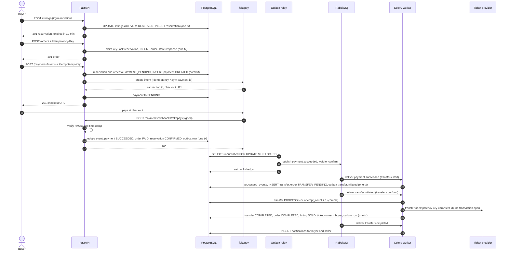

# The purchase flow

M0's checkpoint: draw this from memory, including what every table holds at each step. Study the diagram, close the file, redraw it on paper, then compare.

## Sequence

## What every table holds, step by step

Starting point: the seller's ticket is `VERIFIED`, and their listing was approved, so it is `ACTIVE`.

| Step | `listings` | `reservations` | `orders` | `payments` | `transfers` | ticket owner | Other rows written |
| --- | --- | --- | --- | --- | --- | --- | --- |
| 0 · Listing approved | `ACTIVE` | — | — | — | — | seller | audit `listing.approved`; outbox `listing.approved` |
| 1 · Buyer reserves | `RESERVED` | `CREATED`, `expires_at = now + 10 min` | — | — | — | seller | audit; outbox `reservation.created` |
| 2 · Buyer creates order | `RESERVED` | `CREATED` | `CREATED`, amount copied from listing | — | — | seller | `idempotency_keys` row with stored 201 body; audit |
| 3 · Buyer starts payment | `RESERVED` | `PAYMENT_PENDING` | `PAYMENT_PENDING` | `CREATED`, then `PENDING` with `provider_transaction_id` | — | seller | `idempotency_keys` row; audit |
| 4 · Webhook: paid | `RESERVED` | `CONFIRMED` | `PAID` | `SUCCEEDED` | — | seller | `payment_events` row `PROCESSED`; outbox `payment.succeeded`; audit |
| 5 · Relay publishes | unchanged | unchanged | unchanged | unchanged | — | seller | that outbox row gets `published_at` |
| 6 · Worker starts transfer | `RESERVED` | `CONFIRMED` | `TRANSFER_PENDING` | `SUCCEEDED` | `INITIATED`, then `PROCESSING` | seller | `processed_events ('transfers.start', event id)` |
| 7 · Provider confirms | `SOLD` | `CONFIRMED` | `COMPLETED` | `SUCCEEDED` | `COMPLETED` | **buyer** | outbox `transfer.completed`; audit; other interests `REJECTED` |
| 8 · Notifications | unchanged | unchanged | unchanged | unchanged | unchanged | buyer | two `notifications` rows; `processed_events` row |

Three things to notice:

- The listing stays `RESERVED` from step 1 to step 7. That one row is what keeps everyone else out the whole time.
- The ticket row changes **once**, at step 7. Until the provider confirms, the seller still owns it.
- Every step that leaves the API process (steps 5, 6 and 8) starts from an outbox row written in the same transaction as the change it announces.

## Where each failure leads

| Failure | At step | Ends as |
| --- | --- | --- |
| Someone else reserved first | 1 | 409; nothing written |
| Buyer never creates an order or never pays within 10 minutes | 1 to 2 | Reservation `EXPIRED`, order (if any) `CANCELLED`, listing back to `ACTIVE` |
| Buyer cancels the reservation | 1 to 2 | Reservation `CANCELLED`, listing `ACTIVE` |
| Gateway reports failure | 4 | Payment `FAILED`, order `PAYMENT_FAILED`, reservation `FAILED`, listing `ACTIVE` |
| Webhook never arrives | 4 | Reconciliation asks the gateway and applies step 4 or the failure above |
| Buyer abandons checkout | 3 to 4 | After `expires_at + 15 min`, the gateway confirms unpaid: payment `FAILED`, order `CANCELLED`, reservation `EXPIRED`, listing `ACTIVE` |
| RabbitMQ down | 5 | Outbox rows wait; published when it returns |
| Worker crashes | 6 or 8 | Message redelivered; `processed_events` stops double work |
| Provider fails repeatedly | 6 to 7 | Transfer `REQUIRES_MANUAL_REVIEW`, order `TRANSFER_FAILED`; both end there, since admin retry and refunds are cut |
