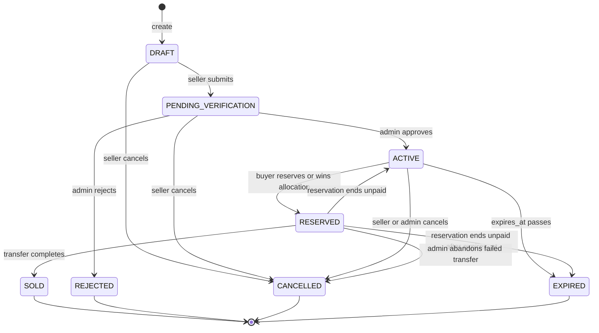
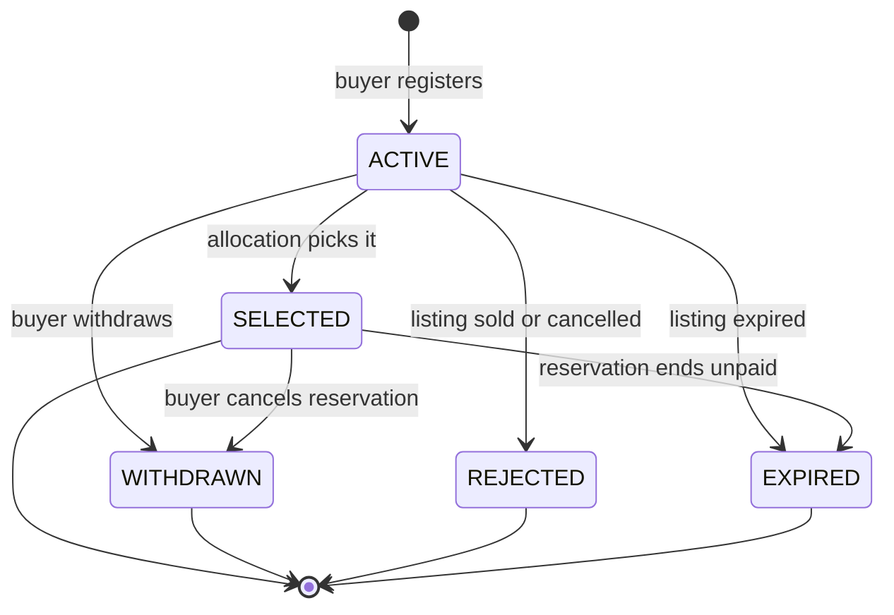
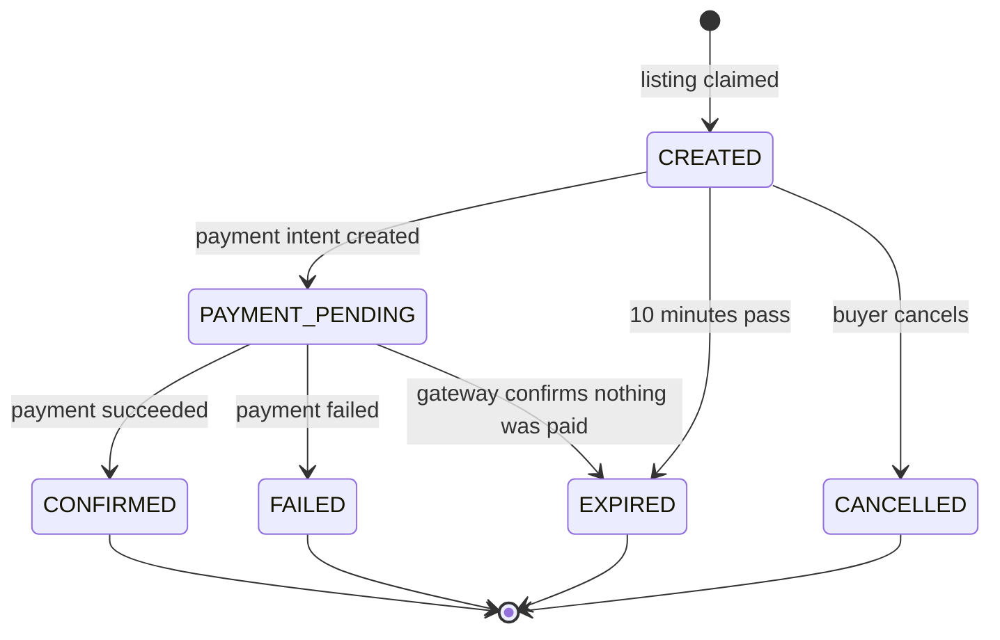
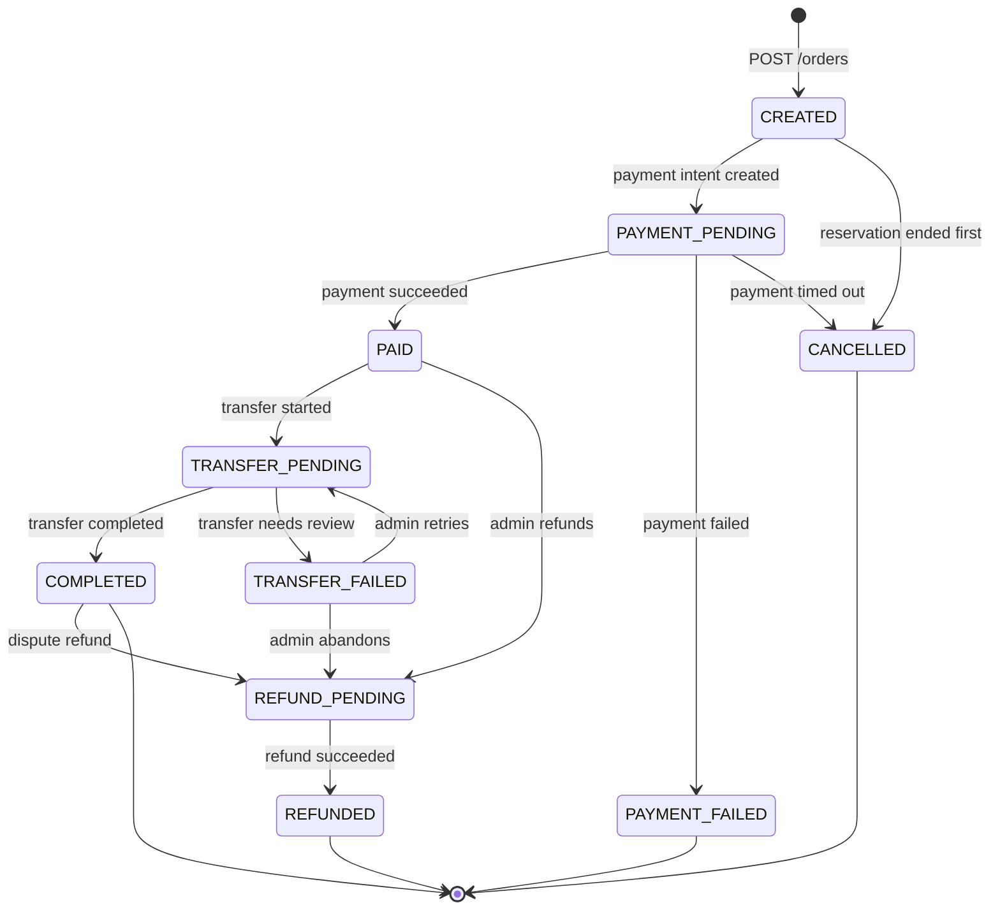
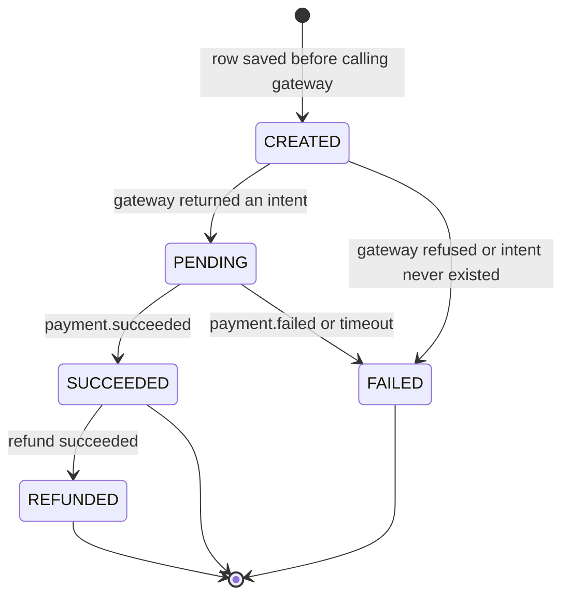
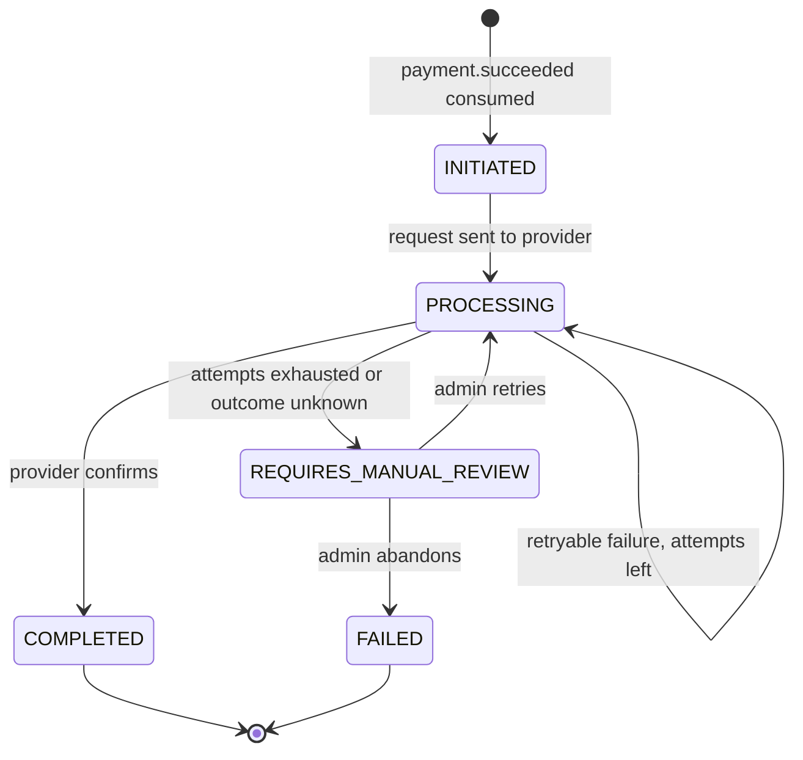

# State machines

Every entity with a lifecycle changes status only through its state machine. A status is never set directly from request data (no `PATCH {"status": "SOLD"}`).

## How a transition is applied

Every module uses the same three-layer pattern, first built for listings in M5:

```python
ALLOWED: dict[str, set[str]] = {
    "DRAFT": {"PENDING_VERIFICATION", "CANCELLED"},
    "PENDING_VERIFICATION": {"ACTIVE", "REJECTED", "CANCELLED"},
    # ...
}


def transition(session, listing_id, from_status, to_status, actor_id):
    # 1. Is this move legal at all?
    if to_status not in ALLOWED.get(from_status, set()):
        raise IllegalTransition(from_status, to_status)  # becomes HTTP 409

    # 2. Is the row still in from_status right now? The check lives inside the UPDATE,
    #    so no other request can change the row between our check and our write.
    row = session.execute(
        update(Listing)
        .where(Listing.id == listing_id, Listing.status == from_status)
        .values(status=to_status, updated_at=func.now())
        .returning(Listing.id)
    ).first()
    if row is None:
        raise ConflictError("The listing changed while you were acting on it.")  # 409

    # 3. Record it in the same transaction: both commit, or neither does.
    audit.record(
        session,
        actor_id,
        "listing",
        listing_id,
        f"listing.{to_status.lower()}",
        {"from": from_status, "to": to_status},
    )
```

The `CHECK` constraint on the status column is the last layer: even a buggy raw SQL statement cannot write a status that does not exist.

Reading the status in Python and then writing it is a race: two requests can both read `ACTIVE`, both decide they may proceed, and both write. Putting `status = :from` in the `WHERE` clause makes the database decide, because a row can only be updated by one transaction at a time.

In the tables below, **Who** is the actor recorded in the audit row. "System" means a worker or scheduled job, recorded as `actor_id = NULL`.

## Listing (M5, M8, M12)



| From | To | Trigger | Who | Guard and side effects (same transaction) |
| --- | --- | --- | --- | --- |
| — | DRAFT | `POST /listings` | seller | Ticket is the caller's, `VERIFIED`, transfer-eligible and `ACTIVE`; no other open listing (partial unique index); price within cap. Copies `event_id` and `original_price_paise` from the ticket. |
| DRAFT | PENDING_VERIFICATION | `POST /listings/{id}/submit` | seller | Ticket still verified and eligible. |
| DRAFT | CANCELLED | `DELETE /listings/{id}` | seller | — |
| PENDING_VERIFICATION | ACTIVE | `POST /admin/listings/{id}/approve` | admin | `expires_at` in the future. Sets `reviewed_by`, `reviewed_at`. Outbox `listing.approved` (notifies the seller). |
| PENDING_VERIFICATION | REJECTED | `POST /admin/listings/{id}/reject` | admin | Reason required (`ck_listings_rejection_reason`). Outbox `listing.rejected`. |
| PENDING_VERIFICATION | CANCELLED | `DELETE /listings/{id}` | seller | — |
| ACTIVE | RESERVED | `POST /listings/{id}/reservations` or allocation | buyer or seller | The conditional UPDATE: `status = 'ACTIVE' AND seller_id <> :buyer AND expires_at > now()`. Inserts the reservation. |
| ACTIVE | CANCELLED | `DELETE /listings/{id}` | seller or admin | Live interests become `REJECTED`. Outbox `listing.cancelled`. |
| ACTIVE | EXPIRED | listing expiry job | system | `expires_at <= now()`. Live interests become `EXPIRED`. |
| RESERVED | ACTIVE | its reservation becomes `EXPIRED`, `CANCELLED` or `FAILED` | system or buyer | Only inside the reservation's own transition, never on its own. Only if `expires_at > now()`. |
| RESERVED | EXPIRED | same as above | system or buyer | The listing's own `expires_at` passed while it was held. |
| RESERVED | SOLD | transfer `COMPLETED` | system | Same transaction as transfer `COMPLETED`, order `COMPLETED` and the ticket's `current_owner_id` change. Remaining interests become `REJECTED`. |
| RESERVED | CANCELLED | `POST /admin/transfers/{id}/abandon` | admin | The transfer failed for good; a refund starts in the same transaction. |

Not a transition, but a rule: `PATCH /listings/{id}` may change the price in `DRAFT`, `PENDING_VERIFICATION` and `ACTIVE`. In `ACTIVE` the price may only go down, so nobody who registered interest sees it rise.

A seller cannot cancel a `RESERVED` listing (FR-04 rule 5): a buyer may be paying or a transfer may be running.

## Interest (M7)



| From | To | Trigger | Who | Guard and side effects |
| --- | --- | --- | --- | --- |
| — | ACTIVE | `POST /listings/{id}/interests` | buyer | Listing `ACTIVE`; buyer is not the seller; no live interest already (partial unique index, violation becomes 409). |
| ACTIVE | SELECTED | `POST /listings/{id}/allocations` | seller | Same transaction as listing `ACTIVE → RESERVED` and the reservation insert. Strategy, candidates and choice go in the audit row. |
| ACTIVE | WITHDRAWN | `DELETE /interests/{id}` | buyer | Owner only. |
| ACTIVE | REJECTED | listing becomes `SOLD` or `CANCELLED` | system | One bulk UPDATE in the listing's transaction. |
| ACTIVE | EXPIRED | listing becomes `EXPIRED` | system | Same. |
| SELECTED | EXPIRED | its reservation becomes `EXPIRED` or `FAILED` | system | The buyer had their chance. The other `ACTIVE` interests stay as fallbacks, so the seller can allocate again. |
| SELECTED | WITHDRAWN | `POST /reservations/{id}/cancel` | buyer | — |

A `SELECTED` interest whose purchase completes simply stays `SELECTED`: it won.

## Reservation (M8, M10)



| From | To | Trigger | Who | Guard and side effects (same transaction) |
| --- | --- | --- | --- | --- |
| — | CREATED | reserve (direct or allocation) | buyer or seller | Listing `ACTIVE → RESERVED` succeeded. `expires_at = now() + 10 min`. |
| CREATED | PAYMENT_PENDING | `POST /payments/intents` | buyer | `expires_at > now()`. Order `CREATED → PAYMENT_PENDING`; payment row inserted as `CREATED`. The gateway is called only after this commits. |
| CREATED | EXPIRED | expiry worker | system | `expires_at <= now()`. Listing back to `ACTIVE` (or `EXPIRED`); order, if any, `CREATED → CANCELLED`; interest `SELECTED → EXPIRED`. Outbox `reservation.expired`. |
| CREATED | CANCELLED | `POST /reservations/{id}/cancel` | buyer | Listing back to `ACTIVE`; order, if any, `→ CANCELLED`; interest `→ WITHDRAWN`. |
| PAYMENT_PENDING | CONFIRMED | `payment.succeeded` webhook or reconciliation | system | Payment `→ SUCCEEDED`, order `→ PAID`, outbox `payment.succeeded`. |
| PAYMENT_PENDING | FAILED | `payment.failed` webhook or reconciliation | system | Payment `→ FAILED`, order `→ PAYMENT_FAILED`, listing back to `ACTIVE`, interest `→ EXPIRED`. |
| PAYMENT_PENDING | EXPIRED | expiry worker, after asking the gateway | system | Only when `expires_at + 15 min grace <= now()` **and** the gateway says the intent was never paid. Payment `→ FAILED` (reason `timeout`), order `→ CANCELLED`, listing back to `ACTIVE`. If the gateway says paid, apply success instead. If the gateway cannot be reached, do nothing and try later. |

The rule from FR-07: the expiry worker's normal scan touches **only** `CREATED`. A `PAYMENT_PENDING` reservation means money may be moving; it is resolved by asking the gateway, never by the clock alone. See hard problem 5 in [`hard-problems.md`](hard-problems.md).

## Order (M9, M10, M12, M13)



| From | To | Trigger | Who | Guard and side effects |
| --- | --- | --- | --- | --- |
| — | CREATED | `POST /orders` with `Idempotency-Key` | buyer | Reservation is the buyer's, `CREATED`, unexpired. Amount copied from the listing. One per reservation (`uq_orders_reservation`). |
| CREATED | PAYMENT_PENDING | `POST /payments/intents` | buyer | With reservation `→ PAYMENT_PENDING`. |
| CREATED | CANCELLED | reservation `EXPIRED` or `CANCELLED` | system or buyer | Inside the reservation's transition. |
| PAYMENT_PENDING | PAID | payment succeeded | system | With reservation `→ CONFIRMED`. |
| PAYMENT_PENDING | PAYMENT_FAILED | payment failed | system | With reservation `→ FAILED`. |
| PAYMENT_PENDING | CANCELLED | payment timeout confirmed by the gateway | system | With reservation `→ EXPIRED`. |
| PAID | TRANSFER_PENDING | `payment.succeeded` consumer creates the transfer | system | One transfer per order (`uq_transfers_order`). |
| PAID | REFUND_PENDING | `POST /admin/orders/{id}/refund` | admin | Only before a transfer exists. Creates a refund row. |
| TRANSFER_PENDING | COMPLETED | transfer `COMPLETED` | system | With listing `→ SOLD` and the ticket owner change. |
| TRANSFER_PENDING | TRANSFER_FAILED | transfer `→ REQUIRES_MANUAL_REVIEW` | system | Notifies buyer, seller and admins. |
| TRANSFER_FAILED | TRANSFER_PENDING | `POST /admin/transfers/{id}/retry` | admin | — |
| TRANSFER_FAILED | REFUND_PENDING | `POST /admin/transfers/{id}/abandon` | admin | With listing `→ CANCELLED`, transfer `→ FAILED`, refund created. |
| COMPLETED | REFUND_PENDING | `POST /admin/disputes/{id}/resolve` with refund | admin | — |
| REFUND_PENDING | REFUNDED | refund succeeded (webhook or reconciliation) | system | With payment `→ REFUNDED`. |

**Why `PAID` is not `COMPLETED` (FR-10):** the buyer paid for a ticket, not for a payment. Until the provider confirms the ticket is in the buyer's name, the platform still owes them something.

If a refund fails, the order stays `REFUND_PENDING`, the refund row becomes `FAILED`, and an admin starts a new refund. Paying sellers out is outside this project's scope.

## Payment (M10)



| From | To | Trigger | Who | Guard and side effects |
| --- | --- | --- | --- | --- |
| — | CREATED | `POST /payments/intents` | buyer | Saved and committed **before** the gateway call, with `idempotency_key = id`. |
| CREATED | PENDING | gateway response | system | Sets `provider_transaction_id`. If we crash first, reconciliation repeats the call with the same idempotency key and the gateway returns the same intent. |
| CREATED | FAILED | gateway refusal, or reconciliation finds no intent | system | Order `→ PAYMENT_FAILED`, reservation `→ FAILED`. |
| PENDING | SUCCEEDED | webhook or reconciliation | system | Amount and currency must equal the order's. Order `→ PAID`, reservation `→ CONFIRMED`. |
| PENDING | FAILED | webhook, gateway timeout, or reconciliation | system | Order `→ PAYMENT_FAILED` or `→ CANCELLED` (timeout). |
| SUCCEEDED | REFUNDED | refund `SUCCEEDED` | system | Order `→ REFUNDED`. |

Every webhook, applied or not, stays in `payment_events`. `provider_response` holds only the latest snapshot. This is how FR-09's "never silently overwritten" holds.

## Transfer (M12)



| From | To | Trigger | Who | Guard and side effects |
| --- | --- | --- | --- | --- |
| — | INITIATED | `payment.succeeded` consumer | system | `uq_transfers_order` makes a duplicate event harmless. Order `PAID → TRANSFER_PENDING`. |
| INITIATED | PROCESSING | worker calls the provider | system | `attempt_count + 1`. The transfer id is sent as the provider's idempotency key. |
| PROCESSING | PROCESSING | retryable error and `attempt_count < 5` | system | Celery retry with exponential backoff and jitter. |
| PROCESSING | COMPLETED | provider success callback | system | One transaction: transfer `COMPLETED`, order `COMPLETED`, listing `SOLD`, ticket `current_owner_id = to_user_id`, outbox `transfer.completed`. |
| PROCESSING | REQUIRES_MANUAL_REVIEW | attempts exhausted, a permanent error, or a timeout with unknown outcome | system | Order `→ TRANSFER_FAILED`. An unknown outcome is never retried blindly: the provider may have done it. |
| REQUIRES_MANUAL_REVIEW | PROCESSING | `POST /admin/transfers/{id}/retry` | admin | Order `→ TRANSFER_PENDING`. |
| REQUIRES_MANUAL_REVIEW | FAILED | `POST /admin/transfers/{id}/abandon` | admin | Order `→ REFUND_PENDING`, refund created, listing `→ CANCELLED`. |

A refund after a failed transfer is a **compensation**, not a rollback: the payment really happened and stays in the history; a second, opposite operation undoes its effect.

## Smaller lifecycles

| Entity | Transitions |
| --- | --- |
| Ticket verification (M4) | `PENDING → VERIFIED` or `PENDING → REJECTED`, by an admin. A ticket's `status` goes `ACTIVE → VOID` if an admin voids it; its open listing is cancelled in the same transaction. |
| Event (M4) | `DRAFT → PUBLISHED → COMPLETED`; `DRAFT` or `PUBLISHED → CANCELLED`. Cancelling an event with open listings or paid orders is out of scope for v1 and is rejected with 409. |
| Refund (M10) | `REQUESTED → PENDING` (gateway accepted) `→ SUCCEEDED` or `FAILED`. Deduplicated like payments. |
| Dispute (M13) | `OPEN → UNDER_REVIEW → RESOLVED_REFUND`, `RESOLVED_RELEASE` or `REJECTED`; `OPEN → REJECTED` directly for obvious abuse. Every change also writes a `dispute_events` row. |
