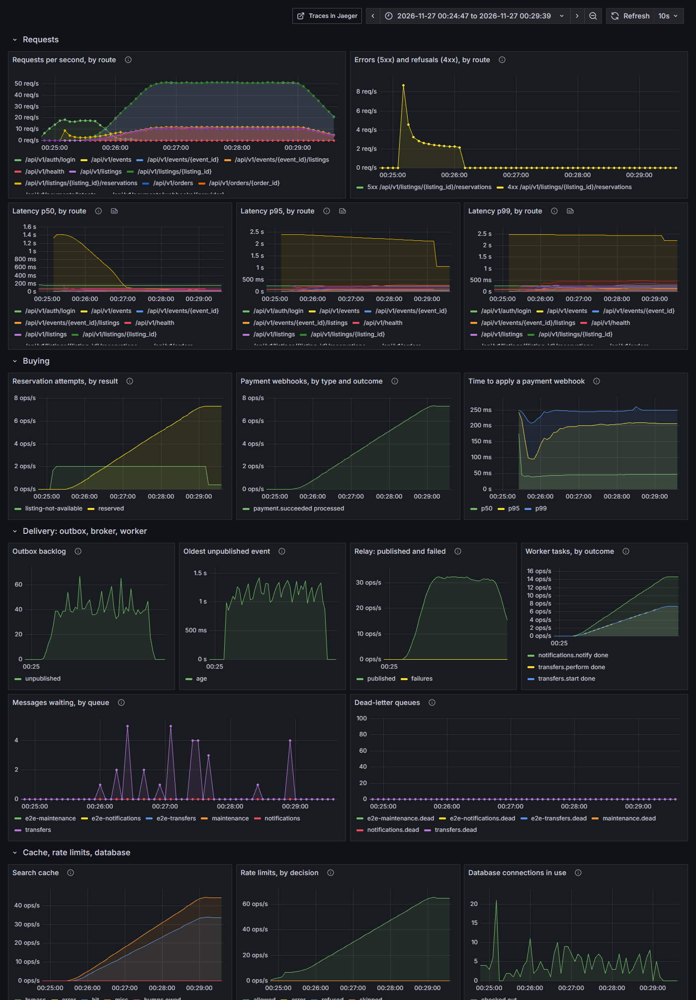
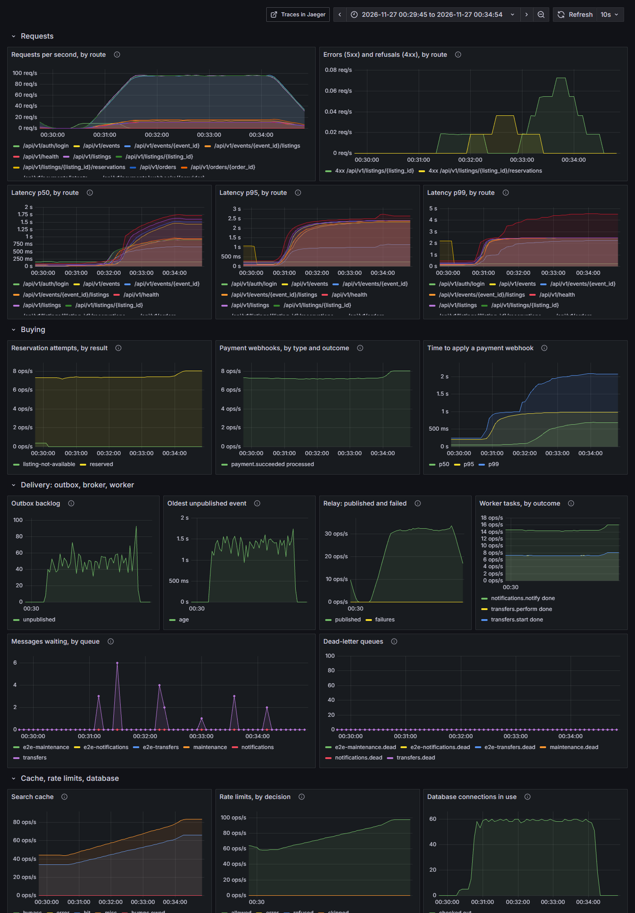
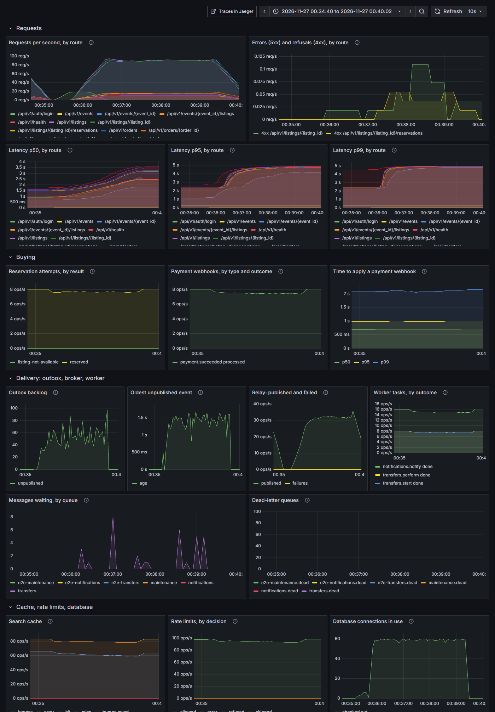
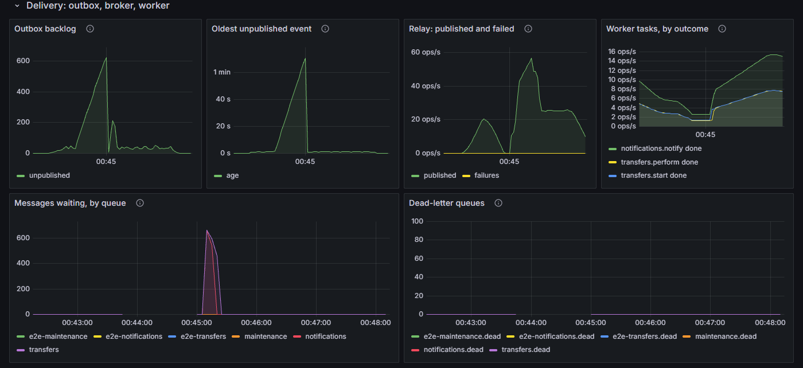

# Load and contention test results (M12)

What happened when I ran [`test-plan.md`](test-plan.md), on 26 November 2026 between 18:37 and 19:30 UTC. Each run's k6 summary and its `docker stats`/Prometheus numbers are in [`tests/load/results/`](../tests/load/results/). Each section below follows the plan's: what I expected, what came out, and why every miss happened.

## In one table

| Test | Result | What decides it |
| --- | --- | --- |
| Invariants | **Pass** | 0 rows after every one of the eight runs |
| Spike, first run | **Failed, fixed** | 131 5xx and 688 timeouts from a thread/connection deadlock; correctness held (1 reserved) |
| Spike, after the fix | **Pass** | 1 reserved, 999 refused with 409, 0 5xx, 1 live hold in Postgres |
| Load, 100 users | **Pass** | reads p95 62 ms, reservations p95 106 ms, 195 req/s, 0 failed |
| Load, 500 users | **Latency missed**, correctness held | 327 req/s; reads p95 1,340 ms, reservations p95 1,649 ms |
| Load, 1,000 users | **Latency missed** (expected), correctness held | 307 req/s; reads p95 3,023 ms, reservations p95 3,315 ms |
| Load, 500 users on 8 API containers | Explains the miss | 469 req/s; reads p95 862 ms |
| Real limits | **Pass** | 119 searches allowed (the bucket allows 120 a minute), 104,913 × 429 with `Retry-After`, 0 5xx |
| Broker drill | **Pass** | backlog 621 while RabbitMQ was down; caught up 30 s after it came back; every order `COMPLETED` |
| Races, 100 rounds | **Pass** | reservation race 110/110 in 90 s; paid-never-released and against-the-clock 2/2 in 27 s |

**In short.** Correctness never moved: no oversell, no double hold, no paid order lost, through a deadlock, a broker outage and 1,000 users. Latency holds NFR-03's targets at 100 users and misses them from 500. The reason is measured, not guessed: each API process tops out at about 90 requests a second, so four of them top out at about 350.

## The machine, the data, the configuration

As the plan's table says: a laptop with an Intel Core i5-13450HX (10 cores, 16 threads) and 23.7 GB of RAM, running Windows 11. Docker Desktop on WSL 2 gets all 16 threads and 11.5 GiB, and k6 runs inside the same VM.

| | |
| --- | --- |
| Data | 2,000 events, 100,000 listings from 2,000 sellers, 1,000 buyers (seeded in 9.5 s) |
| API | 4 containers, one uvicorn process each: 40 threads, a pool of 5 + 10 connections, and the admission gate added by the spike fix below |
| Worker | Celery prefork, 8 processes; one relay; one beat |
| Postgres | 17, `max_connections=200` |
| Tracing | 1 trace in 100 |
| Rate limits | Raised for every run except the limits run |

The one addition to the plan is the 8-container run. `uv run python -m scripts.load_test load --vus 500 --apis 8` scales the API for that run only, then puts it back to four.

## 1. The invariants

`scripts/check_invariants.sql` ran after every run: both spikes, the three load runs, the 8-container run, the limits run and the drill. It returned **0 rows each time**. By the end the perf database held 12,315 orders, all `COMPLETED`.

## 2. Spike: 1,000 buyers, one listing, at once

### First run: a deadlock the tests had never reached

| | |
| --- | --- |
| `reserved` | 1 |
| `refused` (409) | 180 |
| `server_errors` (500) | 131 |
| `unexpected` (no answer within k6's 60 s) | 688 |
| live holds on the listing | 1 |
| invariants | 0 rows |

Correctness held: exactly one buyer got the listing. Most of the others got an error or no answer at all.

The cause is how FastAPI runs a sync route. Each sync dependency, the route itself and the response's validation each wait for a thread from anyio's pool of 40. The request's database session takes its connection on its first query and keeps it until `get_db` commits, after the response is built. Then 250 requests arrive at each process at once:
- every thread ends up waiting for one of the 15 connections;
- every connection belongs to a request that is waiting for a thread for its next step.

Nothing moves until the pool's 30-second timeout turns waiting requests into 500s.

The dashboard could not show it either. `/metrics` needs a thread too, so Prometheus's scrapes timed out and the panels have gaps where the deadlock was.

Committing the sign-in lookup early did not fix it. Timing each checkout showed the connection was then held from the listing query through the validation step instead.

**The fix** is [`app/core/admission.py`](../app/core/admission.py). It lets no more requests into a process than it has threads; the rest wait at the door, holding nothing. With that rule, a request always finds a thread for its next step, so whoever holds a connection finishes and gives it back. `/metrics` skips the gate.

`tests/integration/test_burst.py` reproduces the deadlock at small scale (20 requests, 4 threads, 2 connections):
- before the fix it failed after 13 s with 500s;
- after the fix it passes in 0.7 s.

### After the fix

| | |
| --- | --- |
| `reserved` / `refused` / `server_errors` / `unexpected` | 1 / 999 / 0 / 0 |
| live holds on the listing | 1 |
| reservation latency p50 / p95 / max | 1,636 / 2,730 / 2,921 ms |
| peak CPU | API 1,196% across four containers (mostly setup's 1,000 sign-ins), Postgres 107% |

Each answer is short, but 1,000 arrived in the same instant and took their turns. All of them were answered in about 3 s, which is roughly 340 a second, the same ceiling the load runs found.

## 3. Load: 100, 500 and 1,000 users

Each run: 30 s of ramp-up, a 3-minute hold, a 15 s ramp-down. 80% of users browse; 20% buy and pay.

| | 100 users | 500 users | 1,000 users | 500 users, 8 APIs |
| --- | ---: | ---: | ---: | ---: |
| Requests | 44,595 | 78,075 | 77,349 | 111,955 |
| Requests per second | 194.9 | 327.1 | 307.4 | 469.4 |
| Failed | 0.00% | 0.01% | 0.01% | 0.00% |
| Reads p50 / p95 / p99, ms | 14 / **62** / 107 | 845 / **1,340** / 1,577 | 2,388 / **3,023** / 3,281 | 388 / **862** / 1,056 |
| Reservations p50 / p95 / p99, ms | 34 / **106** / 176 | 1,167 / **1,649** / 1,915 | 2,709 / **3,315** / 3,571 | 687 / **1,143** / 1,320 |
| Order p95, ms | 114 | 1,657 | 3,360 | 1,203 |
| Start paying p95, ms | 263 | 2,524 | 4,203 | 2,056 |
| Purchases (paid) | 2,168 | 2,371 | 2,382 | 3,068 |
| Paying to `PAID` p50 / p95, ms | 521 / 577 | 1,831 / 3,306 | 3,553 / 6,579 | 1,438 / 2,428 |
| Orders left unpaid | 0 | 0 | 0 | 0 |
| Thresholds | **pass** | reads and reservations missed | reads and reservations missed | reads and reservations missed |
| Invariants | 0 rows | 0 rows | 0 rows | 0 rows |

"Paying to `PAID`" is measured by polling the order every 0.5 s, so 521 ms means the first or second poll.

From Prometheus, over each run's own window:

| | 100 | 500 | 1,000 | 500, 8 APIs |
| --- | ---: | ---: | ---: | ---: |
| Database connections in use, most | 11 | 60 (all of them) | 60 (all of them) | 116 |
| Search cache hit ratio | 0.43 | 0.44 | 0.43 | 0.46 |
| Outbox backlog, most | 67 | 93 | 97 | 154 |
| Oldest unpublished event, most | 1.4 s | 1.8 s | 1.7 s | 2.1 s |
| Messages waiting, most | 5 | 6 | 8 | 4 |
| API CPU per process during the hold | — | 1.17 cores | — | 0.90 cores |

Peak CPU and memory from `docker stats`, sampled every 3 s, with the API containers added up:

| | 100 | 500 | 1,000 | 500, 8 APIs |
| --- | --- | --- | --- | --- |
| API | 924%, 693 MiB | 1,283%, 845 MiB | 1,184%, 932 MiB | 1,206%, 1,255 MiB |
| Postgres | 79%, 326 MiB | 126%, 604 MiB | 129%, 637 MiB | 294%, 767 MiB |
| RabbitMQ | 428%, 228 MiB | 421%, 225 MiB | 459%, 231 MiB | 345%, 190 MiB |
| Worker | 116%, 676 MiB | 119%, 682 MiB | 142%, 684 MiB | 230%, 691 MiB |
| Redis | 9%, 36 MiB | 12%, 56 MiB | 13%, 53 MiB | 16%, 77 MiB |
| k6 | 28%, 105 MiB | 59%, 553 MiB | 108%, 1,382 MiB | 71%, 576 MiB |

The API's peak is the setup minute: 1,000 sign-ins, where Argon2 hashes on four lanes outside Python's lock and spreads across cores. During the hold, Prometheus shows the steady number in the CPU row above.

### Why 500 and 1,000 users missed

**What I expected.** The plan expected reads to hold at 500 and the laptop to run out of CPU at 1,000.

**What saturated.** Each API process, before the laptop:
- During the 500-user hold, each of the four processes used 1.16 to 1.17 cores, 4.66 in all, for 358 requests a second.
- That is about 13 ms of CPU per request: building the query, reading rows into objects, validating and serializing the response, plus the middleware.
- One Python process runs Python code on one core at a time, so it tops out at a bit over one core: about 90 requests a second.
- Four processes top out at about 350. At 500 and 1,000 users more requests arrived than that, and the rest waited their turn at the admission gate.

**What didn't saturate.**
- Postgres peaked at 126% of one core out of 16.
- Redis peaked at 12%.
- Messages never waited for more than 8 at a time.

**Why the pool was full.** The pool showed all 60 connections in use. That is a symptom: requests hold a connection while they wait for their process's CPU.

**The check.** I reran 500 users on eight containers:
- Throughput rose 43%, to 469 requests a second, and the reads p95 fell from 1,340 to 862 ms.
- Each process now used 0.90 cores, under its own ceiling, at the same 13 to 14 ms per request. So with eight processes the limit is the laptop itself.
- Its 16 threads were shared by eight API processes, Postgres (3 cores), the worker (2.3), k6, and RabbitMQ, whose Erlang schedulers spin while they wait. RabbitMQ read 420 to 460% under load and 11% idle.

**Where the targets hold.** On this laptop, NFR-03's targets hold at 195 requests a second (100 users). They are missed at 327. I didn't search for the exact knee between the two.

**Not done in M12, in the order I'd try them:**
1. Profile where the 13 ms go.
2. Run one API process per spare core, up to the cores there are.
3. Put k6 on its own machine.
4. Stop RabbitMQ's schedulers spinning (`+sbwt none`) on a shared host.

### On the dashboard

The panels show the Grafana dashboard over each run, in India time (UTC+5:30). Most panels average over 5 minutes, so each picture lags its run and still carries the end of the run before it. The tables above come from k6 and from Prometheus over each run's own window.







## 4. The real limits

| | |
| --- | --- |
| Users | 20, searching without a pause from one address for 1 minute |
| `allowed` | 119 |
| `limited` (429 with `Retry-After`) | 104,913 |
| `server_errors` / `unexpected` | 0 / 0 |
| Latency p50 / p95 / p99 | 11.0 / 17.6 / 21.3 ms |
| Requests per second | 1,750 |
| Search cache hit ratio | 0.98 |
| Invariants | 0 rows |

The search limit is a bucket of 60 that refills at one a second, so a minute allows at most 120 searches; 119 got through. Refusals are fast because a refused request never reaches Postgres. The runner then put the raised limits back and waited for all four containers to answer again.

## 5. Broker drill

The drill ran 100 users for 4 minutes. RabbitMQ was stopped at 60 s and started again at 120 s.

| | |
| --- | --- |
| While RabbitMQ was down | the outbox backlog grew to 621 events; the oldest reached 71 s; 549 paid orders waited for their transfer |
| Buyers meanwhile | 0 failed; reads p95 58.7 ms, reservations p95 113.5 ms; paying to `PAID` p95 573 ms, the same as with RabbitMQ up |
| After RabbitMQ answered (19:14:56) | the relay published the backlog within 5 s; the queues peaked at 1,319 waiting messages and were empty by 19:15:25 |
| Purchases | 2,272, none left unpaid |
| At the end | 9,247 orders, all `COMPLETED`; none left `PAID` or `TRANSFER_PENDING`; the dead-letter queues empty |
| Invariants | 0 rows, including `owner-is-not-buyer` and `sold-twice` |

Buying never waits on RabbitMQ: a payment webhook needs only Postgres. The broker only carries what happens after (the transfer and the emails), and the outbox kept that safe until it was back. The runner printed "settled 174 s after the broker came back". That counts from the broker's return to the end of the load, because it waits for k6 before checking. The backlog itself took 30 s.



The gap in the queue panels is RabbitMQ's own metrics, which were down with it.

## 6. The races, at scale

| | |
| --- | --- |
| `RACE_ROUNDS=100 uv run pytest tests/concurrency/test_reservation_race.py` | 110 passed in 90 s: 100 rounds of 100 buyers for one listing, one winner each time, plus the double click and the seller's cancel |
| `RACE_PAID_ROUNDS=100 uv run pytest tests/concurrency/test_payment_race.py -k "never_released or against_the_clock"` | 2 passed in 27 s: 100 rounds each in which the expiry job never released a paid ticket |

## Run it again

```bash
docker compose up -d db
uv run python -m scripts.load_test seed
uv run python -m scripts.load_test up
uv run python -m scripts.load_test spike
uv run python -m scripts.load_test load --vus 100      # then 500, 1000; --apis 8 to scale the API
uv run python -m scripts.load_test limits
uv run python -m scripts.load_test drill-broker
docker compose up -d                                    # back to the development database
```
